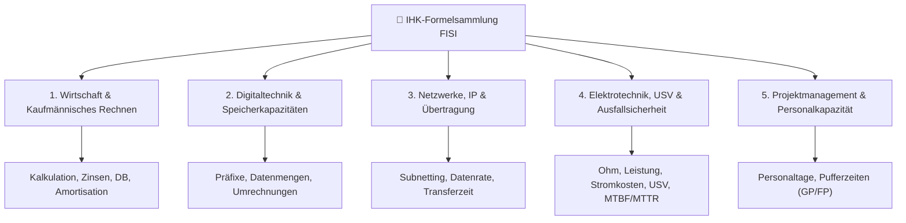

# 📐 AP1 & AP2 Master-Formelsammlung (Fachinformatiker Systemintegration)

> [!IMPORTANT] IHK-Prüfungsrelevanz
> Diese Formelsammlung deckt alle wesentlichen mathematischen und kaufmännischen Berechnungen für **AP01** (*Einrichten eines IT-gestützten Arbeitsplatzes*) und **AP02** (*Konzeption, Administration & Netzwerke*) gemäß VO 2020 ab.

---

## 🧭 Übersicht der Themenbereiche (Mermaid)

---

### 💵 Handelskalkulation (Vorwärtskalkulation)
## 1. 💼 Wirtschaft & Kaufmännisches Rechnen (WISO / BWL)

> [!NOTE] 💡 Hinweis zu Zu- und Abschlägen
> In der Handelskalkulation beziehen sich Rabatte, Skonti und Bezugskosten immer schrittweise auf den jeweiligen Zwischenwert.

### 💵 Handelskalkulation (Vorwärtskalkulation)

> [!INFO] 🛒 Staffelung der Vorwärtskalkulation
> 
> | Rechenschritt | Kalkulationsstufe |
> | :--- | :--- |
> | | **Listeneinkaufspreis (LEP)** |
> | `- Lieferrabatt` | (in Prozent vom LEP) |
> | `=` | **Zieleinkaufspreis (ZEP)** |
> | `- Lieferskonto` | (in Prozent vom ZEP) |
> | `=` | **Bareinkaufspreis (BEP)** |
> | `+ Bezugskosten` | (Fracht, Verpackung, Zoll) |
> | `=` | **Bezugspreis / Einstandspreis** |
> | `+ Handlungskostenzuschlag` | (HKZ in Prozent vom Bezugspreis) |
> | `=` | **Selbstkostenpreis (SKP)** |
> | `+ Gewinnzuschlag` | (in Prozent vom SKP) |
> | `=` | **Barverkaufspreis (BVP)** |
> | `+ Kundenskonto` | (im Hundert: Skonto / (100 - Skonto)) |
> | `=` | **Zielverkaufspreis (ZVP)** |
> | `+ Kundenrabatt` | (im Hundert: Rabatt / (100 - Rabatt)) |
> | `=` | **Listenverkaufspreis netto (LVP)** |
> | `+ Umsatzsteuer` | (19 Prozent MwSt.) |
> | `=` | **Brutto-Listenverkaufspreis** |
### 📊 Deckungsbeitrag, Gewinnschwelle & Abschreibung

> [!INFO] 📈 Deckungsbeitrag (DB) & Gewinnschwelle
> 
> - **Stück-Deckungsbeitrag:**
>     
>     $db = p - k_v$ _(Verkaufspreis pro Stück − variable Stückkosten)_
>     
> - **Gesamt-Deckungsbeitrag:**
>     
>     $DB = E - K_v$ _(Gesamterlös − Gesamte variable Kosten)_
>     
> - **Break-Even-Menge (Gewinnschwelle):**
>     
>     $x_{BEP} = \frac{K_f}{db}$ _(Fixkosten / Stück-Deckungsbeitrag)_
>     

> [!INFO] 📉 Lineare Abschreibung (AfA) & Kalkulatorische Zinsen
> 
> - **Jährliche Abschreibung (AfA):**
>     
>     $\text{AfA} = \frac{\text{Anschaffungswert (AW)}}{\text{Nutzungsdauer in Jahren (ND)}}$
>     
> - **Abschreibungssatz in %:**
>     
>     $\text{AfA-\%} = \frac{100}{\text{Nutzungsdauer in Jahren}}$
>     
> - **Kalkulatorische Zinsen:**
>     
>     $\text{Zinsen} = \frac{\text{Anschaffungswert} + \text{Restwert}}{2} \times \frac{\text{Zinssatz in \%}}{100}$
>     

> [!INFO] ⏳ Amortisationszeit (Payback Period)
> 
> $\text{Amortisationszeit (Jahre)} = \frac{\text{Anschaffungskosten (Netto)}}{\text{Jährlicher Ertrag/Einsparung} - \text{Jährliche Betriebskosten}}$

## 2. 🔢 Digitaltechnik, Speicherkapazitäten & RAID

> [!WARNING] ⚠️ IHK-Falle: Bit vs. Byte & Dezimal vs. Binär
> 
> - **Kilo / Mega / Giga (Dezimal - SI-Einheiten):** Basis 10 ($10^3 = 1.000$)
>     
> - **Kibi / Mebi / Gibi (Binär - IEC-Einheiten):** Basis 2 ($2^{10} = 1.024$)
>     
> - **Datenübertragung:** Angaben meist in **Bit/s** (Mbit/s, Gbit/s)
>     
> - **Speichergrößen:** Angaben meist in **Byte** (MB, GiB, TB)
>     

> [!INFO] 🧮 Umrechnungen & Faktoren
> 
> - $1 \text{ Byte} = 8 \text{ Bit}$
>     
> - $1 \text{ KiB} = 1.024 \text{ Byte} \quad \vert \quad 1 \text{ MiB} = 1.024 \text{ KiB} \quad \vert \quad 1 \text{ GiB} = 1.024 \text{ MiB}$
>     
> - $1 \text{ KB} = 1.000 \text{ Byte} \quad \vert \quad 1 \text{ MB} = 1.000 \text{ KB} \quad \vert \quad 1 \text{ GB} = 1.000 \text{ MB}$
>     

### 💾 RAID-Nutzkapazität (Storage Calculation)

> [!INFO] 💽 RAID-Verbund Nutzkapazität
> 
> - **RAID 0 (Striping):** $N \times S_{\min}$ _(Keine Ausfallsicherheit, 100 % Kapazität)_
>     
> - **RAID 1 (Spiegelung):** $\frac{N}{2} \times S_{\min}$ _(Bruttokapazität / 2)_
>     
> - **RAID 5 (Parität):** $(N - 1) \times S_{\min}$ _(Mindestens 3 Festplatten)_
>     
> - **RAID 6 (Doppelte Parität):** $(N - 2) \times S_{\min}$ _(Mindestens 4 Festplatten)_
>     
> - **RAID 10 (Striped Mirror):** $\frac{N}{2} \times S_{\min}$ _(Mindestens 4 Festplatten)_
>     
>     _(Wobei $N =$ Anzahl der Festplatten, $S_{\min} =$ Kapazität der kleinsten Festplatte)_
>     

## 3. 🌐 Netzwerke, IP-Adressierung & Übertragung

> [!INFO] 📡 Subnetting & Hostberechnung (IPv4)
> 
> $\text{Nutzbare Hosts pro Subnetz} = 2^{(32 - \text{CIDR-Maske})} - 2$
> 
> _(Abzug von 2 Adressen für Netz-ID und Broadcast-Adresse)_

> [!EXAMPLE] 💡 Beispiel Subnetting für /26
> 
> Für eine **/26** Maske ($32 - 26 = 6$ Host-Bits):
> 
> $\text{Anzahl Hosts} = 2^6 - 2 = 64 - 2 = 62 \text{ nutzbare IP-Adressen}$

### ⏱️ Datenübertragungszeit (Transfer Time)

> [!INFO] ⏳ Übertragungsdauer
> 
> $\text{Übertragungszeit } (t) = \frac{\text{Datenmenge (in Bit)}}{\text{Netto-Übertragungsrate (in Bit/s)}}$

> [!INFO] ℹ️ Berücksichtigung von Overhead
> 
> $\text{Netto-Übertragungsrate} = \text{Brutto-Übertragungsrate} \times (1 - \text{Overhead in \%})$

## 4. ⚡ Elektrotechnik, USV & Ausfallsicherheit

> [!INFO] ⚡ Elektrische Grundgesetze & Stromkosten
> 
> - **Spannung:** $U = I \times R \quad [\text{Volt } V]$
>     
> - **Leistung:** $P = U \times I \quad [\text{Watt } W]$
>     
> - **Elektrische Arbeit:** $E = P \times t \quad [\text{Wh} / \text{kWh}]$
>     
> - **Stromkosten:** $\text{Kosten} = E \text{ (in kWh)} \times \text{Preis pro kWh}$
>     

> [!INFO] 🔋 USV-Laufzeit & Dimensionierung
> 
> $\text{Kapazität (Wh)} = \frac{\text{Gesamtleistung (W)} \times \text{Stützzeit (h)}}{\text{Wirkungsgrad der USV } (\eta)}$
> 
> _(Wirkungsgrad $\eta$ liegt in Aufgaben meist bei $0,8$ bis $0,9$)_

### 🛡️ Kennzahlen zur Ausfallsicherheit (MTBF, MTTR, Verfügbarkeit)

> [!INFO] 🛠️ Zuverlässigkeit & Downtime
> 
> $\text{Verfügbarkeit } (A) = \frac{\text{MTBF}}{\text{MTBF} + \text{MTTR}} \times 100\,\%$
> 
> - **MTBF (Mean Time Between Failures):** Mittlere Zeit zwischen zwei Ausfällen
>     
> - **MTTR (Mean Time To Repair):** Mittlere Reparaturdauer
>     
> - **Downtime pro Jahr bei 99,9 % Verfügbarkeit:** $(1 - 0,999) \times 365 \times 24 \text{ Std.} \approx 8,76 \text{ Std./Jahr}$
>     

## 5. 📅 Projektmanagement & Personalkapazität

> [!INFO] 👥 Personalkapazitätsberechnung
> 
> $\text{Brutto-Arbeitstage} = 365 \text{ Tage} - \text{Wochenenden (ca. 104 Tage)}$
> 
> $\text{Netto-Arbeitstage} = \text{Brutto} - \text{Feiertage} - \text{Urlaub} - \text{Krankheit}$
> 
> $\text{Verfügbare Kapazität (Std.)} = \text{Netto-Tage} \times \text{Arbeitszeit/Tag} \times \text{Produktivitätsfaktor}$

> [!INFO] 📊 Netzplantechnik: Pufferzeiten
> 
> - **Gesamter Puffer (GP):** $\text{GP} = \text{SAZ} - \text{FAZ} \quad \text{oder} \quad \text{SEZ} - \text{FEZ}$
>     
> - **Freier Puffer (FP):** $\text{FP} = \text{FAZ}_{\text{Nachfolger}} - \text{FEZ}_{\text{aktuell}}$
>     
> - **Kritischer Pfad:** Alle Vorgänge mit $\text{GP} = 0$.

