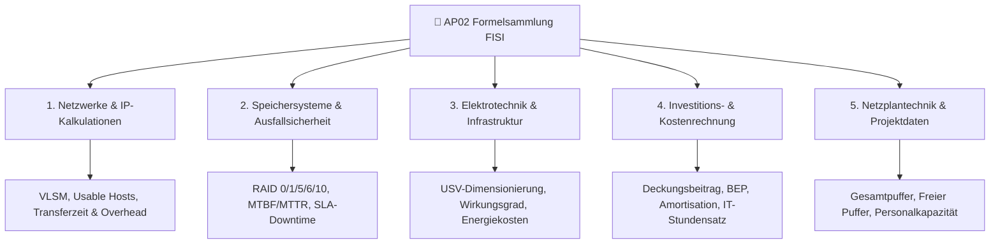

# 📐 AP02 Master-Formelsammlung (Fachinformatiker Systemintegration)

> [!WARNING] AP02: Konzeption, Administration & Netzwerke
> - **Relevanz:** Sehr hoch (Fachqualifikation & Ganzheitliche Aufgaben II)
> - **Fokus:** Diese Formelsammlung konzentriert sich exakt auf die komplexen Berechnungen für **AP02** nach ca. 3 Jahren Ausbildung (Erweiterte Netzwerktechnik, Systemintegration, SLA/Ausfallsicherheit, Investitionsrechnung & Projekt-Controlling).

---

## 🧭 Navigation & Zusammenhänge
- **Vorausgesetztes Thema:** [[Formelsammlung_AP01]]
- **Nächstes Thema:** [[08_Leistungserbringung_und_CRM]]
- **Verwandte Bausteine:** [[06_IPv4_Subnetting_und_VLSM]], [[02_Datenspeicher_RAID]], [[07_IT-Sicherheit_Qualitaetsmanagement]]

---

## 🧭 Übersicht der AP02-Themenbereiche (Mermaid)

---
## 1. 💼 Wirtschaft & Kaufmännisches Rechnen (WISO / BWL / IT-Controlling)

> [!NOTE] 💡 Hinweis zu Zu- und Abschlägen (AP01 & AP02)
> 
> In der Handelskalkulation beziehen sich Rabatte, Skonti und Bezugskosten immer schrittweise auf den jeweiligen Zwischenwert.

### 💵 Handelskalkulation (Vorwärtskalkulation)

> [!INFO] 🛒 Staffelung der Vorwärtskalkulation
> 
> |**Rechenschritt**|**Kalkulationsstufe**|
> |---|---|
> ||**Listeneinkaufspreis (LEP)**|
> |`- Lieferrabatt`|(in Prozent vom LEP)|
> |`=`|**Zieleinkaufspreis (ZEP)**|
> |`- Lieferskonto`|(in Prozent vom ZEP)|
> |`=`|**Bareinkaufspreis (BEP)**|
> |`+ Bezugskosten`|(Fracht, Verpackung, Zoll)|
> |`=`|**Bezugspreis / Einstandspreis**|
> |`+ Handlungskostenzuschlag`|(HKZ in Prozent vom Bezugspreis)|
> |`=`|**Selbstkostenpreis (SKP)**|
> |`+ Gewinnzuschlag`|(in Prozent vom SKP)|
> |`=`|**Barverkaufspreis (BVP)**|
> |`+ Kundenskonto`|(im Hundert: Skonto / (100 - Skonto))|
> |`=`|**Zielverkaufspreis (ZVP)**|
> |`+ Kundenrabatt`|(im Hundert: Rabatt / (100 - Rabatt))|
> |`=`|**Listenverkaufspreis netto (LVP)**|
> |`+ Umsatzsteuer`|(19 Prozent MwSt.)|
> |`=`|**Brutto-Listenverkaufspreis**|

### 📊 Deckungsbeitrag, Gewinnschwelle & Abschreibung (AP01 / AP02)

> [!INFO] 📈 Deckungsbeitrag (DB) & Gewinnschwelle (Break-Even-Point)
> 
> - **Stück-Deckungsbeitrag ($db$):**
>     
>     $db = p - k_v \quad (\text{Verkaufspreis pro Stück} - \text{variable Stückkosten})$
>     
> - **Gesamt-Deckungsbeitrag ($DB$):**
>     
>     $DB = E - K_v \quad (\text{Gesamterlös} - \text{Gesamte variable Kosten})$
>     
> - **Break-Even-Menge (Gewinnschwelle):**
>     
>     $x_{BEP} = \frac{K_f}{db} \quad \left(\frac{\text{Fixkosten}}{\text{Stück-Deckungsbeitrag}}\right)$
>     

> [!INFO] 📉 Lineare Abschreibung (AfA) & Kalkulatorische Zinsen
> 
> - **Jährliche Abschreibung (AfA):**
>     
>     $\text{AfA} = \frac{\text{Anschaffungswert (AW)}}{\text{Nutzungsdauer in Jahren (ND)}}$
>     
> - **Abschreibungssatz in %:**
>     
>     $\text{AfA-\%} = \frac{100}{\text{Nutzungsdauer in Jahren}}$
>     
> - **Kalkulatorische Zinsen:**
>     
>     $\text{Zinsen} = \frac{\text{Anschaffungswert} + \text{Restwert}}{2} \times \frac{\text{Zinssatz in \%}}{100}$
>     

### 💰 Total Cost of Ownership (TCO), Amortisation & IT-Stundensatz (AP02)

> [!INFO] 💸 TCO-Gesamtkostenformel
> 
> $$\text{TCO} = \text{Anschaffungskosten (CapEx)} + \text{Laufende Betriebskosten (OpEx über ND)} - \text{Restwert / Erlös}$$
> 
> _(Wobei $\text{ND} =$ Nutzungsdauer in Jahren)_

> [!INFO] 📊 Aufschlüsselung der Kostenarten (CapEx vs. OpEx)
> 
> |**Kostenkategorie**|**Enthaltene Positionen**|
> |---|---|
> |**Direkte / Harte Kosten (CapEx)**|- Hardware-Anschaffung (Server, Switche, USV)      - Software-Lizenzen (Erstbeschaffung)      - Einrichtung, Montage & Erstkonfiguration durch Externe|
> |**Laufende Betriebskosten (OpEx)**|- Wartungsverträge, Lizenzen/Abos & Support-Gebühren      - Energie- & Kühlkosten (kWh-Stromverbrauch im Serverraum)      - Personalkosten für Administration, Backups & Updates      - Schulungskosten für Mitarbeiter|
> |**Indirekte / Weiche Kosten**|- Ausfallzeiten (Downtime-Kosten bei Systemausfall)      - Produktivitätsverluste bei Einarbeitung|

> [!EXAMPLE] 💡 Beispiel IHK-Aufgabe: Kauf vs. Leasing / Cloud (TCO-Vergleich)
> 
> $$\text{TCO}_{\text{Kauf}} = \text{Hardwarekauf} + (\text{Strom/Jahr} + \text{Wartung/Jahr}) \times \text{Jahre}$$
> 
> $$\text{TCO}_{\text{Cloud/Miete}} = (\text{Monatliche Mietgebühr} \times 12) \times \text{Jahre} + \text{Einmalige Einrichtung}$$

> [!INFO] ⏳ Amortisationszeit & IT-Verrechnungssatz
> 
> - **Amortisationszeit (Payback Period):**
>     
>     $\text{Amortisationsdauer (Jahre)} = \frac{\text{Netto-Anschaffungskosten}}{\text{Jährlicher Ertrag/Einsparung} - \text{Jährliche Betriebskosten}}$
>     
> - **IT-Verrechnungsstundensatz:**
>     
>     $\text{Stundensatz (€/Std.)} = \frac{\text{Gesamtkosten der IT-Abteilung (Personalkosten + Gemeinkosten)}}{\text{Abrechenbare Kundenstunden pro Jahr}}$
>     

## 2. 🔢 Digitaltechnik, Speicherkapazitäten & RAID (AP01 & AP02)

> [!WARNING] ⚠️ IHK-Falle: Bit vs. Byte & Dezimal vs. Binär
> 
> - **Kilo / Mega / Giga (Dezimal - SI-Einheiten):** Basis 10 ($10^3 = 1.000$)
>     
> - **Kibi / Mebi / Gibi (Binär - IEC-Einheiten):** Basis 2 ($2^{10} = 1.024$)
>     
> - **Datenübertragung:** Angaben meist in **Bit/s** (Mbit/s, Gbit/s)
>     
> - **Speichergrößen:** Angaben meist in **Byte** (MB, GiB, TB)
>     

> [!INFO] 🧮 Umrechnungen & Faktoren
> 
> - $1 \text{ Byte} = 8 \text{ Bit}$
>     
> - $1 \text{ KiB} = 1.024 \text{ Byte} \quad \vert \quad 1 \text{ MiB} = 1.024 \text{ KiB} \quad \vert \quad 1 \text{ GiB} = 1.024 \text{ MiB}$
>     
> - $1 \text{ KB} = 1.000 \text{ Byte} \quad \vert \quad 1 \text{ MB} = 1.000 \text{ KB} \quad \vert \quad 1 \text{ GB} = 1.000 \text{ MB}$
>     

### 💾 RAID-Nutzkapazität (Storage Calculation)

> [!INFO] 💽 RAID-Verbund Nutzkapazität & Festplattenanzahl
> 
> |**RAID-Typ**|**Mindestanzahl Disks**|**Nutzbare Kapazität (N= Festplatten, Smin​= kleinste Kapazität)**|
> |---|---|---|
> |**RAID 0 (Striping)**|2 Festplatten|$N \times S_{\min}$ _(0% Ausfallsicherheit)_|
> |**RAID 1 (Spiegelung)**|2 Festplatten|$\frac{N}{2} \times S_{\min}$ _(50% Kapazität)_|
> |**RAID 5 (Parität)**|3 Festplatten|$(N - 1) \times S_{\min}$|
> |**RAID 6 (Doppelparität)**|4 Festplatten|$(N - 2) \times S_{\min}$|
> |**RAID 10 (Striped Mirror)**|4 Festplatten _(gerade)_|$\frac{N}{2} \times S_{\min}$|

## 3. 🌐 Netzwerke, IP-Adressierung & Übertragung (AP01 & AP02)

> [!INFO] 📡 Host- & Netzberechnung (IPv4 / VLSM)
> 
> - **Anzahl vergebbarer Hosts:** $2^{(32 - \text{CIDR})} - 2$
>     
>     _(Abzug von Netz-ID und Broadcast-Adresse)_
>     
> - **Anzahl Subnetze bei Subnet-Splitting:** $2^{\text{Ausgeliehene Bit-Anzahl}}$
>     

> [!INFO] 📊 Wichtige CIDR-Referenzmatrix für die IHK-Prüfung
> 
> |**Subnetzmaske (CIDR)**|**Dezimale Maske**|**Host-Bits**|**Nutzbare IP-Adressen**|
> |---|---|---|---|
> |**/24**|`255.255.255.0`|8 Bit|$2^8 - 2 = 254$|
> |**/25**|`255.255.255.128`|7 Bit|$2^7 - 2 = 126$|
> |**/26**|`255.255.255.192`|6 Bit|$2^6 - 2 = 62$|
> |**/27**|`255.255.255.224`|5 Bit|$2^5 - 2 = 30$|
> |**/28**|`255.255.255.240`|4 Bit|$2^4 - 2 = 14$|
> |**/29**|`255.255.255.248`|3 Bit|$2^3 - 2 = 6$|
> |**/30**|`255.255.255.252`|2 Bit|$2^2 - 2 = 2$ _(Point-to-Point Link)_|

### ⏱️ Datenübertragungszeit & Overhead

> [!INFO] ⏳ Übertragungsdauer & Netto-Durchsatz
> 
> - **Netto-Datenrate:**
>     
>     $\text{Netto-Rate} = \text{Brutto-Datenrate} \times (1 - \text{Overhead in \%})$
>     
> - **Übertragungsdauer:**
>     
>     $\text{Zeit } (t) = \frac{\text{Datenmenge (in Bit)}}{\text{Netto-Datenrate (in Bit/s)}}$
>     

## 4. ⚡ Elektrotechnik, USV & Ausfallsicherheit (AP01 & AP02)

> [!INFO] ⚡ Elektrische Grundgesetze & Stromkosten
> 
> - **Spannung:** $U = I \times R \quad [\text{Volt } V]$
>     
> - **Leistung:** $P = U \times I \quad [\text{Watt } W]$
>     
> - **Elektrische Arbeit:** $E = P \times t \quad [\text{Wh} / \text{kWh}]$
>     
> - **Stromkosten:** $\text{Kosten} = \text{Verbrauch (in kWh)} \times \text{Preis pro kWh}$
>     

> [!INFO] 🔋 USV-Laufzeit & Dimensionierung
> 
> $\text{Kapazität (Wh)} = \frac{\text{Gesamtleistung (W)} \times \text{Stützzeit (h)}}{\text{Wirkungsgrad der USV } (\eta)}$
> 
> _(Hinweis: Der Wirkungsgrad $\eta$ liegt in IHK-Aufgaben meist zwischen $0,8$ und $0,9$)_

### 🛡️ Kennzahlen zur Ausfallsicherheit (SLA, MTBF, MTTR)

> [!INFO] 🛠️ Zuverlässigkeit & Downtime
> 
> - **System-Verfügbarkeit ($A$):**
>     
>     $A = \frac{\text{MTBF}}{\text{MTBF} + \text{MTTR}} \times 100\,\%$
>     
> - **MTBF (Mean Time Between Failures):** Mittlere Zeitspanne zwischen zwei Ausfällen
>     
> - **MTTR (Mean Time To Repair):** Mittlere Reparatur- / Entstörzeit
>     
> 
> |**SLA-Level (Verfügbarkeit)**|**Maximale Ausfallzeit pro Jahr (365 Tage=8.760 Std.)**|
> |---|---|
> |**99,0 %**|$87,6 \text{ Stunden}$|
> |**99,9 % (Three Nines)**|$8,76 \text{ Stunden} \quad (\approx 525 \text{ Minuten})$|
> |**99,99 % (Four Nines)**|$52,56 \text{ Minuten}$|

## 5. 📅 Projektmanagement & Personalkapazität (AP01 & AP02)

> [!INFO] 👥 Personalkapazitätsberechnung
> 
> - **Brutto-Arbeitstage:** $365 \text{ Tage} - \text{Wochenenden (ca. 104 Tage)} = 261 \text{ Tage}$
>     
> - **Netto-Arbeitstage:** $\text{Brutto-Tage} - \text{Feiertage} - \text{Urlaubstage} - \text{Krankheitstage}$
>     
> - **Verfügbare Arbeitsstunden:** $\text{Netto-Arbeitstage} \times \text{Tägliche Arbeitszeit (Std.)} \times \text{Produktivitätsfaktor}$
>     

> [!INFO] 📊 Netzplantechnik: Pufferzeiten
> 
> - **Frühester Ende-Zeitpunkt (FEZ):** $\text{FEZ} = \text{FAZ} + \text{Dauer}$
>     
> - **Spätester Anfangs-Zeitpunkt (SAZ):** $\text{SAZ} = \text{SEZ} - \text{Dauer}$
>     
> - **Gesamter Puffer (GP):** $\text{GP} = \text{SAZ} - \text{FAZ} \quad \text{oder} \quad \text{GP} = \text{SEZ} - \text{FEZ}$
>     
> - **Freier Puffer (FP):** $\text{FP} = \text{FAZ}_{\text{Nachfolger}} - \text{FEZ}_{\text{aktuell}}$
>     
> - **Kritischer Pfad:** Die Abfolge aller Projektvorgänge mit einem **Gesamtpuffer von 0** ($\text{GP} = 0$). Verzögerungen auf diesem Pfad verschieben das Projektende!
>