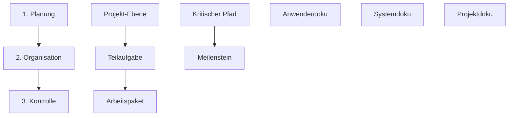

## 🧭 Navigation & Zusammenhänge
- **Vorausgesetztes Thema:** [[01_Einführung_Allgemeine_BWL]]
- **Nächstes Thema:** [[03_Lernmethoden_Wissensmanagement]]
- **Verwandte Bausteine:** [[04_Sicherheit_und_Ergnomie]], [[05_Aufbau- und Ablauforganisation]]

---

## 🎯 IHK-Prüfungsrelevanz
> [!IMPORTANT] AP01: Einrichten eines IT-gestützten Arbeitsplatzes
> - **Relevanz:** Hoch
> - **Fokus:** Einhaltung exakter physiologischer Grenzwerte (Greifräume, Raumklima, Beleuchtung, Lärmschutz) nach ArbStättV sowie die rechtssichere Abgrenzung von Anwender-, System- und Projektdokumentationen.

> [!WARNING] AP02: Konzeption, Administration & Netzwerke
> - **Relevanz:** Hoch
> - **Fokus:** Methoden der Projektstrukturierung (PSP), Terminplanung (Kritischer Pfad in der Netzplantechnik, Gantt-Charts) sowie operative Entscheidungsfindung mittels einer Nutzwertanalyse.

---

## 📖 Einfache Erklärung & Praxisbeispiele
Am zweiten Tag stehen die **Managementfunktionen**, die **Strukturierung von IT-Projekten** sowie vertiefende Maßnahmen des **Gesundheitsschutzes** im Fokus. Jedes IT-Projekt verlangt eine systematische Steuerung von der Analyse über die Strukturierung bis hin zur revisionssicheren Dokumentation.

### Unterthemen & Anschauliche Beispiele:

- **Managementmethoden (MbO, MbE, MbD):** Führungsmodelle zur Entlastung von Vorgesetzten und zur Steigerung der Eigenverantwortung.
  - **Management by Objectives (MbO):** Führung durch Zielvereinbarung. Der Lösungsweg bleibt frei wählbar.
    - 💡 **Praxisbeispiel:** Die Abteilungsleitung vereinbart mit dir das Ziel: *„Migration des lokalen Mailservers zu MS Exchange Online bis zum Quartalsende“*. Wie du die Migrationsskripte aufbaust, entscheidest du selbst.
  - **Management by Exception (MbE):** Eingriff der Führungsebene nur in Ausnahmefällen oder Krisen.
    - 💡 **Praxisbeispiel:** Du darfst Server-Ersatzteile bis zu einem Wert von 500 EUR eigenständig einkaufen. Erst wenn ein Core-Switch für 2.500 EUR ausfällt, musst du die Freigabe der IT-Leitung einholen.
  - **Management by Delegation (MbD):** Dauerhafte Übertragung von Aufgaben, Kompetenzen und Verantwortung auf eine Stelle.
    - 💡 **Praxisbeispiel:** Dir wird die feste Rolle des „Backup-Administrators“ zugewiesen. Du bist eigenverantwortlich für die tägliche Überprüfung der Tapes und die Wiederherstellungstests zuständig.

- **Der Projektstrukturplan (PSP / WBS):** Das zentrale Werkzeug zur hierarchischen Zerlegung eines Gesamtprojekts in Teilaufgaben und die kleinsten Elemente, die **Arbeitspakete**. Es gilt die *100-Prozent-Regel* (Vollständigkeit).
  - 💡 **Praxisbeispiel:** Bei einer *ERP-Einführung* (Projekt-Ebene) unterteilst du das Projekt in die Teilaufgabe *Datenmigration*. Das konkrete, delegierbare Arbeitspaket darunter lautet: *„Bereinigung der Altdaten-Kundendatenbank in Excel“*.

- **Terminplanung (Netzplan & Gantt):** 
  - **Netzplantechnik:** Berechnet den **kritischen Pfad** (Aufgaben ohne Gesamtpuffer). Verzögert sich eine Aufgabe auf diesem Pfad, verschiebt sich das gesamte Projektende.
  - **Gantt-Chart:** Ein horizontales Balkendiagramm zur Visualisierung von zeitlichen Überschneidungen und Nachfolgebeziehungen.
  - **Meilensteine:** Kennzeichnen wichtige Ereignisse (z. B. Projektabschnitte), deren zeitliche Dauer **immer Null** beträgt.

- **IHK-Grenzwerte der Ergonomie & Gesundheit:** Gesetzliche und funktionale Mindestanforderungen am IT-Arbeitsplatz:
  - **Beleuchtung:** Mindestens **500 Lux** auf der Arbeitsfläche; Blickrichtung parallel zur Fensterfront.
  - **Akustik:** Maximal **55 dB(A)** für konzentrierte IT-Tätigkeiten (z. B. Programmieren).
  - **Raumklima:** Temperatur stabil zwischen **20–22 °C**, Luftfeuchtigkeit im Idealbereich von **40–60 %**.
  - **Greifräume:** Tastatur im *zentralen Greifraum* (beidhändig), Maus im *Einhand-Greifraum*, Scanner im *maximalen Greifraum*.

- **Dokumentationsstandards (GoBD & Revisionssicherheit):**
  - **Anwenderdokumentation:** Schritt-für-Schritt-Anleitungen und FAQs für Endnutzer – ohne Fachjargon, aber mit Screenshots.
  - **Systemdokumentation:** Technische Pläne (IP-Adresspläne, Netzwerktopologien) für Administratoren zur Sicherung des Notfallbetriebs (Disaster Recovery).
  - **Projektdokumentation:** Lastenheft, Pflichtenheft und Statusberichte; dient als rechtlicher Nachweis für die Projektabnahme.

---

## 📊 Visuelle Darstellung (Mermaid.js)

---
