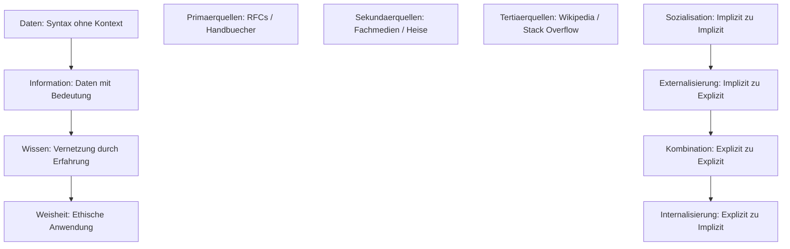

tags: [fisi, ihk, lernsheet]

🧭 Navigation & Zusammenhänge
- **Vorausgesetztes Thema:** [[02_Management, Projektplanung & Arbeitsplatz-Ergonomie]]
- **Nächstes Thema:** [[04_Sicherheit_und_Ergnomie]]
- **Verwandte Bausteine:** [[13_Lebensbegleitendes Lernen & Personal Knowledge Management (PKM)]], [[01_Einführung_Allgemeine_BWL]]
---

🎯 IHK-Prüfungsrelevanz

> [!IMPORTANT] AP01: Einrichten eines IT-gestützten Arbeitsplatzes
> 
> - **Relevanz:** Mittel
> - **Fokus:** Methoden der professionellen Informationsbeschaffung und des persönlichen Wissensmanagements (PKM) zur Bewältigung des _Information Overload_ im Berufsalltag.

> [!WARNING] AP02: Konzeption, Administration & Netzwerke
> 
> - **Relevanz:** Hoch
> - **Fokus:** Strukturierte Verzeichnis- und Dokumentationskonzepte im Unternehmen (SECI-Modell, Docs-as-Code) zur Vermeidung von Doppelarbeit und zum Schutz vor Wissensverlust bei Personalwechseln.

---

📖 Einfache Erklärung & Praxisbeispiele

Am dritten Tag steht die **Recherche, Validierung und systematische Strukturierung von Wissen** im Mittelpunkt. Da IT-Spezialwissen eine geringe Halbwertszeit von nur 2–5 Jahren hat, ist die Fähigkeit zum lebenslangen Lernen eine essenzielle Kernqualifikation für Systemintegratoren.

Unterthemen & Anschauliche Beispiele:

- **Kategorisierung von Recherchequellen:**
    - **Primärquellen (Direktinformation):** Technische Dokumentationen der Hardware-Hersteller, offizielle Standards und Netzwerkprotokolle (RFCs, IEEE-Normen) sowie Quellcode.
        - 💡 **Praxisbeispiel:** Bei der Konfiguration eines neuen Cisco-Routers liest du das offizielle _Hersteller-Handbuch_ oder den entsprechenden _RFC-Standard_ für das Routing-Protokoll.
    - **Sekundärquellen (Aufbereitete Informationen):** Fachzeitschriften, IT-Newsportale (heise online, Golem) und Analystenberichte.
        - 💡 **Praxisbeispiel:** Du informierst dich im _iX-Magazin_ oder auf _heise Security_ über eine neu entdeckte Zero-Day-Sicherheitslücke im Linux-Kernel.
    - **Tertiärquellen (Sammelwerke):** Enzyklopädien (Wikipedia) und kollaborative Entwickler-Plattformen.
        - 💡 **Praxisbeispiel:** Du suchst auf _Stack Overflow_ nach der Lösung für eine kryptische Fehlermeldung beim Starten eines Docker-Containers.
- **Fortgeschrittene Suchstrategien (Boolesche Logik & Google Dorks):**
    - **Boolesche Operatoren:** `AND` (Schnittmenge), `OR` (Vereinigung), `NOT` / `-` (Ausschluss).
        - 💡 **Praxisbeispiel:** Die Suche nach `"Java -JavaScript"` filtert gezielt Webseiten aus, die sich mit der Webskriptsprache befassen, um reine Java-Lösungen zu finden.
    - **Google Dorks:** Eingrenzung der Suche über Operatoren wie `site:` (bestimmte Domain) oder `filetype:` (bestimmte Dateiendung).
        - 💡 **Praxisbeispiel:** Mit `site:cisco.com filetype:pdf "catalyst 9300"` durchsuchst du ausschließlich die Cisco-Webseite nach PDF-Handbüchern für dieses Switch-Models.
- **Informationsbewertung (Die CRAAP-Methode):** Systematisches Framework zur Prüfung von Quellen auf **C**urrency (Aktualität), **R**elevance (Relevanz), **A**uthority (Autorität), **A**ccuracy (Genauigkeit) und **P**urpose (Zweck).
    - 💡 **Praxisbeispiel:** Bevor du ein Skript aus einem Blog auf einem Produktivserver ausführst, prüfst du via CRAAP, ob der Beitrag aktuell ist (_Currency_) und ob der Autor ein verifizierter Experte ist (_Authority_).
- **Lernpsychologie (Cognitive Load Theory & 70-20-10-Modell):**
    - **Cognitive Load Theory (CLT):** Unterscheidet in _intrinsische_ Belastung (Komplexität des Stoffs), _extrinsische_ Belastung (Ablenkungen/schlechte Didaktik) und _lernbezogene_ Belastung (_Germane Load_ – der eigentliche Wissensaufbau).
    - **70-20-10 Lernmodell:** 70 % des Lernens erfolgen durch _Erfahrung_ im Projektalltag (Learning by Doing), 20 % durch _sozialen Austausch_ (Mentoring, Peer-Reviews) und 10 % durch _formales Lernen_ (Zertifikate, Seminare).
- **Wissensmanagement im Unternehmen (Das SECI-Modell):** Transformation von implizitem Wissen (Erfahrungen/Intuition im Kopf) zu explizitem Wissen (dokumentierte Fakten/Prozessbeschreibungen).
    - **Sozialisation (Imp. zu Imp.):** Wissensaustausch durch Zusammenarbeit (z. B. Pair Programming).
    - **Externalisierung (Imp. zu Exp.):** Festhalten von Erfahrungswissen in internen Firmen-Wikis (Confluence).
    - **Kombination (Exp. zu Exp.):** Systematisieren, Strukturieren und Verknüpfen vorhandener Dokumente.
    - **Internalisierung (Exp. zu Imp.):** Aneignung von Wissen durch das Anwenden dokumentierter Lösungen im Alltag.
- **Moderne Dokumentationstrends (Docs as Code):** Technische Dokumentation wird wie Software-Quellcode behandelt. Texte werden in _Markdown_ verfasst, mit _Git_ versioniert und automatisiert über _CI/CD-Pipelines_ geprüft und bereitgestellt.

