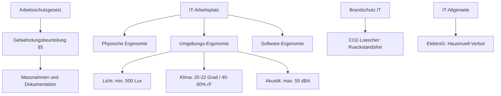

tags: [fisi, ihk, lernsheet]
## 🧭 Navigation & Zusammenhänge
- **Vorausgesetztes Thema:** [[03_Lernmethoden_Wissensmanagement]]
- **Nächstes Thema:** [[05_Aufbau- und Ablauforganisation]]
- **Verwandte Bausteine:** [[02_Management, Projektplanung & Arbeitsplatz-Ergonomie]], [[07_Sicherheit, Normen & Green IT]]
---

🎯 IHK-Prüfungsrelevanz

> [!IMPORTANT] AP01: Einrichten eines IT-gestützten Arbeitsplatzes
> 
> - **Relevanz:** Hoch
> - **Fokus:** Einhaltung exakter physiologischer Grenzwerte für Bildschirmarbeitsplätze (Sehabstände, Raumklima, Akustik nach ASR) sowie gesetzliche Pflichten zur Gefährdungsbeurteilung (§ 5 ArbSchG) und Sicherheitskennzeichnung (ASR A1.3).

> [!WARNING] AP02: Konzeption, Administration & Netzwerke
> 
> - **Relevanz:** Hoch
>     
> - **Fokus:** Vorbeugender Brandschutz in Rechenzentren (Brandklassen, CO2-Löschmittel) sowie gesetzliche Vorgaben zur umweltgerechten Entsorgung von IT-Altgeräten (ElektroG) und nachhaltige Rechenzentrumskonzepte (Green IT).

---

📖 Einfache Erklärung & Praxisbeispiele

Am vierten Tag stehen der **rechtssichere Arbeitsschutz**, die **Hardware- und Software-Ergonomie** sowie die **ökologische Verantwortung (Green IT)** im IT-Betrieb im Vordergrund. Der Grundsatz lautet: Der Arbeitsplatz muss sich dem Menschen anpassen, nicht der Mensch dem Arbeitsplatz.

Unterthemen & Anschauliche Beispiele:

- **Rechtlicher Arbeitsschutz & Gefährdungsbeurteilung:** Das Arbeitsschutzgesetz (ArbSchG) und die Arbeitsstättenverordnung (ArbStättV) bilden die rechtliche Basis. Arbeitgeber müssen gemäß § 5 ArbSchG eine systematische _Gefährdungsbeurteilung_ durchführen und dokumentieren. Zudem sind jährliche _Arbeitsschutz-Unterweisungen_ gesetzliche Pflicht.
    - 💡 **Praxisbeispiel:** Vor dem Rollout neuer IT-Arbeitsplätze beurteilst du systematisch physische Risiken (z. B. Stolperfallen durch Netzkabel) und psychische Risiken (z. B. Stress durch ständige Erreichbarkeit).
- **Elektrische Sicherheit (DGUV Vorschrift 3):** Ortsveränderliche elektrische Geräte (Monitore, Server, Netzteile) müssen regelmäßig durch Sicht-, Mess- und Funktionsprüfungen kontrolliert werden.
    - 💡 **Praxisbeispiel:** Du verhinderst im Büro das sogenannte _„Daisy Chaining“_ (Hintereinanderschalten von Mehrfachsteckdosen), da hierbei akute Überlastungs- und Brandgefahr besteht.
- **Brandschutz im Rechenzentrum & IT-Anlagen:** In Serverräumen kommen automatische Brandmeldeanlagen (BMA) und hochempfindliche Rauchfrüherkennungssysteme zum Einsatz.
    - **Brandklassen:** Wichtig für die IT sind vor allem Klasse A (feste Stoffe wie Verpackungen) und Klasse C (Gasbrände).
    - **Löschmittel:** Für IT-Anlagen sind ausschließlich _CO2-Löscher_ zulässig, da sie rückstandsfrei löschen und keine Hardwareschäden verursachen. _Warnung:_ Wasser oder Schaum in spannungsführenden Anlagen sind lebensgefährlich.
- **Umweltschutz & Green IT (ElektroG):** IT-Systeme belasten die Umwelt durch hohen Energiebedarf, Wasserverbrauch für Kühlung und seltene Rohstoffe bei der Hardwareproduktion.
    - **Green IT Strategien:** Virtualisierung zur Erhöhung der Serverauslastung, Kaltgang-Warmgang-Systeme im Rechenzentrum und der Einsatz von 80-Plus-zertifizierten Netzteilen.
    - **ElektroG:** IT-Altgeräte dürfen niemals über den Hausmüll entsorgt werden. Es gilt eine gesetzliche Rücknahmepflicht der Hersteller und Händler. Vor der Entsorgung muss eine zertifizierte Datenträgervernichtung erfolgen.
- **Physische Arbeitsplatz-Ergonomie:**
    - **Monitor:** Optimaler Sehabstand beträgt **50 bis 70 cm** (Armlänge). Die Oberkante des Bildschirms liegt auf oder leicht unter Augenhöhe, der Monitor ist ca. 20 Grad nach hinten geneigt.
    - **Eingabegeräte:** Ergonomische Tastaturen verhindern das Abknicken der Handgelenke. Vertikal-Mäuse verhindern die Unterarmverdrehung (Pronation) und mindern das Risiko für das **RSI-Syndrom** („Mausarm“).
    - **Bürostuhl:** Muss höhenverstellbar sein, eine Lordosenstütze besitzen, auf 5 Rollen standsicher sein und _dynamisches Sitzen_ (Haltungswechsel) unterstützen.
- **Umgebungs-Ergonomie (ASR-Grenzwerte):**
    - **Beleuchtung (ASR A3.4):** Mindestens **500 Lux** auf der Arbeitsfläche, gleichmäßig ausgeleuchtet.
    - **Klima:** Wohlfühltemperatur zwischen **20 und 22 °C**, relative Luftfeuchtigkeit zwischen **40 und 60 %**.
    - **Akustik:** Maximal **55 dB(A)** für vorwiegend geistige und konzentrierte Arbeit.
    - **Platzbedarf (ASR A1.2):** Mindestens **8 bis 10 Quadratmeter** pro Arbeitsplatz inklusive freier Verkehrswege.
- **Software-Ergonomie:**
    - **Aufgabenangemessenheit:** Unterstützt den Arbeitsfluss ohne unnötige Klicks oder Dialoge.
    - **Erwartungskonformität:** Konsistente Bedienung (z. B. standardisierte OS-Shortcuts wie Strg+C / Strg+S).
    - **Steuerbarkeit:** Benutzer können Menüleisten, Kurzbefehle und Schriftgrößen individuell anpassen (Barrierefreiheit).

