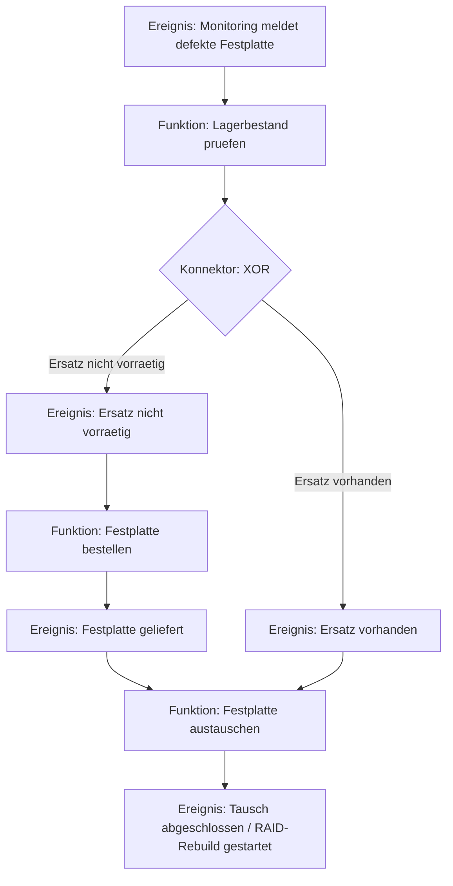

tags: [fisi, ihk, lernsheet]
## 🧭 Navigation & Zusammenhänge
- **Vorausgesetztes Thema:** [[05_Aufbau- und Ablauforganisation]]
- **Nächstes Thema:** [[07_Controlling]]
- **Verwandte Bausteine:** [[05_Aufbau- und Ablauforganisation]], [[11_Grundkonzepte der OOP vs. Strukturierte Programmierung]]

---

🎯 IHK-Prüfungsrelevanz

> [!IMPORTANT] AP01: Einrichten eines IT-gestützten Arbeitsplatzes
> 
> - **Relevanz:** Mittel
> - **Fokus:** Verständnis von Standard-IT-Abläufen. Die IHK fordert oft die textuelle Beschreibung oder Vervollständigung von Workflows (z. B. "User-Onboarding" oder "Berechtigungsvergabe").

> [!WARNING] AP02: Konzeption, Administration & Netzwerke
> 
> - **Relevanz:** Sehr Hoch
> - **Fokus:** Prozessmodellierung ist ein absoluter Kernbestandteil der Ganzheitlichen Aufgaben II. Du musst eEPK-Syntaxfehler erkennen, BPMN-Gateways (XOR, AND, OR) fehlerfrei zuordnen und logische Abläufe in die richtige visuelle Form bringen können.

---

📖 Einfache Erklärung & Praxisbeispiele

Die Prozessmodellierung dient dazu, komplexe betriebliche Abläufe transparent zu machen, Fehlerquellen zu finden und Medienbrüche (z. B. den Wechsel von Software zu Papier) zu eliminieren. In der IHK-Prüfung triffst du im Wesentlichen auf zwei Standards:

1. Ereignisgesteuerte Prozesskette (eEPK)

Ein schlankes, semantisches Modell, das vor allem für die betriebswirtschaftliche Sicht genutzt wird.

- **Ereignis (Sechseck):** Beschreibt einen Zustand. Stoßen Prozesse an oder schließen sie ab. **IHK-Regel:** _Substantiv + Partizip_ (z. B. "Störung gemeldet").
- **Funktion (Abgerundetes Rechteck):** Beschreibt eine aktive Tätigkeit. **IHK-Regel:** _Substantiv + Infinitiv_ (z. B. "Ticket erfassen").
- **Konnektoren:** **UND** (alle Pfade), **ODER** (mindestens ein Pfad), **XOR** (exakt ein Pfad).
- **Erweiterte Elemente:** Organisationseinheiten (Wer macht es? -> Ellipse) und Informationsobjekte (Welche Daten? -> Rechteck).

> [!CAUTION] Goldene eEPK-Regeln für die Prüfung (Syntax-Check):
> 
> 1. Ein Prozess beginnt und endet **immer** mit einem Ereignis.
> 2. Ereignisse und Funktionen müssen sich **immer abwechseln**.
> 3. Nach einem Ereignis darf **niemals** ein XOR- oder OR-Splitting folgen, da Ereignisse keine Entscheidungen treffen können! Entscheidungen fallen nur in/nach Funktionen.

- 💡 **IHK-Praxisbeispiel (eEPK):**  
    _Ereignis:_ "Server-Ausfall bemerkt" → _Funktion:_ "Infrastruktur prüfen" → _XOR-Konnektor_ → _Ereignis 1:_ "Hardware defekt" **ODER** _Ereignis 2:_ "Software-Fehler liegt vor".

2. Business Process Model and Notation (BPMN 2.0)

Der weltweite, technische Standard zur Schnittstelle zwischen Prozessdesign und Softwareentwicklung.

- **Flow Objects:** Events (Kreise für Start, Intermediate, End), Activities/Tasks (Rechtecke für Arbeitsschritte) und Gateways (Rauten für Entscheidungen: `X` = Exclusive, `+` = Parallel, `O` = Inclusive).
- **Struktur:** **Pools** repräsentieren ganze Unternehmen/Teilnehmer. **Lanes** unterteilen den Pool vertikal oder horizontal in Abteilungen oder Rollen (z. B. "Support", "Technik").
- **Verbindungen:** Sequence Flow (durchgezogene Linie für zeitliche Abfolgen) und Message Flow (gestrichelte Linie mit Kreis für Kommunikation über Pool-Grenzen hinweg).

---

🛠️ Direktvergleich für die Prüfung

|Merkmal|eEPK (Ereignisgesteuerte Prozesskette)|BPMN 2.0 (Business Process Model and Notation)|
|---|---|---|
|**Hauptfokus**|Betriebswirtschaftliche Dokumentation, logische Kausalität|IT-Spezifikation, Automatisierung & Workflow-Engines|
|**Elementvielfalt**|Schlank, fokussiert (wenige Basissymbole)|Sehr mächtig (über 100 Symbole für technische Details)|
|**Zuständigkeiten**|Werden über separate Ellipsen an Funktionen gehängt|Werden durch die visuelle Platzierung in **Pools & Lanes** definiert|
|**Typischer Fehler**|XOR-Splitting nach einem Ereignis (Syntax-Verstoß)|Falscher Linientyp (z. B. Sequence Flow zwischen zwei Pools)|

