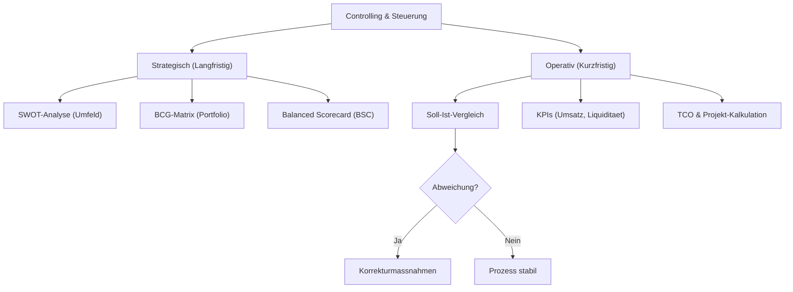

tags: [fisi, ihk, lernsheet]
## 🧭 Navigation & Zusammenhänge
- **Vorausgesetztes Thema:** [[06_Prozessmodellierung]]
- **Nächstes Thema:** [[08_Kundenberatung und Marketing in der IT]]
- **Verwandte Bausteine:** [[01_Einführung_Allgemeine_BWL]], [[05_Kosten erfassen und bewerten (Kostenartenrechnung)]]
---

🎯 IHK-Prüfungsrelevanz

> [!IMPORTANT] AP01: Einrichten eines IT-gestützten Arbeitsplatzes
> 
> - **Relevanz:** Niedrig bis Mittel
> - **Fokus:** Wirtschaftlichkeitsbetrachtungen von IT-Systemen aus Sicht des Anwenders (z. B. einfache Kosten-Nutzen-Vergleiche bei Hardware-Ausstattungen).

> [!WARNING] AP02 / WiSo: Konzeption, Administration & Geschäftsprozesse
> 
> - **Relevanz:** Sehr Hoch
> - **Fokus:** Ein absoluter IHK-Klassiker für kaufmännische Punkte. Du musst den Unterschied zwischen operativem und strategischem Controlling kennen, die SWOT-Analyse, Porters Five Forces sowie die Rechenverfahren TCO (Total Cost of Ownership) und Amortisationszeit fehlerfrei anwenden können.

---

📖 Einfache Erklärung & Praxisbeispiele

Controlling bedeutet nicht einfach nur "Kontrollieren", sondern **aktives Steuern des Unternehmens** auf Basis von Plan-, Ist- und Abweichungsanalysen (Controlling-Regelkreis). Es liefert die datenbasierte Grundlage für Managemententscheidungen und gliedert sich in zwei Dimensionen:

1. Operatives vs. Strategischen Controlling

- **Operatives Controlling (Kurzfristig, bis 1 Jahr):** Fokussiert sich auf die harten, internen Finanzdaten wie Liquidität, Umsatz, Gewinn und Wirtschaftlichkeit.
    - 💡 **IHK-Praxisbeispiel:** Du prüfst monatlich die abrechenbaren Stunden (_Billable Hours_) deiner Techniker, um die Auslastung der Abteilung zu steuern.
- **Strategisches Controlling (Langfristig, 3–5 Jahre):** Fokussiert sich auf die Existenzsicherung, Trends und den Aufbau von Wettbewerbsvorteilen (USP).
    - 💡 **IHK-Praxisbeispiel:** Die Geschäftsführung analysiert über eine **Portfolio-Analyse (BCG-Matrix)**, ob veraltete On-Premise-Infrastrukturen (_Poor Dogs_) abgemeldet und stattdessen Budget in Cloud-Security (_Stars_) investiert wird.

2. Strategische Analysetools

- **SWOT-Analyse:** Verknüpft die interne Analyse (**S**trengths/Stärken, **W**eaknesses/Schwächen) mit der externen Marktanalyse (**O**pportunities/Chancen, **T**hreats/Risiken).
- **Porters Five Forces:** Branchenstrukturanalyse zur Messung der Wettbewerbsintensität anhand von fünf Kräften (Rivalität, Kundenmacht, Lieferantenmacht, neue Anbieter, Ersatzprodukte).
    - ⚠️ **IT-Besonderheit:** Im IT-Sektor herrscht oft eine extrem hohe _Lieferantenmacht_ durch Quasi-Monopolisten wie Microsoft, Cisco oder Intel.

3. Vertriebs- und kaufmännische Instrumente

- **Total Cost of Ownership (TCO):** Eine ganzheitliche Kostenbetrachtung. Ein IT-System kostet nicht nur den Anschaffungspreis, sondern verursacht Kosten für Betrieb, Wartung, Strom und Entsorgung.
- **Kosten-Nutzen-Analyse & Amortisation:** Stellt die TCO den finanziellen Einsparungen oder Erlösen gegenüber, um zu berechnen, ab wann (_Payback Period_) sich die IT-Investition bezahlt macht.

---

🛠️ Direktvergleich für die Prüfung

| Analysemodell           | Interne / Externe Sicht                                               | IHK-Prüfungsfokus                                       |
| ----------------------- | --------------------------------------------------------------------- | ------------------------------------------------------- |
| **SWOT-Analyse**        | **Kombiniert** (Stärken/Schwächen = intern, Chancen/Risiken = extern) | Strategische Positionierung und Risikoidentifikation    |
| **Porters Five Forces** | **Rein extern** (Fokus liegt vollständig auf dem Markt/Umfeld)        | Bewertung des Preisdrucks und der Marktexistenz         |
| **Primärforschung**     | **Extern** (Direkte Feldforschung am Markt / Kunden)                  | Teuer, zeitaufwendig, aber liefert exakte Echtzeitdaten |
| **Sekundärforschung**   | **Kombiniert** (Auswertung alter CRM-Daten oder externer Berichte)    | Schnelle, kostengünstige Schreibtischforschung          |

