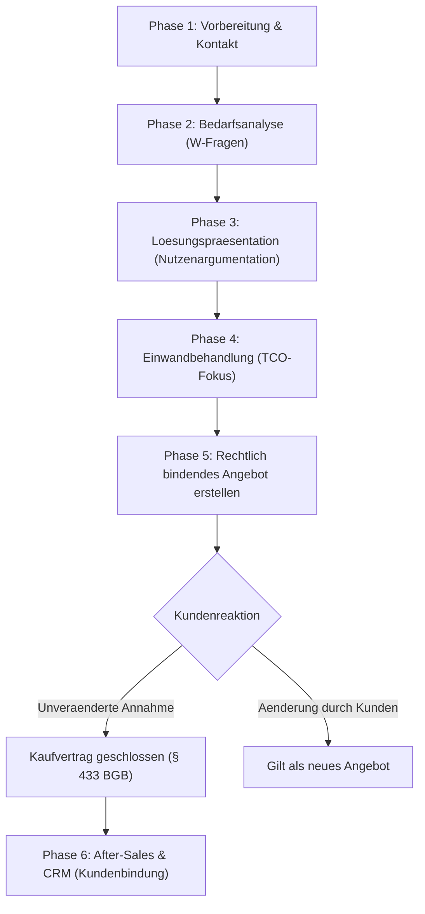

tags: [fisi, ihk, lernsheet]
## 🧭 Navigation & Zusammenhänge
- **Vorausgesetztes Thema:** [[07_Controlling]]
- **Nächstes Thema:** [[09_Cyber-Security & Social Engineering]]
- **Verwandte Bausteine:** [[08_Kommunikation, Beratung & CRM]], [[17_Rahmenbedingungen und Kundenberatung]]
---

🎯 IHK-Prüfungsrelevanz

> [!IMPORTANT] AP01: Einrichten eines IT-gestützten Arbeitsplatzes
> 
> - **Relevanz:** Mittel
> - **Fokus:** Einhaltung der Corporate Identity (CI) des eigenen Betriebs bei der Dokumentation sowie kundenorientiertes Verhalten im technischen Support (After-Sales-Betreuung).

> [!WARNING] AP02 / WiSo: Konzeption, Administration & Geschäftsprozesse
> 
> - **Relevanz:** Sehr Hoch
> - **Fokus:** Das kaufmännische Kernwissen schlägt in Abschlussprüfungen regelmäßig zu Buche. Die IHK prüft hier intensiv den **Marketing-Mix (4 Ps)**, die **rechtliche Bindung von Angeboten** (BGB, Freizeichnungsklauseln) sowie das **AIDA-Modell** und die **Nutzenargumentation**.

---

📖 Einfache Erklärung & Praxisbeispiele

Da sich fast alle IT-Dienstleistungen auf einem **Käufermarkt** bewegen (das Angebot ist größer als die Nachfrage), müssen Unternehmen radikal kundenorientiert denken. Marketing fungiert hier als Denkhaltung im gesamten Betrieb.

1. Der klassische Marketing-Mix (Die 4 Ps)

Der Marketing-Mix beschreibt die vier operativen Säulen der Unternehmensstrategie:

- **Product (Produktpolitik):** Was verkaufen wir? Unterscheidung zwischen Kernleistung (z. B. Software-Funktion) und Zusatzleistung (Wartungsverträge, Schulungen).
- **Price (Preispolitik):** Zu welchem Preis und welchen Konditionen? Strategien umfassen Skimming (Abschöpfen bei High-End-Tech) oder Penetration (Kampfpreise zur Marktdurchdringung).
- **Place (Distributionspolitik):** Über welche Kanäle? Direktvertrieb (eigener Außendienst für Großkunden) vs. indirekter Vertrieb (Partner/Reseller).
- **Promotion (Kommunikationspolitik):** Wie erfährt der Kunde von uns? (Messen, LinkedIn, SEO, AIDA-Modell).

2. Kundenorientierte Beratung & Einwandbehandlung

In der IT-Beratung gilt die goldene Regel: **Kunden kaufen keine technischen Merkmale (Features), sondern Lösungen für ihre Probleme**.

- ❌ **Technisches Merkmal:** „Dieser Server verfügt über 128 GB RAM.“
- **Kundennutzen (Nutzenargumentation):** „Ihre Datenbankabfragen laufen dadurch doppelt so schnell, was Ihren Mitarbeitern wertvolle Wartezeit spart.“
- 🛠️ **Einwandbehandlung:** Kommen Preis-Einwände, nutzt der IT-Profi die _Bumerang-Methode_ (Einwand in Vorteil drehen) oder lenkt den Fokus weg vom reinen Anschaffungspreis hin zur langfristigen **Total Cost of Ownership (TCO)**.

3. Rechtliche Grundlagen im Angebotswesen

Ein IT-Angebot ist eine rechtlich bindende Willenserklärung (Antrag). Nimmt der Kunde das Angebot unverändert an, entsteht automatisch ein **Kaufvertrag (§ 433 BGB)**.

- ⚠️ **Erlöschen der Bindung:** Wenn der Kunde das Angebot abändert (gilt rechtlich als neues Angebot) oder die Frist abläuft.
- 📝 **Freizeichnungsklauseln:** Will das Systemhaus die Bindung einschränken oder ausschließen, müssen Klauseln wie _„Preis freibleibend“_ (Preisänderung) oder _„Unverbindliches Angebot“_ genutzt werden.

---

🛠️ Direktvergleich für die Prüfung

|Begriff / Modell|IHK-Definition|Fokus im IT-Vertrieb|
|---|---|---|
|**Dienstleistung vs. Sachgut**|IT-Services sind **immateriell** und benötigen den **externen Faktor**.|Zertifikate/Referenzen sichern Vertrauen; Kunde muss aktiv mitwirken (z. B. Zugänge freigeben).|
|**AIDA-Modell**|**A**ttention → **I**nterest → **D**esire → **A**ction.|Stufenweise Prüfung der Wirksamkeit von Marketing- und Werbemaßnahmen.|
|**Vorkalkulation vs. Nachkalkulation**|Kostenschätzung vorab vs. Ist-Kosten-Prüfung nach Projektabschluss.|Schutz vor unrentablen Projekten und Basis für künftige Stundensatzkalkulationen.|
|**Corporate Identity (CI)**|Ganzheitliche Unternehmenspersönlichkeit.|Teilt sich auf in **Design** (Logo/Kleidung), **Communication** (Tonalität) und **Behaviour**.|

