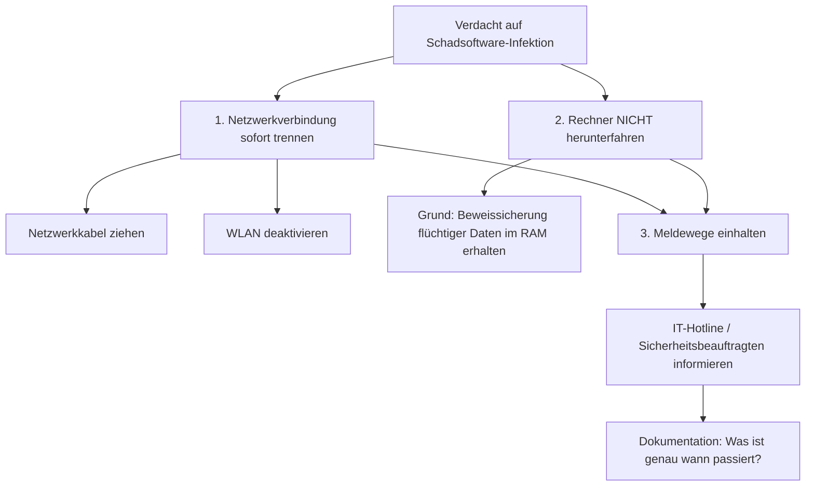

tags: [fisi, ihk, lernsheet]
## 🧭 Navigation & Zusammenhänge
- **Vorausgesetztes Thema:** [[08_Kundenberatung und Marketing in der IT]]
- **Nächstes Thema:** [[01_Computer-Formfaktoren & Hardware-Layouts]]
- **Verwandte Bausteine:** [[03_Gefahrenquellen, Malware-Typen & Gegenmaßnahmen]], [[01_Grundlagen der IT-Sicherheit & Schutzziele]]

---

🎯 IHK-Prüfungsrelevanz

> [!IMPORTANT] AP01: Einrichten eines IT-gestützten Arbeitsplatzes
> 
> - **Relevanz:** Sehr Hoch
> - **Fokus:** Verhaltensregeln am Arbeitsplatz. Die IHK prüft hier regelmäßig die Umsetzung organisatorischer Richtlinien wie der **Clean Desk Policy**, den Umgang mit Besuchern (**Tailgating**) sowie die physische Absicherung mobiler Endgeräte.

> [!WARNING] AP02 / WiSo: Konzeption, Administration & Geschäftsprozesse
> 
> - **Relevanz:** Höchst relevant
> - **Fokus:** Ein absoluter Kernbereich für die Fachinformatiker-Prüfung. Die Kernziele der Informationssicherheit (**CIA-Triade**), Angriffsmuster des Social Engineering (**CEO-Fraud**, **Baiting**, **Phishing**) sowie technische Schutz- und Sofortmaßnahmen bei Sicherheitsvorfällen sind regelmäßige Punktelieferanten.

---

📖 Einfache Erklärung & Praxisbeispiele

Informationssicherheit beschreibt den Zustand, der frei von inakzeptablen Risiken ist oder als gefahrlos eingestuft wird. Da über 80 % aller IT-Sicherheitsvorfälle beim Anwender beginnen, steht das Konzept der **"Human Firewall"** im Mittelpunkt: Jeder Mitarbeiter fungiert als aktiver Sensor zur Erkennung von Gefahren.

1. Die CIA-Sicherheitsziele (Die CIA-Triade)

Die drei elementaren Grundpfeiler der IT-Sicherheit:

- **Vertraulichkeit (Confidentiality):** Schutz vor unbefugter Einsicht (z. B. durch Verschlüsselung).
- **Integrität (Integrity):** Schutz vor unbefugter Modifikation oder Manipulation (z. B. durch digitale Signaturen).
- **Verfügbarkeit (Availability):** Schutz vor Systemausfällen (z. B. durch redundante Netzteile oder Backups).

2. Social Engineering & Psychologische Manipulation

Angreifer versuchen gezielt, das logische Denken von Menschen durch Stress, Angst, Hilfsbereitschaft oder Autorität auszuschalten.

- **CEO-Fraud (Chef-Betrug):** Fake-Mails im Namen der Geschäftsführung fordern unter absolutem Zeitdruck und Geheimhaltung dringende Überweisungen.
- **Techniker-Anruf (Vishing):** Vorgetäuschte IT-Experten (z. B. angeblicher Microsoft-Support) erschleichen sich telefonisch Fernzugriff auf den Rechner.
- **Baiting (Ködern):** Präparierte USB-Sticks (**BadUSB**) werden auf dem Firmenparkplatz "verloren", um die Neugier des Finders auszunutzen.

3. Phishing-Prävention

Die Analyse verdächtiger Nachrichten (E-Mails, SMS = Smishing) erfolgt über eine strikte Checkliste:

- Abgleich des sichtbaren Absendernamens mit der echten Mailadresse im **Header**.
- Prüfung auf unpersönliche Anreden und fehlerhafte Grammatik.
- **Hovern:** Mit der Maus über Links fahren, ohne zu klicken, um das reale Linkziel zu prüfen.
- Rechnungen im `.zip`- oder `.exe`-Format sowie Makros in Office-Dokumenten blockieren.

4. Sicherheit im Büro & Mobiles Arbeiten

- **Clean Desk Policy:** Keine vertraulichen Dokumente oder Passwörter offen am Arbeitsplatz oder auf Post-its liegen lassen.
- **Bildschirmsperre:** Konsequentes Sperren des PCs (`Windows + L`) beim Verlassen des Platzes.
- **Tailgating / Piggybacking:** Unbefugte Personen, die durch bereits geöffnete Türen mitschlüpfen, aktiv ansprechen oder der Security melden.
- **Öffentlicher Raum:** Nutzung von **Blickschutzfolien** gegen Schulterblicke (_Shoulder Surfing_) sowie zwingende **VPN-Pflicht** in öffentlichen WLANs.

---

🛠️ Direktvergleich für die Prüfung

|Sicherheitsbegriff|IHK-Definition|Fokus & Maßnahme|
|---|---|---|
|**Informationssicherheit**|Schutz von Informationen jeglicher Art vor Bedrohungen.|Übergreifendes Regelwerk für digitale und physische Daten.|
|**Datenschutz (DSGVO)**|Schutz der Persönlichkeitsrechte natürlicher Personen.|Rechtlicher Umgang mit personenbezogenen Daten.|
|**Passwort-Hygiene**|Schutz digitaler Identitäten vor Brute-Force-Angriffen.|**Länge vor Komplexität** (12–16 Zeichen); Nutzung von Pass-Phrasen.|
|**MFA (Multi-Faktor)**|Absicherung über mindestens zwei unterschiedliche Faktoren.|Kombination aus **Wissen** (Passwort) und **Besitz** (MFA-Token/App).|

---

🚨 IHK-Notfallmanagement: Sofortmaßnahmen nach dem "Klick"

Wenn ein Anwender auf einen Phishing-Link geklickt oder einen verdächtigen Anhang ausgeführt hat, müssen zur Schadensbegrenzung Sekundenentscheidungen getroffen werden:

