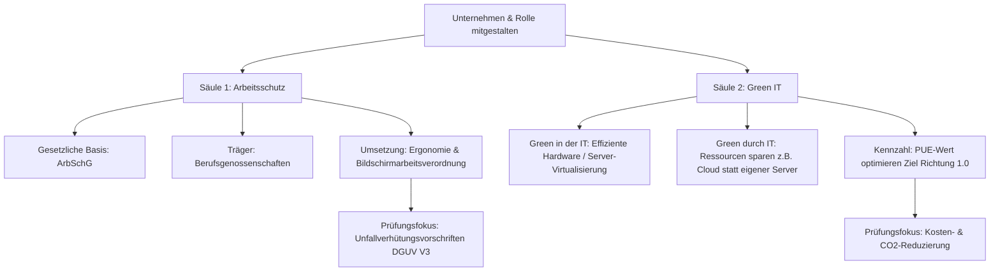

**Tags:** #Lernfeld1 #Arbeitsschutz #GreenIT #FisiPrüfung

---

### 🗺️ Navigation & Zusammenfassung
* **Vorheriges Thema:** [[09_Cyber-Security & Social Engineering]]
* **Nächstes Thema:** [[05_Systemtechnik Grundlagen Hardware, Physik & Ökonomie]]
* **Verwandte Bausteine:** [[04_Sicherheit_und_Ergnomie]], [[05_Systemtechnik Grundlagen Hardware, Physik & Ökonomie]]

---

### 🎓 IHK-Prüfungsrelevanz: AP01 & AP02

> [!IMPORTANT] **🟢 IHK Prüfungsrelevanz: AP01 (Teil 1 der gestreckten Abschlussprüfung)**
> **Relevanz:** Sehr hoch (Standard-Wirtschafts- und Sozialskunde-Thema sowie Kernbestandteil der gebundenen Aufgaben).
> **Fokus:** Die IHK prüft hier knallhart die gesetzlichen Pflichten aus dem Arbeitsschutzgesetz (ArbSchG), die Rechte der Berufsgenossenschaften und die exakten Vorgaben für die Bildschirmarbeitsverordnung. Du musst Symbole zuordnen und Fluchtwegepläne verstehen können.

> [!INFO] **🔵 IHK Prüfungsrelevanz: AP02 (Teil 2 der gestreckten Abschlussprüfung)**
> **Relevanz:** Kernkompetenz im Bereich "Planung und Auslegung".
> **Fokus:** In der AP2 rutscht das Thema in den technischen und wirtschaftlichen Bereich. Hier geht es vor allem um Green IT im Rechenzentrum: Berechnung der PUE (Power Usage Effectiveness), Virtualisierungsstrategien zur CO2-Minderung und die fachgerechte, zertifizierte Entsorgung von Altgeräten (ElektroG).

---

### 📖 Einfache Erklärung & Praxisbeispiele

#### 💡 Das Konzept einfach erklärt
Stell dir vor, du gründest ein IT-Systemhaus. Damit der Laden läuft und rechtlich sauber bleibt, musst du zwei große Bereiche meistern: **Den Schutz deiner Leute (Arbeitsschutz)** und **den Schutz der Umwelt sowie Ressourcen (Green IT)**. 

Beim **Arbeitsschutz** geht es nicht nur darum, dass dir kein Server auf den Fuß fällt. Es ist gesetzlich geregelt, wie ein IT-Arbeitsplatz auszusehen hat (Ergonomie), damit du auch nach 10 Jahren Code-Prüfen keine chronischen Rückenschmerzen hast. Die Berufsgenossenschaften (DGUV) sind hier deine gesetzliche Unfallversicherung – sie machen die Regeln, und dein Betrieb zahlt die Beiträge.

**Green IT** wiederum sorgt dafür, dass deine Infrastruktur nicht unnötig viel Strom frisst. Rechenzentren sind weltweit riesige CO2-Schleudern. Als FISI optimierst du hier an zwei Hebeln: *Green in der IT* (sparsamere Server kaufen, Software effizienter machen) und *Green durch IT* (durch smarte Software, Videokonferenzen oder Cloud-Computing dafür sorgen, dass z. B. Autofahrten oder Papierkram in anderen Abteilungen eingespart werden).

#### 💻 Praxisbeispiel & Technische Umsetzung
**Szenario:** Du sollst als FISI ein neues Serverraum-Konzept planen und gleichzeitig die Büroarbeitsplätze für die Software-Entwickler ergonomisch einrichten.

1. **Umsetzung Arbeitsschutz (Ergonomischer Bildschirmarbeitsplatz):**
   * **Monitor:** Der Bildschirm steht parallel zur Fensterfront (Vermeidung von Blendung). Die Oberkante des Monitors befindet sich maximal auf Augenhöhe (Entlastung der Nackenmuskulatur).
   * **Stuhl & Tisch:** Dynamisch einstellbarer Bürostuhl. Tastatur und Maus liegen auf einer Ebene mit den angewinkelten Unterarmen (90-Grad-Winkel).

2. **Umsetzung Green IT (Rechenzentrums-Effizienz berechnen):**
   Du misst den Gesamtstromverbrauch deines Serverraums inklusive Klimaanlage und Beleuchtung und vergleichst ihn mit dem reinen Verbrauch der IT-Infrastruktur (Server, Switches, Storage), um den **PUE-Wert (Power Usage Effectiveness)** zu ermitteln. Die Formel lautet:
   
   $$\text{PUE} = \frac{\text{Gesamtenergie des Rechenzentrums}}{\text{Energie der reinen IT-Infrastruktur}}$$
   
   *Messwerte deines Serverraums:*
   * Stromverbrauch aller IT-Komponenten: 50 kW
   * Stromverbrauch für Kühlung, USV-Verluste und Licht: 35 kW
   * Gesamter Energiebedarf = 50 kW + 35 kW = 85 kW

   _Berechnung:_
   $$\text{PUE} = \frac{85\text{ kW}}{50\text{ kW}} = 1.7$$
   
   _Mentoren-Fazit:_ Ein PUE von 1.7 bedeutet, dass für jedes Watt IT-Leistung zusätzliche 0,7 Watt für die Umgebung (meist Kühlung) draufgehen. Ziel moderner Green-IT-Rechenzentren ist ein Wert nahe 1.0 (z. B. durch Kaltgang-Einhausung oder Virtualisierung von Servern, um die Hardware-Auslastung von 15% auf 80% zu heben).

---

### 📊 Visualisierung & Logik (Mermaid)

---

### ⚠️ IHK-Prüfungsstolperfallen
* **Stolperfalle 1: Wer zahlt die Beiträge zur Berufsgenossenschaft?** In Wirtschafts-Aufgaben wird oft gefragt, wie sich die Beiträge zur gesetzlichen Unfallversicherung zusammensetzen. Azubis kreuzen hier gerne "50% Arbeitnehmer und 50% Arbeitgeber" an, weil sie es von der Kranken- oder Rentenversicherung so kennen. -> *Lösung:* Die Beiträge zur Berufsgenossenschaft (Unfallversicherung) werden zu **100% allein vom Arbeitgeber** getragen.
* **Stolperfalle 2: PUE-Wert falsch herum berechnet.** In der Aufregung der Prüfung werfen Prüflinge im Bruch Zähler und Nenner durcheinander, was zu einem PUE-Wert von unter 1,0 führt (z. B. 0,58). -> *Lösung:* Merke dir: Der PUE-Wert **muss immer größer oder exakt gleich 1,0 sein**. Es kann niemals weniger Energie insgesamt verbraucht werden als die IT-Komponenten allein benötigen. Die größere Zahl (Gesamtenergie) steht *immer* oben auf dem Bruchstrich.
* **Stolperfalle 3: Missachtung der DGUV Vorschrift 3 (ehemals BGV A3).** Bei Fragen zur Inbetriebnahme von IT-Geräten im Betrieb wird oft vergessen, wer diese überhaupt anschließen oder prüfen darf. -> *Lösung:* Jedes elektrische Betriebsmittel im Unternehmen muss vor der ersten Inbetriebnahme und danach regelmäßig durch eine **Elektrofachkraft** oder unter deren Leitung (Prüfprotokoll nach DGUV V3) geprüft werden. Der Azubi darf nicht einfach privat mitgebrachte Kaffeemaschinen oder Mehrfachsteckdosen im Serverraum anstecken.
