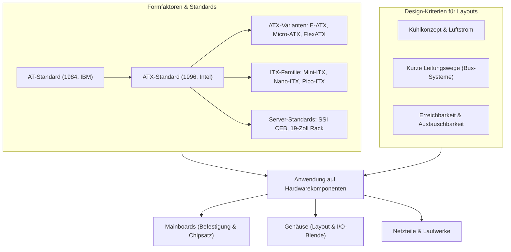

## tags: [fisi, ihk, lernsheet]

## 🧭 Navigation & Zusammenhänge
- **Vorausgesetztes Thema:** [[09_Cyber-Security & Social Engineering]]
- **Nächstes Thema:** [[02_Datenspeicher & Sicherheit RAM, Massenspeicher, RAID & Dateisysteme]]
- **Verwandte Bausteine:** [[05_Systemtechnik Grundlagen Hardware, Physik & Ökonomie]], [[06_Stromversorgung, USV & Netzformen]]
## 🎯 IHK-Prüfungsrelevanz

> [!IMPORTANT] AP01: Einrichten eines IT-gestützten Arbeitsplatzes
> 
> - **Relevanz:** Hoch
>     
> - **Fokus:** Auswahl passender Hardwarekomponenten (Gehäuse, Mainboard, Netzteil) zur Zusammenstellung normgerechter Clientsysteme sowie Beachtung von Standard-Formfaktoren für Kompatibilität und Austauschbarkeit.
>     

> [!WARNING] AP02: Konzeption, Administration & Netzwerke
> 
> - **Relevanz:** Mittel
>     
> - **Fokus:** Unterscheidung von Computerklassen (Desktop, Workstation, Server, Embedded), Auswahl geeigneter Server-Gehäuse (19"-Racks) und Verständnis von Layouts bezüglich Belüftung/Kühlung und Erweiterbarkeit.
>     

## 📖 Einfache Erklärung & Praxisbeispiele

Ein **Formfaktor** in der Computertechnik beschreibt die physische Größe, Form und die Befestigungsmöglichkeiten (z. B. Schraubenlöcher) eines Bauteils. Durch diese Standardisierung lassen sich Komponenten wie Mainboards, Gehäuse, Netzteile und Laufwerke unterschiedlicher Hersteller problemlos kombinieren und austauschen.

### Unterthemen & Anschauliche Beispiele:

- **Grundlagen & Computerklassen:**
    
    - Formfaktoren definieren Standards für Computergehäuse, Mainboards, Netzteile, Festplatten und Laufwerke.
        
    - Computer werden je nach Einsatz in Klassen unterteilt: **Desktop** (Bare bone, Tower), **Workstation** (Big-Tower), **Server** (Tower, 19"-Rack, DIN-Rail) und **Embedded Computer** (Schaltschrank/Spezialgehäuse).
        
    - 💡 **Praxisbeispiel:** Für ein Ingenieurbüro wählst du eine Workstation im Tower-Gehäuse für hohe Rechenleistung und Erweiterbarkeit, während in einer Produktionshalle ein robuster Embedded PC auf einer DIN-Hutschiene im Schaltschrank montiert wird.
        
- **Entwicklung & Formfaktoren (AT vs. ATX u. a.):**
    
    - **AT-Formfaktor (Advanced Technology):** Eingeführt von IBM (1984) als Nachfolger des PC XT. Standardmäßig war nur die Tastaturschnittstelle direkt auf dem Mainboard.
        
    - **ATX-Formfaktor (Advanced Technology Extended):** 1996 von Intel eingeführt. Schnittstellen wurden direkt auf dem Mainboard integriert und eine I/O-Blende genutzt.
        
    - **Varianten & Derivate:** E-ATX, Micro-ATX, Flex-ATX, Mini-ITX, Nano-ITX, Pico-ITX, BTX sowie SSI CEB (Serverbereich).
        
    - 💡 **Praxisbeispiel:** Bei der Aufrüstung eines Büro-PCs stellst du fest, dass das Micro-ATX-Mainboard dank abwärtskompatibler Schraubpunkte problemlos in ein Standard-ATX-Gehäuse passt.
        
- **Mainboard- & Gehäuse-Layout:**
    
    - **Gehäuse- und Mainboard-Layout:** Das Gehäuse bietet passende Befestigungspunkte für den Formfaktor. Das Mainboard platziert Komponenten (CPU-Sockel, RAM-Slots, PCIe-Steckplätze, Chipsatz) an standardisierten Positionen.
        
    - **I/O-Blende (Shield):** Metallblende an der Gehäuserückseite zur Abdeckung und Anpassung an die Mainboard-Anschlüsse.
        
    - **Komponentenstandort:** Wird durch Wärmeentwicklung (Luftstrom), kurze Leitungswege und Erreichbarkeit bestimmt.
        
    - 💡 **Praxisbeispiel:** Der CPU-Sockel sitzt oben nah an den Lüftern, während Grafikkarten so platziert werden, dass sie den kühlen Luftstrom von der Gehäusefront optimal nutzen und kurze Signalwege zu den PCI-Express-Lanes haben.

