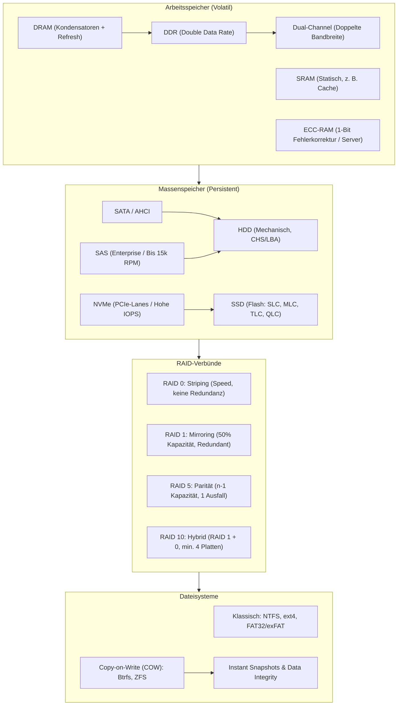

## tags: [fisi, ihk, lernsheet]

## 🧭 Navigation & Zusammenhänge
- **Vorausgesetztes Thema:** [[01_Computer-Formfaktoren & Hardware-Layouts]]
- **Nächstes Thema:** [[03_Busstrukturen & Bootprozess]]
- **Verwandte Bausteine:** [[04_RAM & Massenspeicher Technologien, RAID & Dateisysteme]], [[08_Betriebssysteme & Softwarearchitektur]]
## 🎯 IHK-Prüfungsrelevanz

> [!IMPORTANT] AP01: Einrichten eines IT-gestützten Arbeitsplatzes
> 
> - **Relevanz:** Hoch
>     
> - **Fokus:** Auswahl und Konfiguration von Arbeitsspeicher (Dual-Channel, Timings), Massenspeichern (SSD/HDD, NVMe/SATA) sowie die passenden Dateisysteme (NTFS, FAT32/exFAT) für Clientsysteme.
>     

> [!WARNING] AP02: Konzeption, Administration & Netzwerke
> 
> - **Relevanz:** Hoch
>     
> - **Fokus:** Berechnung und Konfiguration von RAID-Verbünden (RAID 0, 1, 5, 10), Fehlerkorrektur im Serverbereich (ECC-RAM), Enterprise-Schnittstellen (SAS) und moderne Dateisysteme mit Copy-on-Write (ZFS, Btrfs).
>     

## 📖 Einfache Erklärung & Praxisbeispiele

Die Speicherhierarchie eines Computers reicht vom flüchtigen, extrem schnellen Arbeitsspeicher bis hin zu persistenten, redundanten Massenspeichern und hochverfügbaren Dateisystemen.

### Unterthemen & Anschauliche Beispiele:

- **Arbeitsspeicher (RAM):**
    
    - **DRAM vs. SRAM:** DRAM (Dynamic RAM) speichert Bits in Kondensatoren, die ständig aufgefrischt werden müssen (Refresh-Zyklus). SRAM (Static RAM) benötigt keinen Refresh, ist extrem schnell, aber teuer (z. B. CPU-Cache).
        
    - **DDR & Dual-Channel:** Double Data Rate überträgt Daten bei steigender und fallender Taktflanke. Dual-Channel verdoppelt die Bandbreite durch parallele Anbindung über zwei Speicherkanäle (korrekte Bestückung auf den Slots beachten!).
        
    - **Latenzen & Timings:** Gemessen z. B. als CAS Latency (CL). Je niedriger die Timings, desto schneller reagiert der Speicher.
        
    - **ECC-RAM:** Error-Correcting Code erkennt und korrigiert 1-Bit-Fehler (Schutz vor Bit-Flips) in Servern und Workstations.
        
    - 💡 **Praxisbeispiel:** Beim Einbau von zwei RAM-Riegeln steckst du diese in die Slots A2 und B2, um Dual-Channel zu aktivieren und die Speicherbandbreite für rechenintensive Anwendungen zu verdoppeln.
        
- **Massenspeicher & Adressierung (HDD, SSD, Schnittstellen):**
    
    - **HDD vs. SSD:** HDDs nutzen rotierende Magnetplatten (Platter) und Schreib-Leseköpfe (mechanische Latenz). SSDs nutzen Flash-Speicher mit Floating-Gate-Transistoren (SLC, MLC, TLC, QLC).
        
    - **Adressierung:** CHS (_Cylinder-Head-Sector_) beschrieb früher die physische Geometrie (8-GB-BIOS-Grenze). LBA (_Logical Block Addressing_) abstrahiert die Festplatte in eine lineare Abfolge durchnummerierter Blöcke.
        
    - **Schnittstellen & Protokolle:**
        
        - **SATA:** Desktop/Archivierung (AHCI-Protokoll, NCQ).
            
        - **NVMe:** Direkt über PCIe-Lanes angebunden für massive Parallelität und hohe IOPS.
            
        - **SAS:** Serial Attached SCSI für Enterprise-Server (bis zu 15.000 RPM).
            
    - 💡 **Praxisbeispiel:** Eine Datenbank-Instanz auf einem Server erfordert hohe IOPS (Input/Output Operations Per Second), weshalb NVMe-SSDs über PCIe anstelle von SATA-SSDs eingesetzt werden.
        
- **RAID-Systeme (Redundancy of Independent Disks):**
    
    - **RAID 0 (Striping):** Daten werden auf alle Platten verteilt. Maximale Performance, aber keine Redundanz (1 defekte Platte = Totalverlust).
        
    - **RAID 1 (Mirroring):** 1:1 Spiegelung. 50 % Kapazitätsverlust, volle Ausfallsicherheit einer Platte.
        
    - **RAID 5 (Striping + Parität):** Verteilt Daten und Parität (XOR-Prinzip). Kapazität: $(n-1)$ Platten. Verkraftet 1 Plattenausfall. Weist eine Schreib-Penalty auf.
        
    - **RAID 10 (1+0 Hybrid):** Kombination aus Spiegelung und Striping. Benötigt mindestens 4 Platten. Höchste Performance und Ausfallsicherheit.
        
    - 💡 **Praxisbeispiel:** Das Betriebssystem eines Servers liegt auf einem RAID 1 (2 SSDs), während die Nutzdaten auf einem RAID 5 aus 4 HDDs liegen, wo der Ausfall einer einzelnen Platte kompensiert werden kann.
        
- **Dateisysteme & Copy-on-Write (COW):**
    
    - **FAT32 / exFAT:** Hohe Kompatibilität, aber fehlende Rechteverwaltung und Dateigrößenbeschränkungen (FAT32 max. 4 GB).
        
    - **NTFS:** Windows-Standard mit ACLs (Zugriffsrechten), Journaling und Kompression.
        
    - **ext4:** Robuster Linux-Standard mit Journaling und effizienter Verzeichnisverwaltung.
        
    - **Copy-on-Write (COW) – ZFS & Btrfs:** Geänderte Daten werden an einen neuen Ort geschrieben, bevor der Zeiger aktualisiert wird. Ermöglicht sekundenschnelle Snapshots ohne Speicherverbrauch und verhindert Inkonsistenzen. ZFS bietet zudem Self-Healing via Prüfsummen.
        
    - 💡 **Praxisbeispiel:** Vor einem kritischen Software-Update auf einem Linux-Server erstellst du mit Btrfs/ZFS einen Instant-Snapshot, um das System bei Problemen blitzschnell zurückzusetzen.

