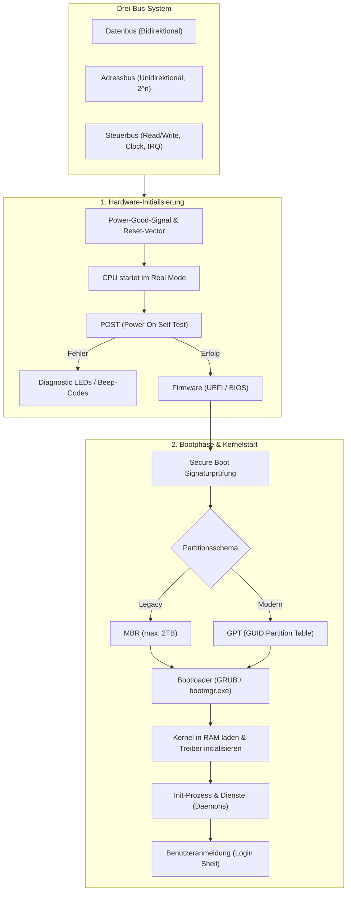

## tags: [fisi, ihk, lernsheet]

## 🧭 Navigation & Zusammenhänge
- **Vorausgesetztes Thema:** [[02_Datenspeicher & Sicherheit RAM, Massenspeicher, RAID & Dateisysteme]]
- **Nächstes Thema:** [[04_RAM & Massenspeicher Technologien, RAID & Dateisysteme]]
- **Verwandte Bausteine:** [[01_Computer-Formfaktoren & Hardware-Layouts]], [[08_Betriebssysteme & Softwarearchitektur]]
## 🎯 IHK-Prüfungsrelevanz

> [!IMPORTANT] AP01: Einrichten eines IT-gestützten Arbeitsplatzes
> 
> - **Relevanz:** Hoch
>     
> - **Fokus:** Verständnis des Bootvorgangs (UEFI/BIOS, POST, Secure Boot), Auswahl und Fehleranalyse von Schnittstellen (USB, PCIe, Thunderbolt) sowie Diagnose von Hardwarefehlern beim Systemstart (POST-Codes, Beep-Codes).
>     

> [!WARNING] AP02: Konzeption, Administration & Netzwerke
> 
> - **Relevanz:** Mittel bis Hoch
>     
> - **Fokus:** Unterscheidung von Festplatten-Partitionierungsstilen (MBR vs. GPT), Bootloader-Konfiguration (GRUB, Windows Boot Manager), System-Troubleshooting bei Startproblemen und Bandbreitenberechnung von Bus-Systemen im Serverbereich.
>     

## 📖 Einfache Erklärung & Praxisbeispiele

Die interne Kommunikation eines Computers basiert auf definierten **Busstrukturen**, die Signale zwischen CPU, Arbeitsspeicher und Peripheriegeräten übertragen. Der **Bootprozess** beschreibt die mehrstufige Initialisierung von der ersten Stromzufuhr bis zur Übergabe an den Betriebssystem-Kernel.

### Unterthemen & Anschauliche Beispiele:

- **Das Drei-Bus-System & Übertragungsmodi:**
    
    - **Datenbus:** Transportiert die eigentlichen Nutzinformationen bidirektional. Die Breite (z. B. 64 Bit) bestimmt die Datenmenge pro Taktzyklus.
        
    - **Adressbus:** Unidirektionale Auswahl der Zielkomponente oder Speicherzelle. Die Adressbreite $n$ limitiert den adressierbaren Speicherbereich ($2^n$).
        
    - **Steuerbus:** Überträgt Befehle (z. B. Read/Write), Taktsignale und Interrupt-Requests.
        
    - **Parallel vs. Seriell:** Parallele Übertragung leidet bei hohen Taktraten unter Laufzeitunterschieden (Clock Skew) und Interferenzen. Moderne serielle Punkt-zu-Punkt-Verbindungen (z. B. PCIe) nutzen differenzielles Signaling und erreichen wesentlich höhere Transferraten.
        
    - 💡 **Praxisbeispiel:** Während alte IDE-Kabel mit 80 breiten Adern durch _Clock Skew_ an Leistungsgrenzen stießen, übertragen moderne PCIe-Lanes Daten seriell und hochfrequent ohne Laufzeitverzögerung zwischen den Adern.
        
- **Moderne Schnittstellen (PCIe, USB, Thunderbolt):**
    
    - **PCI Express (PCIe):** Modulare Anbindung in Lanes (x1, x4, x8, x16) im Full-Duplex-Betrieb.
        
    - **USB:** Master-Slave-Architektur in Baum-Topologie inklusive Stromversorgung (Power Delivery).
        
    - **Thunderbolt:** Funktioniert als externer Tunnel für PCIe- und DisplayPort-Signale sowie Stromversorgung.
        
    - 💡 **Praxisbeispiel:** Über ein einziges Thunderbolt-Kabel verbindest du ein Business-Notebook mit einer Dockingstation, die gleichzeitig zwei 4K-Monitore ansteuert, Daten via PCIe überträgt und den Laptop lädt.
        
- **Der Bootprozess & Firmware (BIOS vs. UEFI):**
    
    - **Pre-POST & Power-Good-Signal:** Das Netzteil stabilisiert die Spannungen und sendet das Power-Good-Signal. Die CPU startet im Kompatibilitätsmodus (_Real Mode_) und lädt den Reset-Vector.
        
    - **POST (Power On Self Test):** Hardware-Inventarisierung und Funktionsprüfung (CPU, RAM, GPU). Fehler werden über Beep-Codes, Diagnostic LEDs oder Hex-Codes (Port 80h) signalisiert.
        
    - **BIOS vs. UEFI:** Das klassische BIOS ist auf 16-Bit und 1 MB Adressraum beschränkt. UEFI unterstützt Partitionen $>2\text{ TB}$, besitzt eine grafische Oberfläche, eigenen Netzwerkstack (PXE-Boot) und bietet **Secure Boot** zur Prüfung digitaler Signaturen.
        
    - 💡 **Praxisbeispiel:** Beim Einschalten des PCs bleibt der Bildschirm schwarz und das Mainboard gibt 3 kurze Pieptöne aus (Beep-Code) bzw. die DRAM-LED leuchtet – ein klarer Hinweis auf ein Problem beim RAM-POST.
        
- **MBR vs. GPT, Bootloader & Kernelstart:**
    
    - **MBR (Master Boot Record):** Max. 4 primäre Partitionen, maximal 2 TB Festplattengröße.
        
    - **GPT (GUID Partition Table):** Bietet nahezu unbegrenzte Partitionen, Backup-Header für Redundanz und ist Voraussetzung für UEFI/Secure Boot.
        
    - **Bootloader & Kernel:** UEFI/BIOS lädt den Bootloader (z. B. GRUB bei Linux oder `bootmgr.exe` bei Windows). Dieser lädt den Betriebssystem-Kernel und Treiber (Initramfs) in den RAM, bevor der Init-Prozess die Hintergrunddienste startet.
        
    - 💡 **Praxisbeispiel:** Meldet ein System beim Start „No bootable device found“, prüfst du im UEFI, ob die Boot-Reihenfolge verändert wurde oder ob eine GPT-Partitionbeschädigung vorliegt.

