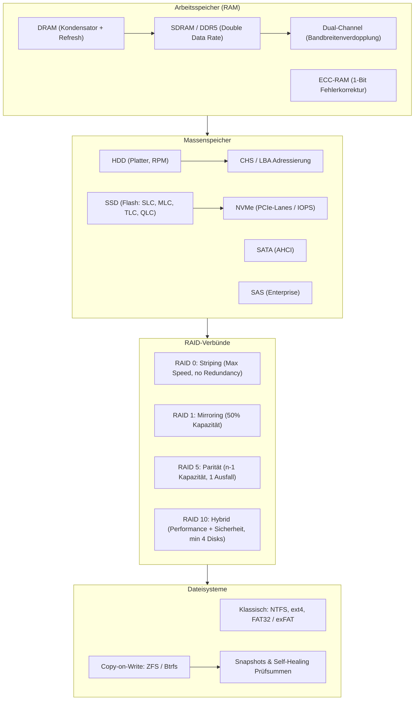

## tags: [fisi, ihk, lernsheet]

## 🧭 Navigation & Zusammenhänge
- **Vorausgesetztes Thema:** [[03_Busstrukturen & Bootprozess]]
- **Nächstes Thema:** [[05_Systemtechnik Grundlagen Hardware, Physik & Ökonomie]]
- **Verwandte Bausteine:** [[02_Datenspeicher & Sicherheit RAM, Massenspeicher, RAID & Dateisysteme]], [[08_Betriebssysteme & Softwarearchitektur]]
## 🎯 IHK-Prüfungsrelevanz

> [!IMPORTANT] AP01: Einrichten eines IT-gestützten Arbeitsplatzes
> 
> - **Relevanz:** Hoch
>     
> - **Fokus:** Auswahl und Installation passender RAM-Module (Dual-Channel, Timings, CAS Latency) sowie Auswahl geeigneter Client-Massenspeicher (NVMe vs. SATA) und Dateisysteme (NTFS, exFAT).
>     

> [!WARNING] AP02: Konzeption, Administration & Netzwerke
> 
> - **Relevanz:** Hoch
>     
> - **Fokus:** Dimensionierung, Berechnung und Gegenüberstellung von RAID-Leveln (RAID 0, 1, 5, 10), Einsatz von ECC-RAM im Serverumfeld, Festplattenadressierung (LBA) und Evaluierung moderner Copy-on-Write-Dateisysteme (ZFS, Btrfs).
>     

## 📖 Einfache Erklärung & Praxisbeispiele

Computer nutzen eine abgestufte **Speicherhierarchie**, die von flüchtigem, extrem schnellem Arbeitsspeicher (RAM) bis hin zu allen Formen korrekturfähiger, redundanter und fortlaufend gesicherter Massenspeicher reicht.

### Unterthemen & Anschauliche Beispiele:

- **Arbeitsspeicher (RAM-Technologien & Architektur):**
    
    - **DRAM vs. SRAM:** DRAM speichert Bits in Kondensatoren, die kontinuierlich in einem Refresh-Zyklus aufgefrischt werden müssen. SRAM hält die Ladung ohne Refresh (z. B. CPU-Cache).
        
    - **SDRAM / DDR:** _Double Data Rate_ sendet Signale sowohl bei der steigenden als auch bei der fallenden Flanke des Taktsignals.
        
    - **Latenzen & Timings:** Bspw. CL16-18-18-38 (CAS Latency). Eine niedrigere Latenz bedeutet schnellere Antwortzeiten. Höhere Taktfrequenzen gleichermaßen kompensieren teils höhere Latenzen.
        
    - **Dual-Channel / Quad-Channel:** Verdoppelt bzw. vervierfacht die Speicherbandbreite durch parallele Bus-Anbindung.
        
    - **ECC-RAM:** Erkennt und korrigiert 1-Bit-Fehler (_Bit-Flips_) in Servern und Workstations.
        
    - 💡 **Praxisbeispiel:** Wenn in einem DB-Server ein Bit-Flip auftritt, verhindert ECC-RAM den Systemabsturz und korrigiert das Bit automatisch.
        
- **Massenspeicher & Adressierung (HDD, SSD, Schnittstellen):**
    
    - **HDD vs. SSD:** HDDs arbeiten mechanisch mit Schreib-Leseköpfen und Platten (RPM). SSDs nutzen Flash-Zellen (SLC, MLC, TLC, QLC) mit Floating-Gate-Transistoren ohne mechanische Verzögerung.
        
    - **Adressierung:** _CHS (Cylinder-Head-Sector)_ adressiert die physische Geometrie (alte 8-GB-BIOS-Grenze). Modernes _LBA (Logical Block Addressing)_ abstrahiert den Speicher in eine fortlaufende Folge linear durchnummerierter Blöcke.
        
    - **Schnittstellen:** SATA (AHCI, NCQ) für Standard-Anwendungen, NVMe direkt über PCIe-Lanes für extrem hohe IOPS, und SAS für Server-Systeme (bis 15.000 RPM).
        
    - 💡 **Praxisbeispiel:** Beim Upgrade eines CAD-Arbeitsplatzes wird eine NVMe-SSD verbaut, damit große 3D-Dateien dank direkter PCIe-Anbindung in Sekunden geladen werden.
        
- **RAID-Verbünde (Redundancy of Independent Disks):**
    
    - **RAID 0 (Striping):** Verteilt Blöcke auf $n$ Platten. Hohe Schreib-/Leseleistung, aber keinerlei Redundanz (1 Ausfall = Totalverlust).
        
    - **RAID 1 (Mirroring):** 1:1 Spiegelung. $50\,\%$ Nutzkapazität, hohe Ausfallsicherheit.
        
    - **RAID 5 (Striping mit Parität):** Verteilt Daten und XOR-Paritäten über alle Platten. Kapazität: $(n-1) \times \text{Größe}$. Kompensiert 1 Plattenausfall. Besitzt eine Schreib-Penalty.
        
    - **RAID 10 (1+0 Hybrid):** Kombination aus Mirroring und Striping. Benötigt min. 4 Platten. Bietet höchste Ausfallsicherheit und Performance.
        
    - 💡 **Praxisbeispiel:** Bei einem File-Server mit 4 Festplatten à 2 TB im RAID 5 stehen $3 \times 2\text{ TB} = 6\text{ TB}$ Speicher zur Verfügung; fällt eine Festplatte aus, läuft das System uneingeschränkt weiter.
        
- **Dateisysteme & Copy-on-Write (COW):**
    
    - **FAT32 / exFAT:** Sehr hohe Kompatibilität, aber ohne Zugriffsrechte (ACLs) und mit Dateigrößen-Limits bei FAT32.
        
    - **NTFS:** Windows-Standard mit ACL-Rechteverwaltung, Journaling und Kompression.
        
    - **ext4:** Verbreitetes, robustes Linux-Dateisystem mit Journaling.
        
    - **Copy-on-Write (COW) – Btrfs & ZFS:** Änderungen schreiben Daten immer an freie neue Orte, bevor Zeiger angepasst werden. Ermöglicht Snapshots ohne direkten Speicherverbrauch, schützt vor Inkonsistenzen und Btrfs/ZFS bieten Enterprise-Features wie Self-Healing und Prüfsummen.
        
    - 💡 **Praxisbeispiel:** Ein Enterprise-NAS mit ZFS erkennt einen „Silent Data Corruption“-Fehler über Prüfsummen und repariert die beschädigte Datei via Self-Healing automatisch.

