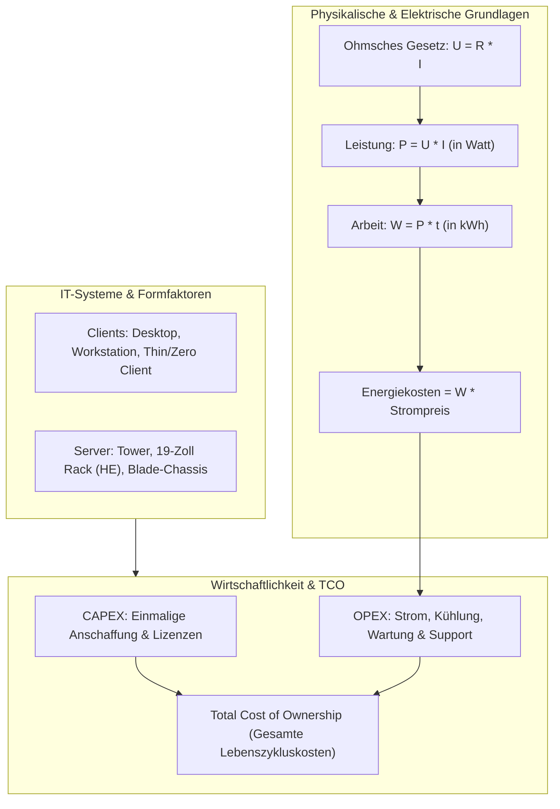

## tags: [fisi, ihk, lernsheet]

## 🧭 Navigation & Zusammenhänge
- **Vorausgesetztes Thema:** [[04_RAM & Massenspeicher Technologien, RAID & Dateisysteme]]
- **Nächstes Thema:** [[06_Stromversorgung, USV & Netzformen]]
- **Verwandte Bausteine:** [[01_Computer-Formfaktoren & Hardware-Layouts]], [[07_Sicherheit, Normen & Green IT]]
## 🎯 IHK-Prüfungsrelevanz

> [!IMPORTANT] AP01: Einrichten eines IT-gestützten Arbeitsplatzes
> 
> - **Relevanz:** Hoch
>     
> - **Fokus:** Klassifizierung von Client-Systemen (Desktop, Workstation, Notebook, Thin/Zero Client), Beachtung von Hardware-Ergonomie und Gesetzen (BITV), sowie sicherer Umgang mit elektrischen Spannungen und Schutzmaßnahmen am Arbeitsplatz.
>     

> [!WARNING] AP02: Konzeption, Administration & Netzwerke
> 
> - **Relevanz:** Hoch
>     
> - **Fokus:** Auswahl von Server-Formfaktoren (Tower, 19"-Rack, Blade), Wirtschaftlichkeitsanalysen und TCO-Berechnungen (CAPEX, OPEX), elektrische Leistungsberechnungen zur Dimensionierung von Stromkreisen im Data Center sowie Kostenberechnungen für den Energiebedarf.
>     

## 📖 Einfache Erklärung & Praxisbeispiele

Eine ganzheitliche IT-Infrastruktur erfordert neben der passenden Hardware-Auswahl ein solides Verständnis betriebswirtschaftlicher Beschaffungskriterien sowie der physikalischen Grundlagen der Elektrotechnik.

### Unterthemen & Anschauliche Beispiele:

- **Klassifizierung von IT-Systemen & Formfaktoren:**
    
    - **Stationäre & Mobile Clients:** Standard-Desktops (modular, gutes Preis-Leistungs-Verhältnis), Workstations (ECC-RAM, ISV-Zertifizierungen, Profi-GPUs wie Quadro), All-in-One PCs und Notebooks (Ultrabooks, Ruggedized für raue Umgebungen).
        
    - **Thin & Zero Clients:** Serverbasierte Arbeitsplätze ohne lokale Anwendungslogik; Zero Clients besitzen kein eigenes Betriebssystem und nutzen spezialisierte Hardware-Protokolle (z. B. PCoIP).
        
    - **Server-Bauformen:**
        
        - **Tower-Server:** KMUs, leise, werkzeuglos wartbar.
            
        - **19"-Rack-Server:** Standardisierung nach Höheneinheiten ($1\text{ HE} = 4,445\text{ cm}$ / $1,75\text{ Zoll}$), Redundanz (Netzteile, Hot-Swap-Lüfter), strukturierte Belüftung (Cold/Hot Aisle).
            
        - **Blade-Server:** Höchste Packdichte; Blades teilen sich Stromversorgung, Kühlung und Management im Chassis.
            
    - 💡 **Praxisbeispiel:** Ein Architekturbüro benötigt für 3D-CAD-Anwendungen Workstations mit ECC-RAM und ISV-zertifizierten Treibern, während die Buchhaltung auf zentral gemanagte Thin Clients zugreift.
        
- **Ökonomie, Wirtschaftlichkeit & Ergonomie:**
    
    - **Magisches Viereck der Beschaffung:** Zielkonflikt aus Leistungsfähigkeit, Wirtschaftlichkeit, Qualität/Ergonomie und Zeit/Verfügbarkeit.
        
    - **CAPEX vs. OPEX:** CAPEX (_Capital Expenditures_) sind einmalige Anschaffungs- und Lizenzkosten. OPEX (_Operational Expenditures_) umfassen laufende Kosten für Strom, Kühlung, Wartung und Support.
        
    - **Total Cost of Ownership (TCO):** Ganzheitliche Lebenszykluskosten unter Einbeziehung versteckter Kosten (Ausfallzeiten, Schulungen, Administration).
        
    - **Ergonomie & BITV:** Höhenverstellbarkeit, definierte Tastatur-Druckpunkte sowie Barrierefreiheit nach BITV (z. B. Screenreader-Unterstützung).
        
    - 💡 **Praxisbeispiel:** Ein günstiges Server-Angebot mit niedrigem Kaufpreis (CAPEX) entpuppt sich durch hohe Leistungsaufnahme und teure Wartungsverträge als TCO-Falle über die 5-jährige Nutzungsdauer.
        
- **Physikalische Grundlagen & Das Ohmsche Gesetz:**
    
    - **Größen:**
        
        - Spannung $U$ in Volt [V] (Potentialdifferenz / Antriebskraft, Parallelschaltung beim Messen).
            
        - Stromstärke $I$ in Ampere [A] (Ladungsträger pro Zeit, Reihenschaltung beim Messen).
            
        - Widerstand $R$ in Ohm [$\Omega$] (Hemmung des Stromflusses).
            
    - **Spannungsarten:** Wechselspannung (AC, $230\text{ V} / 50\text{ Hz}$) vs. Gleichspannung (DC, $12\text{ V}, 5\text{ V}, 3,3\text{ V}$ im PC).
        
    - **Ohmsches Gesetz:** $U = R \cdot I \quad \Leftrightarrow \quad I = \frac{U}{R} \quad \Leftrightarrow \quad R = \frac{U}{I}$.
        
    - **Gefahren & Schutz:** Spannungen $>50\text{ V AC}$ und Ströme $>50\text{ mA}$ sind lebensgefährlich. Schutz über Schutzleiter (PE) und FI-Schutzschalter (RCD).
        
    - 💡 **Praxisbeispiel:** Ein 12V-Gehäuselüfter besitzt einen Innenwiderstand von $24\,\Omega$. Nach $I = \frac{U}{R}$ fließt eine Stromstärke von $I = \frac{12\text{ V}}{24\,\Omega} = 0,5\text{ A}$ ($500\text{ mA}$).
        
- **Elektrische Leistung, Arbeit & Kostenberechnung:**
    
    - **Elektrische Leistung ($P$):** $P = U \cdot I$ in Watt [W]. Alternativ: $P = I^2 \cdot R$ oder $P = \frac{U^2}{R}$.
        
    - **Elektrische Arbeit ($W$):** $W = P \cdot t$ in Wattsekunden [Ws] bzw. Kilowattstunden [kWh].
        
    - **Kostenberechnung:** $\text{Kosten } [€] = W \text{ [kWh]} \cdot \text{Strompreis } [€/\text{kWh}]$.
        
    - 💡 **Praxisbeispiel:** Ein Server-Rack mit 10 Servern zieht bei $230\text{ V}$ jeweils $1,5\text{ A}$. Pro Server $P = 230\text{ V} \cdot 1,5\text{ A} = 345\text{ W}$. Gesamtsystem: $3450\text{ W}$ ($3,45\text{ kW}$). In 24 Stunden beträgt die Arbeit $W = 3,45\text{ kW} \cdot 24\text{ h} = 82,8\text{ kWh}$. Bei $0,30\text{ €/kWh}$ liegen die Tageskosten bei $24,84\text{ €}$.

