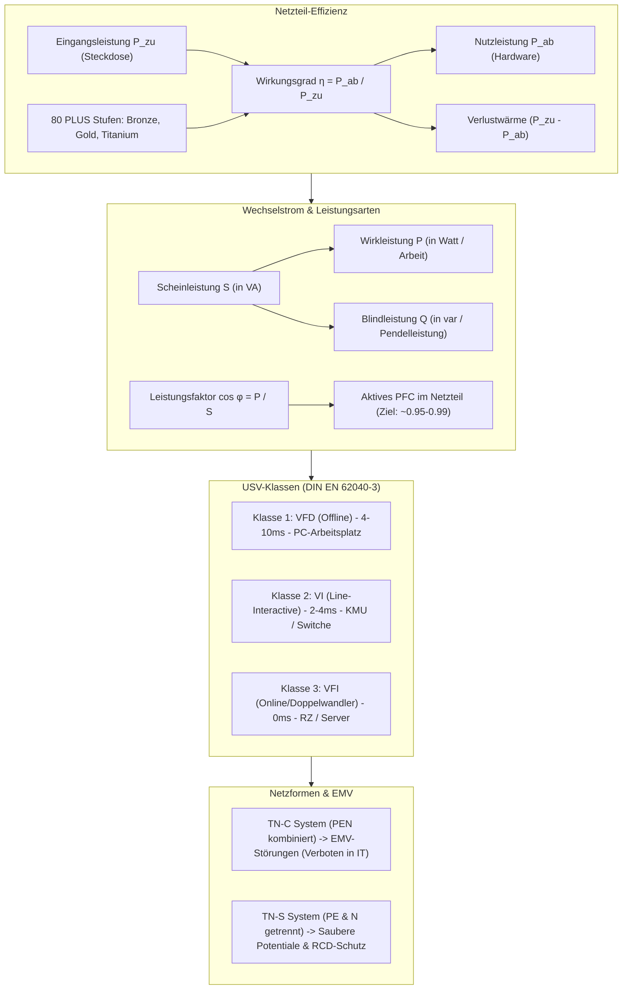

## tags: [fisi, ihk, lernsheet]

## 🧭 Navigation & Zusammenhänge
- **Vorausgesetztes Thema:** [[05_Systemtechnik Grundlagen Hardware, Physik & Ökonomie]]
- **Nächstes Thema:** [[07_Sicherheit, Normen & Green IT]]
- **Verwandte Bausteine:** [[01_Computer-Formfaktoren & Hardware-Layouts]], [[04_Sicherheit_und_Ergnomie]]
## 🎯 IHK-Prüfungsrelevanz

> [!IMPORTANT] AP01: Einrichten eines IT-gestützten Arbeitsplatzes
> 
> - **Relevanz:** Hoch
>     
> - **Fokus:** Auswahl von Netzteilen nach Effizienzklassen (80 PLUS Zertifizierungen), Berechnung des tatsächlichen Stromverbrauchs aus der Steckdose unter Einbeziehung des Wirkungsgrads ($\eta$) und grundlegende Absicherung von Arbeitsplatz-PCs mittels VFD-USVs.
>     

> [!WARNING] AP02: Konzeption, Administration & Netzwerke
> 
> - **Relevanz:** Hoch
>     
> - **Fokus:** Dimensionierung von Unterbrechungsfreien Stromversorgungen (USV) (Unterscheidung Wirkleistung $P$ in Watt vs. Scheinleistung $S$ in VA), Auswahl der passenden USV-Klasse (VFD, VI, VFI), Berechnung der Batteriekapazität und Stützzeit sowie Auswahl EMV-konformer Netzformen (TN-S vs. TN-C) für Rechenzentren.
>     

## 📖 Einfache Erklärung & Praxisbeispiele

Die zuverlässige Stromversorgung ist die Lebensader jeder IT-Infrastruktur. Ein tiefes Verständnis von Wechselstrom-Effekten, den Unterschieden zwischen den verschiedenen Leistungsarten, effizienten Netzteilen, USV-Anlagen und sicheren Netzformen schützt vor Hardware-Schäden, Datenverlusten und Netzstörungen.

### Unterthemen & Anschauliche Beispiele:

- **Wechselstromtechnik & Leistungsarten (P, Q, S):**
    
    - **Wechselspannung (AC):** Sinusförmiger Verlauf mit 50 Hz (Effektivwert 230 V, Spitzenwert ca. 325 V). Erlaubt einfache Transformation und verlustarme Fernübertragung.
        
    - **Phasenverschiebung & Blindleistung:** Durch induktive oder kapazitive Lasten (z. B. Spulen, Schaltnetzteile) laufen Strom und Spannung zeitversetzt, wodurch Energie im Netz pendelt.
        
    - **Die drei Leistungsarten:**
        
        - **Wirkleistung ($P$ in Watt [W]):** Die tatsächlich verrichtete Arbeit (Rechenleistung, Wärme). Relevanz für die Stromrechnung und Kühlung.
            
        - **Blindleistung ($Q$ in Var [var]):** Pendelt ungenutzt zwischen Erzeuger und Verbraucher hin und her.
            
        - **Scheinleistung ($S$ in Voltampere [VA]):** Die geometrische Summe aus Wirk- und Blindleistung ($S^2 = P^2 + Q^2$). Maßgebend für die Dimensionierung von Leitungen, Trafos und USVs.
            
    - **Leistungsfaktor ($\cos \varphi$) & PFC:** $\cos \varphi = \frac{P}{S}$. Misst die Effizienz der Energienutzung ($1,0 =$ reine Wirklast, in der EU ist aktive Power Factor Correction [PFC] bei PC-Netzteilen Pflicht, um Werte nahe 0,95–0,99 zu erreichen).
        
    - 💡 **Praxisbeispiel:** Ein Server zieht $400\text{ W}$ Wirkleistung bei einem Leistungsfaktor von $\cos \varphi = 0,8$. Die erforderliche Scheinleistung für die USV liegt bei $S = \frac{400\text{ W}}{0,8} = 500\text{ VA}$. Eine USV mit nur $450\text{ VA}$ wäre überlastet, obwohl $400\text{ W}$ auf dem Papier ausreichend wirken!
        
- **Effizienz & Wirkungsgrad ($\eta$):**
    
    - **Wirkungsgrad ($\eta = \frac{P_{\text{ab}}}{P_{\text{zu}}}$):** Verhältnis von abgegebener Nutzen-Leistung zur zugeführten Leistung aus der Steckdose. Nicht genutzte Energie wird als Verlustwärme frei.
        
    - **80 PLUS Zertifizierungen:** Energiestandards für PC-/Server-Netzteile bei 20 %, 50 % und 100 % Auslastung (z. B. White $\ge 82\%$, Bronze $\ge 85\%$, Gold $\ge 90\%$, Titanium $\ge 94\%$).
        
    - 💡 **Praxisbeispiel:** Wenn PC-Komponenten intern $300\text{ W}$ aufnehmen ($P_{\text{ab}}$) und das Netzteil einen Wirkungsgrad von $80\%$ ($\eta = 0,8$) aufweist, zieht das Netzteil $P_{\text{zu}} = \frac{300\text{ W}}{0,8} = 375\text{ W}$ aus der Steckdose. $75\text{ W}$ müssen als Abwärme gekühlt werden.
        
- **Unterbrechungsfreie Stromversorgung (USV):**
    
    - **Klassen nach DIN EN 62040-3:**
        
        - **Klasse 1 – VFD (Offline / Voltage Frequency Dependent):** Leitet Strom direkt durch, schaltet bei Ausfall per Relais um (Umschaltzeit $4\text{--}10\text{ ms}$). Bietet nur Schutz bei Blackouts (für einfache Desktop-PCs).
            
        - **Klasse 2 – VI (Line-Interactive / Voltage Independent):** Gleicht mit einem Spannungsregler (AVR) Unter-/Überspannungen aus (Umschaltzeit $2\text{--}4\text{ ms}$). Ideal für Switche und KMU-Server.
            
        - **Klasse 3 – VFI (Online / Voltage Frequency Independent):** Dauerwandler (Doppelwandler: AC $\rightarrow$ DC $\rightarrow$ Akku $\rightarrow$ DC $\rightarrow$ AC). Umschaltzeit $0\text{ ms}$, erzeugt eine perfekte Sinuswelle und bietet Vollschutz für kritische Server in Rechenzentren.
            
    - **Dimensionierung & Stützzeit:** Last immer in Scheinleistung (VA) ermitteln, $20\text{--}30\%$ Reserve einplanen und Batteriekapazität berechnen:
        
        $$\text{Kapazität [Ah]} \approx \frac{\text{Last [W]} \cdot \text{Stützzeit [h]}}{\text{Batteriespannung [V]}}$$
        
        (In der Praxis zzgl. ca. $40\%$ Aufschlag für Wandlerverluste).
        
    - **Management:** Per USB oder SNMP-Netzwerkkarte kann die USV bei kritischem Akkustand ein automatisches und geordnetes Herunterfahren (_Shutdown_) der Server/VMs einleiten.
        
    - 💡 **Praxisbeispiel:** Bei einem Stromausfall im RZ übernimmt eine VFI-Online-USV ohne jegliche Umschaltzeit ($0\text{ ms}$) die Versorgung. Erreicht der Akku nach 15 Minuten einen Stand von $20\%$, sendet die USV per SNMP ein Signal an den Hypervisor, um alle virtuellen Maschinen sauber herunterzufahren.
        
- **Netzformen (TN-C vs. TN-S) & Sicherheit:**
    
    - **TN-C-System (Terre Neutre Combiné):** Schutzleiter (PE) und Neutralleiter (N) sind in einem gemeinsamen PEN-Leiter kombiniert. Betriebsströme fließen über den PEN-Leiter und erzeugen Vagabundierende Störströme auf Datenschirmen – in IT-Umgebungen strikt verboten!
        
    - **TN-S-System (Terre Neutre Séparé):** Fünfleiter-System mit strikt getrenntem Schutzleiter (PE) und Neutralleiter (N). Garantiert saubere Potentiale, verhindert Netzstörungen auf Datenleitungen (EMV-freundlich) und ermöglicht den Einsatz von RCDs (FI-Schutzschaltern).
        
    - 💡 **Praxisbeispiel:** In einem älteren Gebäude mit TN-C-Netz kommt es ständig zu sporadischen Abbrüchen im Gigabit-Netzwerk, da Ausgleichsströme über die Abschirmungen der Cat-7-Kabel fließen. Eine Umrüstung auf ein TN-S-System beseitigt die EMV-Störungen nachhaltig.

