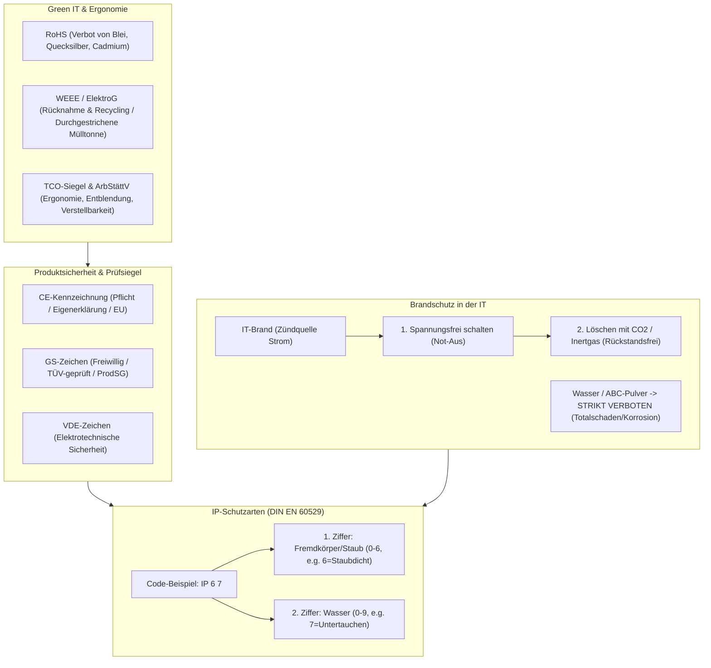

## tags: [fisi, ihk, lernsheet]

## 🧭 Navigation & Zusammenhänge
- **Vorausgesetztes Thema:** [[06_Stromversorgung, USV & Netzformen]]
- **Nächstes Thema:** [[08_Betriebssysteme & Softwarearchitektur]]
- **Verwandte Bausteine:** [[04_Sicherheit_und_Ergnomie]], [[01_Grundlagen der IT-Sicherheit & Schutzziele]]

## 🎯 IHK-Prüfungsrelevanz

> [!IMPORTANT] AP01: Einrichten eines IT-gestützten Arbeitsplatzes
> 
> - **Relevanz:** Hoch
>     
> - **Fokus:** Einhaltung rechtlicher und ergonomischer Vorgaben am Arbeitsplatz nach Arbeitsstättenverordnung (ArbStättV / ehem. BildscharbV), Beachtung von Ergonomie-Siegeln (TCO-Zertifizierung), Beurteilung von Prüfsiegeln auf Hardware (CE, GS, VDE) sowie umweltgerechte Altgeräteentsorgung nach WEEE/ElektroG.
>     

> [!WARNING] AP02: Konzeption, Administration & Netzwerke
> 
> - **Relevanz:** Hoch
>     
> - **Fokus:** Auswahl geeigneter IP-Schutzarten für Industrie- und Outdoor-PCs (DIN EN 60529), Brandschutzkonzepte und richtige Löschmittel für Serverräume/IT-Anlagen (CO2/Inertgas vs. Wasser/Pulver), Haftungsfragen bei Fahrlässigkeit und Einhaltung ökologischer Richtlinien (RoHS).
>     

## 📖 Einfache Erklärung & Praxisbeispiele

Der Betrieb von IT-Systemen erfordert im beruflichen Alltag die strikte Einhaltung gesetzlicher Normen, Produktsicherheitsstandards, Brandschutzvorschriften und Umweltschutzrichtlinien, um Mensch, Daten und Umwelt zu schützen.

### Unterthemen & Anschauliche Beispiele:

- **Prüfsiegel, Normen & Haftung:**
    
    - **CE-Kennzeichnung (_Conformité Européenne_):** Zwingendes „Verwaltungszeichen“ (Reisepass) für den europäischen Binnenmarkt. Kein Qualitätssiegel, sondern eine reine Eigenerklärung des Herstellers/Importeurs über die Einhaltung aller EU-Richtlinien.
        
    - **GS-Zeichen (_Geprüfte Sicherheit_):** Freiwilliges, gesetzlich geregeltes Prüfsiegel nach Produktsicherheitsgesetz (ProdSG). Im Gegensatz zur CE-Kennzeichnung von einer unabhängigen, zugelassenen Stelle (z. B. TÜV, DEKRA) geprüft.
        
    - **VDE-Zeichen:** Zertifikat des Verbands der Elektrotechnik für elektrische und thermische Sicherheit sowie mechanische Stabilität (besonders wichtig bei Netzteilen und Kabeln).
        
    - **Arbeitsschutz & Haftung:** Gesetzliche Vorgaben basieren auf BetrSichV (TRBS), GefStoffV (TRGS) und ArbStättV (ASR). IT-Kräfte haften bei fahrlässigem Handeln oder „wider besseren Wissens“ persönlich und unbeschränkt, wenn Schäden durch fehlende Qualifikation oder Vorsatz entstehen.
        
    - 💡 **Praxisbeispiel:** Beim Import günstiger Server-Netzteile aus Drittländern stellt sich heraus, dass das angebrachte CE-Zeichen gefälscht war. Der Importeur haftet als Inverkehrbringer voll für entstandene Brandschäden und muss mit Verkaufsverboten sowie Bußgeldern rechnen.
        
- **Brandschutz in der IT & Löschmittel:**
    
    - **Verbrennungsdreieck:** Feuer benötigt Brennstoff, Sauerstoff und Zündenergie (Wärme/Funken).
        
    - **Elektrischer Brand:** Die frühere „Brandklasse E“ existiert nicht mehr – Elektrizität ist die Zündquelle, nicht der Brennstoff. Vor Löscharbeiten nach Möglichkeit Spannungsfreiheit herstellen (Not-Aus).
        
    - **Geeignete Löschmittel:**
        
        - **Kohlendioxid ($\text{CO}_2$):** Löscht im Serverraum vollkommen **rückstandsfrei** durch Sauerstoffverdrängung und ist nicht leitfähig (Vorsicht: Erstickungsgefahr für Personen!).
            
        - **Inertgase (Argon, Stickstoff):** Standard in automatischen Gaslöschanlagen in Rechenzentren.
            
    - **Ungeeignete Löschmittel:** **Wasser** (elektrische Leitfähigkeit / Kurzschluss) und **ABC-Pulver** (die Pulverpartikel sind extrem korrosiv, dringen in kleinste Ritzen ein und zerfressen Platinen irreversibel – führt zum Totalschaden).
        
    - 💡 **Praxisbeispiel:** Bei einem Kabelbrand im Serverrack greift der Systemintegrator zum $\text{CO}_2$-Löscher direkt neben der Tür anstatt zum Pulverlöscher auf dem Flur, um das Feuer rückstandsfrei zu ersticken und Nebenschäden an benachbarten Racks zu vermeiden.
        
- **IP-Schutzarten (DIN EN 60529):**
    
    - **Code-Aufbau:** Bspw. **IP67**.
        
        - **1. Ziffer (0–6):** Schutz gegen Fremdkörper, Staub und Berührung (z. B. $2 = \text{handrückensicher/fingergeschützt}$, $5 = \text{staubgeschützt}$, $6 = \text{staubdicht}$).
            
        - **2. Ziffer (0–9):** Schutz gegen Wasser (z. B. $0 = \text{kein Schutz}$, $4 = \text{Spritzwasser}$, $7 = \text{zeitweiliges Untertauchen}$, $8 = \text{dauerndes Untertauchen}$).
            
    - 💡 **Praxisbeispiel:** Während im Büro ein Standard-PC mit **IP20** ausreicht, wird in einer Sägewerk-Produktionshalle ein Industrie-PC mit **IP54** montiert, damit weder Sägestaub ins Gehäuse eindringt noch Spritzwasser bei der Hallenreinigung den Rechner beschädigt.
        
- **Green IT, Richtlinien & Öko-Label:**
    
    - **RoHS-Richtlinie (_Restriction of Hazardous Substances_):** Verbietet bzw. beschränkt gefährliche Stoffe in Elektrogeräten (z. B. Blei im Lötzinn, Quecksilber, Cadmium, Chrom VI). Führte zur Umstellung auf bleifreies Löten.
        
    - **WEEE-Richtlinie & ElektroG (_Waste of Electrical and Electronic Equipment_):** Regelt das Recycling und die kostenlose Rücknahmepflicht für Elektroaltgeräte durch Händler/Hersteller (Symbol: durchgestrichene Mülltonne).
        
    - **Umwelt- und Energie-Label:**
        
        - **Energy Star:** US-Label (EPA) für Energiesparfunktionen/Standby-Verbrauch (oft nur Mindeststandards).
            
        - **Blauer Engel:** Deutsches Umweltzeichen mit sehr hohen Anforderungen an Reparierbarkeit, Langlebigkeit, geringe Lärmemission und Schadstofffreiheit.
            
    - 💡 **Praxisbeispiel:** Bei der Ausmusterung von 50 alten Office-PCs lässt das Unternehmen diese nach ElektroG über zertifizierte Rücknahmesysteme entsorgen (WEEE), während Neuanschaffungen zwingend RoHS-konform sein müssen.
        
- **Ergonomie am Arbeitsplatz (ArbStättV & TCO):**
    
    - **TCO-Zertifizierung:** Weltweit führendes Prüfsiegel für IT-Arbeitsplätze (schwedischer Gewerkschaftsbund). Bewertet Ergonomie (Bildqualität, Verstellbarkeit), Emissionen (Strahlung/Lärm), Energieeffizienz und Ökologie/Recycling.
        
    - **Arbeitsstättenverordnung (ArbStättV / ehem. BildscharbV):** Verpflichtende Vorgaben für Arbeitgeber. Verlangt u. a. strahlungs- und reflexionsarme, dreh-/neigbare Bildschirme, eine separate, neigbare Tastatur sowie an den Kenntnisstand angepasste Software.
        
    - 💡 **Praxisbeispiel:** Bei der Einrichtung von Büroarbeitsplätzen wählt der Systemintegrator TCO-zertifizierte Monitore mit VESA-Halterung, um Blendreize nach ArbStättV zu vermeiden und eine individuelle Höhenverstellung zu gewährleisten.

