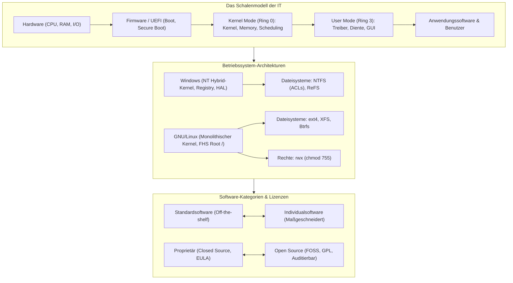

## tags: [fisi, ihk, lernsheet]

## 🧭 Navigation & Zusammenhänge
- **Vorausgesetztes Thema:** [[07_Sicherheit, Normen & Green IT]]
- **Nächstes Thema:** [[09_Software-Qualität, Testing & Künstliche Intelligenz]]
- **Verwandte Bausteine:** [[03_Busstrukturen & Bootprozess]], [[04_RAM & Massenspeicher Technologien, RAID & Dateisysteme]]
## 🎯 IHK-Prüfungsrelevanz

> [!IMPORTANT] AP01: Einrichten eines IT-gestützten Arbeitsplatzes
> 
> - **Relevanz:** Hoch
>     
> - **Fokus:** Auswahl und Installation passender Client-Betriebssysteme und -Editionen (Windows Home vs. Pro vs. Enterprise), Einrichtung von Benutzern und Zugriffsrechten (Windows NTFS-ACLs bzw. Linux `chmod`/POSIX-Rechte), Verständnis der Software-Schichten (Firmware, Treiber, Kernel) sowie Differenzierung von Lizenzmodellen.
>     

> [!WARNING] AP02: Konzeption, Administration & Netzwerke
> 
> - **Relevanz:** Hoch
>     
> - **Fokus:** Vergleich der Betriebssystem-Architekturen (Monolithischer vs. Hybrid-/Micro-Kernel), Server-Dateisysteme (NTFS, ReFS, ext4, XFS, Btrfs), Prozess-Scheduling und Speicherverwaltung (Swap/Pagefile), Evaluierung von Linux-Distributionen im Serverumfeld sowie strategische Gegenüberstellung von Standard- vs. Individualsoftware bzw. Open Source (FOSS) vs. proprietären Systemen.
>     

## 📖 Einfache Erklärung & Praxisbeispiele

Software bildet als immaterielle Komponente das Gegenstück zur physischen Hardware. Das **Betriebssystem** steuert als zentrale Vermittlungsinstanz (Systemsoftware) die Hardware-Ressourcen, führt Anwendungen aus und stellt Benutzerschnittstellen (GUI/CLI) bereit.

### Unterthemen & Anschauliche Beispiele:

- **Software-Grundlagen, Schalenmodell & Firmware:**
    
    - **Kategorisierung:** Systemsoftware (OS, Treiber), Anwendungssoftware (Office, Browser, ERP) und Entwicklungssoftware (Compiler, IDEs).
        
    - **Schalenmodell:**
        
        - _Hardware_ $\rightarrow$ _Firmware (BIOS/UEFI)_ $\rightarrow$ _Betriebssystem-Kernel (Ring 0)_ $\rightarrow$ _Systemdienste & Treiber_ $\rightarrow$ _Anwendungssoftware & User (Ring 3)_.
            
    - **Firmware (BIOS vs. UEFI):** Das veraltete BIOS (16-Bit, MBR, max. 2 TB) wurde durch **UEFI** (64-Bit, GPT, Secure Boot, GUI, Netzwerkfähigkeit vor OS-Start) abgelöst.
        
    - 💡 **Praxisbeispiel:** Ein neuer Server startet über ein UEFI mit aktivierten GPT-Partitionen und Secure Boot, um das Laden unautorisierter Rootkits während der Firmware-Phase zu verhindern.
        
- **Architektur von Betriebssystemen & Kernel-Aufgaben:**
    
    - **Aufgaben:** Zuteilung von CPU-Zeit (Scheduling), Arbeitsspeicherverwaltung (RAM & Virtueller Speicher/Swap), I/O-Steuerung, Dateisystem- & Rechtemanagement.
        
    - **Kernel-Architekturen:**
        
        - **Monolithischer Kernel:** Alle Dienste (Treiber, Dateisystem) laufen im geschützten Kernel-Space (Ring 0). Sehr schnell, aber ein fehlerhafter Treiber kann das Gesamtsystem abstürzen lassen (z. B. Linux).
            
        - **Micro-Kernel:** Nur Kernfunktionen (Scheduling, IPC) in Ring 0, Treiber laufen im User-Space (Ring 3). Extrem stabil, aber mehr Overhead.
            
        - **Hybrid-Kernel:** Kombination beider Ansätze (z. B. Windows NT).
            
    - **Memory Management & Treiber:** RAM-Adressräume werden isoliert. Läuft der RAM voll, lagert das OS Speicherseiten auf die Festplatte aus (Swapping/Pagefile). Treiber übersetzen OS-Befehle für spezifische Hardware.
        
    - 💡 **Praxisbeispiel:** Reicht der physische RAM bei einer datenbankintensiven Abfrage nicht aus, lagert das Betriebssystem in die Auslagerungsdatei (`pagefile.sys` / Swap) aus – das System bleibt stabil, wird jedoch spürbar langsamer.
        
- **Die Windows-Welt (NT-Linie & Dateisysteme):**
    
    - **Architektur:** Basiert auf dem Windows NT Hybrid-Kernel mit HAL (_Hardware Abstraction Layer_ zur Isolierung der Hardware) und zentraler **Registry** für Konfigurationen.
        
    - **Editionen:** _Home_ (Privat, ohne Domänenbeitritt/BitLocker), _Pro_ (KMU, Domäne, Gruppenrichtlinien, RDP), _Enterprise_ (Großkunden, AppLocker, DirectAccess).
        
    - **Dateisysteme:**
        
        - **NTFS:** Standard mit ACLs (Rechtevergabe), Journaling (Absturzsicherheit), EFS-Verschlüsselung und Kompression.
            
        - **ReFS (_Resilient File System_):** Modernes Server-Dateisystem, das schleichenden Datenverfall (_Bit Rot_) automatisch erkennt und repariert (nicht bootfähig).
            
    - 💡 **Praxisbeispiel:** In einer Unternehmensdomäne wird Windows 11 Pro eingesetzt, damit Admins über Gruppenrichtlinien (GPOs) zentral BitLocker aktivieren und Zugriffsrechte auf NTFS-Freigaben steuern können.
        
- **Die Linux/Unix-Welt (GNU/Linux, FHS & Rechte):**
    
    - **Linux vs. GNU/Linux:** Linux ist streng genommen nur der Kernel (von Linus Torvalds, GPL). Zusammen mit den GNU-Tools entsteht das vollständige Betriebssystem.
        
    - **Distributionen:** Debian-Familie (Ubuntu, Mint; `.deb`, `apt`), RedHat-Familie (RHEL, Fedora; `.rpm`, `dnf`).
        
    - **Filesystem Hierarchy Standard (FHS):** Keine Laufwerksbuchstaben (wie `C:`), sondern ein Verzeichnisbaum ab der Wurzel (`/`). Wichtig: `/etc` (Konfigurationen), `/var` (Variable Daten/Logs), `/home` (Benutzer), `/bin` (Programme).
        
    - **Linux Dateisysteme:** `ext4` (Standard, stabil), `XFS` (Performance bei großen Dateien, RedHat-Standard), `Btrfs` (CoW-Dateisystem mit Snapshots).
        
    - **POSIX-Rechte (`rwx`):** `r=4`, `w=2`, `x=1` auf den Ebenen _Owner_, _Group_, _Others_.
        
    - 💡 **Praxisbeispiel:** Der Befehl `chmod 755 script.sh` setzt die Rechte so, dass der Besitzer alle Rechte hat ($4+2+1=7$), während Gruppe und Andere das Skript nur lesen und ausführen dürfen ($4+1=5$).
        
- **Software-Kategorien (Lizenzen & Beschaffung):**
    
    - **Standardsoftware vs. Individualsoftware:** Standardlösungen (MS Office, SAP) sind günstig, erprobt und sofort verfügbar, passen aber nicht immer zu 100 % auf eigene Prozesse. Individualsoftware wird maßgeschneidert entwickelt, ist jedoch extrem teuer und birgt Entwickler-Abhängigkeiten.
        
    - **Proprietär (Closed Source) vs. Open Source (FOSS):**
        
        - _Proprietär:_ Quellcode geheim, Nutzung über EULA/Lizenzgebühren, Hersteller-Support (z. B. Windows).
            
        - _FOSS (Free and Open Source):_ Quellcode offen, veränderbar, frei von Vendor-Lock-in (z. B. Linux, LibreOffice).
            
    - 💡 **Praxisbeispiel:** Ein Unternehmen setzt beim Webserver auf ein kommerzielles Open-Source-Modell (Red Hat Enterprise Linux): Der Quellcode ist frei, aber RHEL liefert zertifizierten Enterprise-Support und Sicherheits-Patches gegen eine Abonnementsgebühr.

