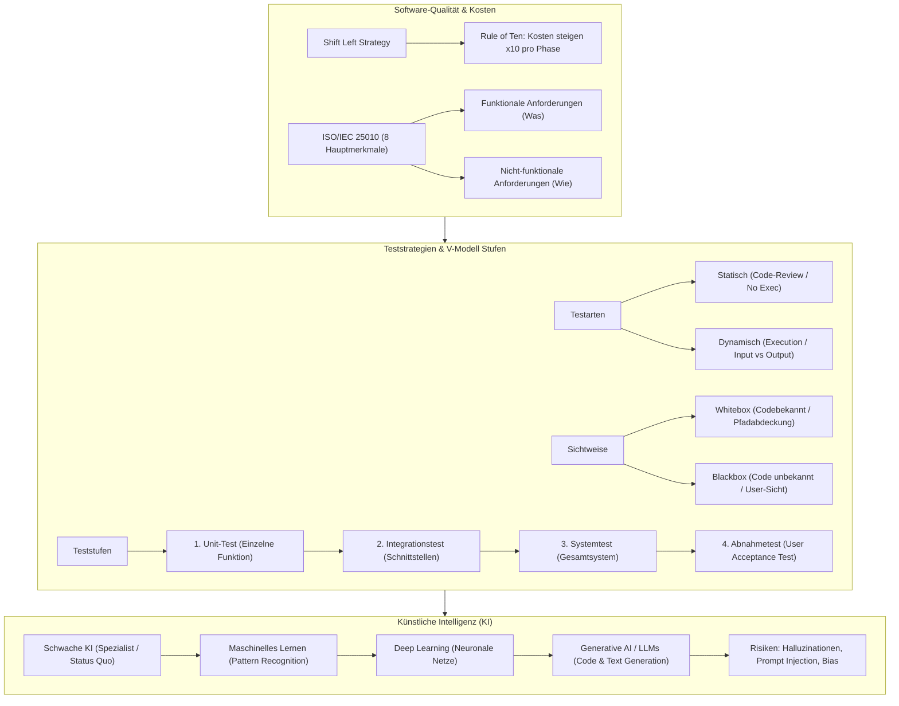

## tags: [fisi, ihk, lernsheet]

## 🧭 Navigation & Zusammenhänge
- **Vorausgesetztes Thema:** [[08_Betriebssysteme & Softwarearchitektur]]
- **Nächstes Thema:** [[10_Angebotsvergleich & Nutzwertanalyse (NWA)]]
- **Verwandte Bausteine:** [[14_Künstliche Intelligenz & Blockchain]], [[11_Prüf- und Testverfahren in der IT]]

## 🎯 IHK-Prüfungsrelevanz

> [!IMPORTANT] AP01: Einrichten eines IT-gestützten Arbeitsplatzes
> 
> - **Relevanz:** Mittel
>     
> - **Fokus:** Bewertung von Usability (Benutzbarkeit) und Barrierefreiheit nach ISO 25010, Durchführung grundlegender Abnahmetests (User Acceptance Tests) aus Anwendersicht sowie die Nutzung von KI-basierten Assistenten (z. B. Copiloten) am Arbeitsplatz unter Beachtung der IT-Sicherheit und des Datenschutzes.
>     

> [!WARNING] AP02: Konzeption, Administration & Netzwerke
> 
> - **Relevanz:** Hoch
>     
> - **Fokus:** Systematische Ableitung funktionaler und nicht-funktionaler Qualitätsanforderungen, Anwendung des ISO 25010-Qualitätsmodells im Pflichtenheft, Gegenüberstellung von Teststrategien (Whitebox/Blackbox, statisch/dynamisch), Durchlaufen von Teststufen im V-Modell sowie Risikobewertung beim Einsatz generativer KI (Halluzinationen, Prompt Injection, Bias).
>     

## 📖 Einfache Erklärung & Praxisbeispiele

Software verschleißt nicht wie physikalische Hardware, weshalb Qualitätsprobleme stets auf Spezifikations-, Design- oder Logikfehler zurückzuführen sind. Qualität muss im Lebenszyklus von Anfang an „eingebaut“ und durch strukturierte Tests sowie Normen (wie ISO 25010) nachgewiesen werden. Künstliche Intelligenz bietet dabei neuartige Möglichkeiten zur Unterstützung im IT-Alltag, bringt aber auch spezifische Risiken mit sich.

### Unterthemen & Anschauliche Beispiele:

- **Grundlagen der Software-Qualität & „Rule of Ten“:**
    
    - **Qualitätsbegriff:** Grad, in dem ein System gestellte Anforderungen und Spezifikationen erfüllt (IEEE).
        
    - **Rule of Ten (Zehnerregel):** Die Kosten für die Behebung eines Fehlers steigen exponentiell mit jeder Phase des Entwicklungszyklus. (Planung: $\text{Faktor } 1$, Entwicklung: $\text{Faktor } 10$, Test: $\text{Faktor } 100$, Produktion/Kunde: $\text{Faktor } 1000+$). Qualitätssicherung muss daher so früh wie möglich ansetzen (_Shift Left_).
        
    - **Funktionale vs. Nicht-funktionale Anforderungen:** Funktionale Anforderungen beschreiben _was_ das System tut (z. B. „Rechnung drucken“). Nicht-funktionale Anforderungen definieren _wie_ das System agiert (z. B. Antwortzeiten, Sicherheit, Erlernbarkeit). Letztere werden oft vergessen und sind Hauptursache für gescheiterte IT-Projekte.
        
    - 💡 **Praxisbeispiel:** Wird ein Architekturfehler in der Datenbankstruktur bereits während des Konzeptionstermins korrigiert, kostet dies wenige Minuten Arbeitszeit (Faktor 1). Fällt derselbe Fehler erst im laufenden Kundensystem auf, erfordert dies teure Notfall-Patches, Datenmigrationen und Ausfallentschädigungen (Faktor 1000+).
        
- **Das Qualitätsmodell ISO/IEC 25010:**
    
    - Internationaler Standard zur einheitlichen Beschreibung von Software-Qualität über **8 Hauptmerkmale**:
        
        1. **Funktionale Eignung (Functional Suitability):** Vollständigkeit, Korrektheit, Angemessenheit.
            
        2. **Leistungs-Effizienz (Performance Efficiency):** Zeitverhalten, Ressourcennutzung (CPU/RAM), Kapazität.
            
        3. **Kompatibilität (Compatibility):** Koexistenz neben anderen Programmen, Interoperabilität über Schnittstellen/APIs.
            
        4. **Benutzbarkeit (Usability):** Erlernbarkeit, Bedienbarkeit, Fehlervermeidung, Barrierefreiheit.
            
        5. **Zuverlässigkeit (Reliability):** Reife/Fehlerhäufigkeit (MTBF), Verfügbarkeit, Fehlertoleranz, Wiederherstellbarkeit.
            
        6. **Sicherheit (Security):** Vertraulichkeit, Integrität, Nicht-Abstreitbarkeit, Authentizität.
            
        7. **Wartbarkeit (Maintainability):** Modularität, Wiederverwendbarkeit, Analysierbarkeit, Testbarkeit.
            
        8. **Übertragbarkeit (Portability):** Anpassbarkeit auf andere Hardware, Installierbarkeit, Austauschbarkeit.
            
    - 💡 **Praxisbeispiel:** Ein Unternehmen fordert im Pflichtenheft für ein neues ERP-System nach ISO 25010: „Interoperabilität via REST-API“ (Kompatibilität), „Antwortzeit bei Suchanfragen $< 500\text{ ms}$ bei 200 gleichzeitigen Usern“ (Leistungs-Effizienz) sowie „Zwei-Faktor-Authentifizierung“ (Sicherheit).
        
- **Software-Testen & Teststrategien:**
    
    - **Verifikation vs. Validierung:** Verifikation fragt „Bauen wir das Produkt richtig?“ (Prüfung gegen Pflichtenheft). Validierung fragt „Bauen wir das richtige Produkt?“ (Prüfung gegen Kundenbedürfnisse).
        
    - **Statische vs. Dynamische Tests:** Statische Tests führen den Code _nicht_ aus (Code-Reviews, statische Code-Analyse). Dynamische Tests führen die Software mit Testdaten aus und vergleichen Soll-/Ist-Ergebnisse.
        
    - **Blackbox- vs. Whitebox-Tests:** Whitebox-Tests setzen Kenntnis des Quellcodes voraus (Prüfung aller Pfade/Schleifen). Blackbox-Tests prüfen ausschließlich Eingaben und Ausgaben über die Nutzerschnittstelle ohne Codekenntnis.
        
    - **Teststufen (V-Modell):** Unit-Test (Komponententest einzelner Funktionen) $\rightarrow$ Integrationstest (Prüfung von Schnittstellen) $\rightarrow$ Systemtest (Gesamtsystem in Testumgebung) $\rightarrow$ Abnahmetest (User Acceptance Test durch Kunden).
        
    - 💡 **Praxisbeispiel:** Ein Entwickler schreibt für eine Berechnungsfunktion einen automatisierten Unit-Test (Whitebox). Später führt der Kunde einen Abnahmetest durch (Blackbox), um zu prüfen, ob die Workflows in der realen Betriebsumgebung seinen Geschäftsprozessen entsprechen.
        
- **Künstliche Intelligenz (KI), ML & Generative AI:**
    
    - **Kategorisierung:** Schwache KI löst konkrete Spezialaufgaben ohne Bewusstsein (Status heute: ChatGPT, Bilderkennung). Starke KI (AGI) agiert als genereller Intellekt auf menschlichem Niveau (Science-Fiction).
        
    - **Maschinelles Lernen (ML) & Deep Learning:** Abkehr von starr programmierten Regeln. Systeme erkennen Muster aus Daten. Unterteilt in _Supervised_ (Lernen mit gelabelten Daten), _Unsupervised_ (selbstständige Strukturfindung) und _Reinforcement Learning_ (Belohnung/Bestrafung). Deep Learning nutzt vielschichtige neuronale Netze.
        
    - **Generative AI & LLMs:** Large Language Models (z. B. GPT-4) berechnen statistisch das wahrscheinlichste nächste Wort und erzeugen neue Inhalte (Code, Text, Bilder).
        
    - **Chancen & Risiken in der IT:** Chancen liegen in der Automatisierung von Routine-Code, Fehlersuche und Dokumentation. Risiken umfassen _Halluzinationen_ (überzeugend vorgetragene Falschinformationen), _Bias_ (Vorurteile in Trainingsdaten), Urheberrechtsfragen und Sicherheitslücken wie _Prompt Injection_.
        
    - 💡 **Praxisbeispiel:** Ein Fachinformatiker nutzt einen KI-Copiloten zur Generierung eines PowerShell-Skripts. Er muss den Code vor der Ausführung manuell prüfen (dynamischer Test/Review), da die KI durch eine Halluzination veraltete oder fehlerhafte Befehlsparameter eingebaut haben könnte.

