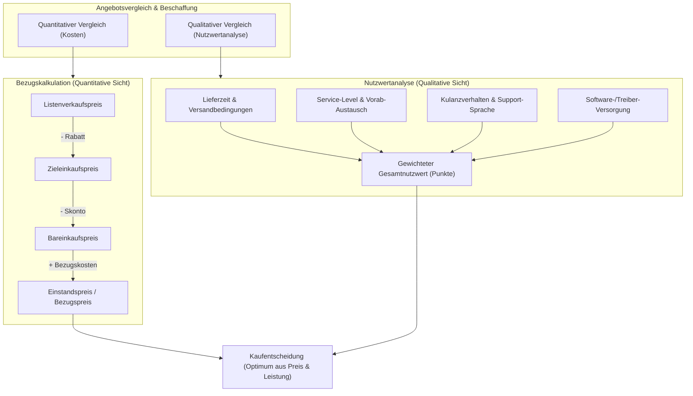

## tags: [fisi, ihk, lernsheet]

## 🧭 Navigation & Zusammenhänge
- **Vorausgesetztes Thema:** [[09_Software-Qualität, Testing & Künstliche Intelligenz]]
- **Nächstes Thema:** [[11_Beschaffungsprozess & Nutzwertanalyse (NWA)]]
- **Verwandte Bausteine:** [[11_Beschaffungsprozess & Nutzwertanalyse (NWA)]], [[15_Recht, Lizenzen & Handelskalkulation]]
## 🎯 IHK-Prüfungsrelevanz

> [!IMPORTANT] AP01: Einrichten eines IT-gestützten Arbeitsplatzes
> 
> - **Relevanz:** Mittel
>     
> - **Fokus:** Quantitative Bewertung von Lieferantenangeboten (Bezugskalkulation unter Einbeziehung von Listenpreis, Rabatt, Skonto und Bezugskosten) zur Beschaffung von Client- oder Netzwerkkomponenten.
>     

> [!WARNING] AP02: Konzeption, Administration & Netzwerke
> 
> - **Relevanz:** Hoch
>     
> - **Fokus:** Durchführung multikriterieller Entscheidungsanalysen mittels **Nutzwertanalyse (NWA)** zur Gegenüberstellung quantitativer (Kosten) und qualitativer Kriterien (Lieferzeit, Service, Kulanz, Support, Garantie) bei der Beschaffung von Server- und Rechenzentrumshardware.
>     

## 📖 Einfache Erklärung & Praxisbeispiele

Der kaufmännische **Angebotsvergleich** gliedert sich in zwei wesentliche Verfahren: die **quantitative Bezugskalkulation** (Rein rechnerischer Vergleich der Einstandspreise) und die **qualitative Nutzwertanalyse (NWA)** (Bewertung nicht-monetärer Faktoren wie Servicequalität, Kulanz, Lieferzeit und Garantien). In der Praxis entscheidet nicht zwingend das billigste Angebot, sondern das System mit dem besten Preis-Leistungs-Verhältnis und den geringsten Betriebsrisiken.

### Unterthemen & Anschauliche Beispiele:

- **Quantitativer Angebotsvergleich (Bezugskalkulation):**
    
    - **Schema der Bezugskalkulation:**
        
        $$\text{Listenpreis (brutto/netto)}$$
        
        $$- \text{Lieferrabatt}$$
        
        $$= \text{Zieleinkaufspreis}$$
        
        $$- \text{Lieferskonto}$$
        
        $$= \text{Bareinkaufspreis}$$
        
        $$+ \text{Bezugskosten (Verpackung, Versand, Fracht)}$$
        
        $$= \text{Bezugspreis (Einstandspreis)}$$
        
    - 💡 **Praxisbeispiel (Rechenbeispiel für 20 Stück Netzwerkkarten):**
        
        - **Angebot 1 (NetComponents):** $20 \times 320{,}00\text{ €} = 6.400{,}00\text{ €}$. Abzüglich $5\%$ Rabatt ($320{,}00\text{ €}$) $= 6.080{,}00\text{ €}$ Zieleinkaufspreis. Abzüglich $2\%$ Skonto ($121{,}60\text{ €}$) $= 5.958{,}40\text{ €}$ Bareinkaufspreis. Zuzüglich $45{,}00\text{ €}$ Versand $= \mathbf{6.003{,}40\text{ €}}$ Einstandspreis.
            
        - **Angebot 2 (Global-Tech Direct):** $20 \times 245{,}00\text{ €} = \mathbf{4.900{,}00\text{ €}}$ Einstandspreis (Kein Rabatt, kein Skonto, versicherter Versand frei ab 5.000 €; zzgl. Fracht falls unter Limit).
            
        - **Angebot 3 (FlexIT Solutions):** $20 \times 350{,}00\text{ €} = 7.000{,}00\text{ €}$. Abzüglich $8\%$ Projektrabatt ($560{,}00\text{ €}$) $= \mathbf{6.440{,}00\text{ €}}$ Einstandspreis (Kein Skonto, Versand kostenlos).
            
- **Qualitativer Angebotsvergleich & Nutzwertanalyse (NWA):**
    
    - **Zielsetzung:** Systematische und objektivierte Bewertung unmessbarer (qualitativer) Kriterien über Punkte und Gewichtungsfaktoren.
        
    - **Bewertungskriterien aus den vorliegenden Angeboten:**
        
        - **Lieferzeit & Versand:** FlexIT liefert sofort (Kurier/Express inklusive), NetComponents in 5 Werktagen, Global-Tech Direct benötigt 14 Werktage aus dem Ausland.
            
        - **Service & Support:** FlexIT bietet 12 Monate Vorab-Austausch (Next Business Day) und einen dedizierten Ansprechpartner. Global-Tech hat nur ein englisches Ticket-System ohne Vorab-Austausch.
            
        - **Kulanz & Risiken:** FlexIT ersetzt selbst verschuldete Schäden kulant. Global-Tech hat verspätete Treiber-Updates und keine Kulanz. NetComponents berechnet $10\%$ Wiedereinlagerungsgebühr bei Falschbestellung.
            
    - 💡 **Praxisbeispiel:** Obwohl _Global-Tech Direct_ rein rechnerisch der günstigste Anbieter ist, führt das Fehlen von Vorab-Austausch und verspäteten Treiber-Updates bei kritischer Rechenzentrumsinfrastruktur zu hohen Ausfallrisiken. Die Nutzwertanalyse zeigt, dass _FlexIT Solutions_ aufgrund des exzellenten Service trotz des höchsten Preises den höchsten Gesamtnutzwert liefert.

