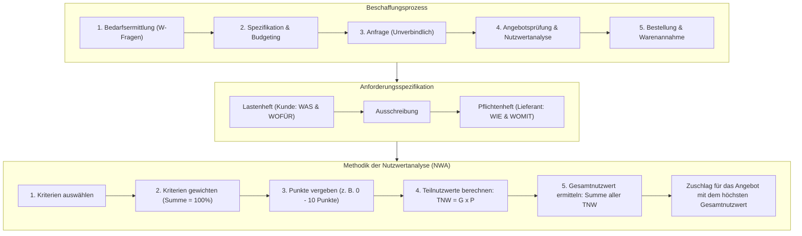

## tags: [fisi, ihk, lernsheet]

## 🧭 Navigation & Zusammenhänge
- **Vorausgesetztes Thema:** [[10_Angebotsvergleich & Nutzwertanalyse (NWA)]]
- **Nächstes Thema:** [[12_Historie der IT Entwicklung, Meilensteine & gesellschaftlicher Druck]]
- **Verwandte Bausteine:** [[10_Angebotsvergleich & Nutzwertanalyse (NWA)]], [[15_Recht, Lizenzen & Handelskalkulation]]
## 🎯 IHK-Prüfungsrelevanz

> [!IMPORTANT] AP01: Einrichten eines IT-gestützten Arbeitsplatzes
> 
> - **Relevanz:** Mittel
>     
> - **Fokus:** Formulierung strukturierter Bedarfsanforderungen (W-Fragen), Auslösen unverbindlicher Anfragen bei Lieferanten sowie Durchführung quantitativer Angebotsvergleiche (Bezugskalkulation von Hard- und Software für Arbeitsplätze).
>     

> [!WARNING] AP02: Konzeption, Administration & Netzwerke
> 
> - **Relevanz:** Hoch
>     
> - **Fokus:** Phasen des IT-Beschaffungsprozesses, präzise Abgrenzung und Erstellung von **Lastenheft** (Auftraggeber-Sicht / „WAS“) vs. **Pflichtenheft** (Auftragnehmer-Sicht / „WIE“), Erstellung eines Preisspiegels zur Vergleichbarkeit und die rechnerische Durchführung der **Nutzwertanalyse (NWA)** inkl. Gewichtungsfaktoren, Punktevergabe, Teilnutzwerten und Gesamtnutzwert zur objektiven Begründung von Investitionen.
>     

## 📖 Einfache Erklärung & Praxisbeispiele

Der kaufmännische **Beschaffungsprozess** steuert den geordneten Ablauf von der ersten Bedarfsmeldung im Unternehmen bis zur betriebsbereiten Bereitstellung von Hard- oder Software. Um teure Fehlkäufe zu vermeiden, werden die Anforderungen im **Lastenheft** und die technische Umsetzung im **Pflichtenheft** dokumentiert. Die finale Auswahl eines Lieferanten erfolgt durch die mathematische Methode der **Nutzwertanalyse (NWA)**, die neben dem reinen Preis auch qualitative „weiche“ Faktoren (z. B. Supportqualität, Lieferzeit, Garantie) in harte Kennzahlen übersetzt.

### Unterthemen & Anschauliche Beispiele:

- **Phasen des IT-Beschaffungsprozesses & Bedarfsanforderung:**
    
    - **Prozessabfolge:** Bedarfsermittlung $\rightarrow$ Spezifikation & Budgetierung $\rightarrow$ Marktanalyse & Angebotseinholung (unverbindliche Anfrage) $\rightarrow$ Angebotsprüfung & Nutzwertanalyse $\rightarrow$ Bestellung & Warenannahme.
        
    - **Bedarfsauslöser:** Ersatzbeschaffung (Defekt), Erweiterungsinvestition (neue Mitarbeiter) oder Technologiewechsel.
        
    - **Die W-Fragen:** _WAS_ wird benötigt (Typ/Qualität), _WIE VIEL_ (Menge), _WANN_ (Liefertermin), _WO_ (Einsatzort) und _WARUM_ (Begründung für das Budget).
        
    - 💡 **Praxisbeispiel:** Die Grafikabteilung meldet wegen eines Systemwechsels (Technologiewechsel) Bedarf für 10 neue CAD-Workstations an. Der IT-Einkauf prüft die W-Fragen, erstellt eine Spezifikation und holt bei drei Systemhäusern unverbindliche Angebote ein.
        
- **Lastenheft vs. Pflichtenheft:**
    
    - **Lastenheft (Anforderung / „WAS wofür?“):** Vom **Auftraggeber (Kunden)** erstellt. Beschreibt Gesamtheit der Wünsche, Ziele, Rahmenbedingungen und fachlichen Anforderungen, lässt den konkreten Lösungsweg aber offen. Bildet die Basis für die Ausschreibung.
        
    - **Pflichtenheft (Realisierung / „WIE und WOMIT?“):** Vom **Auftragnehmer (Lieferanten/IT-Dienstleister)** erstellt. Beschreibt die exakte technische Lösung, verwendete Hardware/Software und konkrete Umsetzungsschritte. Bildet die vertragliche Basis für die spätere Abnahme.
        
    - 💡 **Praxisbeispiel:**
        
        - _Lastenheft des Kunden:_ „Das neue Storage-System muss eine Speicherkapazität von $100\text{ TB}$ bieten und einen Datendurchsatz von $10\text{ Gbit/s}$ garantieren.“
            
        - _Pflichtenheft des IT-Dienstleisters:_ „Wir installieren ein NetApp-Storage-Array mit $12 \times 10\text{ TB}$ NVMe-SSDs im RAID 6 und binden es über zwei $10\text{ GbE}$-SFP+-Schnittstellen an den Core-Switch an.“
            
- **Angebotsvergleich & Vergleichbarkeit (Preisspiegel):**
    
    - **Quantitative Kriterien (Hard Facts):** Messbar in Zahlen – Einstandspreis (Listenpreis minus Rabatt/Skonto plus Bezugskosten), Lieferzeit in Tagen, Garantiedauer, Zahlungsziele.
        
    - **Qualitative Kriterien (Soft Facts):** Bewertung von Supportqualität, Sprache/Erreichbarkeit, Service-Levels (z. B. Vorab-Austausch), Kulanzverhalten, Ergonomie und Umweltzertifikaten.
        
    - **Preisspiegel:** Tabellarische Gegenüberstellung heterogener Angebote zur Herstellung einer einheitlichen Vergleichbarkeit (z. B. Umrechnung extra kostenpflichtiger Garantieversicherungen auf einen gemeinsamen TCO-Nenner).
        
    - 💡 **Praxisbeispiel:** Angebot A verlangt $1.000\text{ €}$ inkl. 5 Jahren Garantie vor Ort. Angebot B verlangt $850\text{ €}$, bietet aber nur 2 Jahre Bring-In-Garantie. Im Preisspiegel werden die Kosten für eine 3-jährige Garantieerweiterung zu Angebot B hinzugerechnet, um beide Angebote objektiv vergleichbar zu machen.
        
- **Methodik der Nutzwertanalyse (NWA):**
    
    - **Ziel:** Objektivierung von Kaufentscheidungen und Umwandlung nicht-monetärer ("weicher") Kriterien in vergleichbare Nutzwerte.
        
    - **Berechnungsschritte:**
        
        1. _Auswahl der Kriterien & Gewichtung ($G$):_ Vergabe von Gewichtungsfaktoren in Prozent (Summe $100\% = 1{,}0$).
            
        2. _Punktevergabe ($P$):_ Bewertung jedes Anbieters je Kriterium auf einer definierten Skala (z. B. $0$ bis $10$ Punkte oder $1$ bis $5$).
            
        3. _Berechnung der Teilnutzwerte ($TNW$):_
            
            $$\text{Teilnutzwert } (TNW) = \text{Gewichtung } (G) \times \text{Punkte } (P)$$
            
        4. _Ermittlung des Gesamtnutzwerts ($GNW$):_ Addition aller Teilnutzwerte per Anbieter. Das Angebot mit der höchsten Summe gewinnt den Zuschlag.
            
    - **Vortrag & Kritik (Pro / Contra):**
        
        - _Vorteile:_ Transparenz, Nachvollziehbarkeit bei Team-Entscheidungen, klärt Kernanforderungen.
            
        - _Nachteile:_ Subjektivität bei Gewichtung und Punktevergabe, Gefahr der Scheingenauigkeit durch Kommastellen.
            
    - 💡 **Praxisbeispiel (NWA-Musterrechnung für zwei Server-Angebote):**
        

|**Kriterium**|**Gewichtung (G)**|**Punkte Anb. A (PA​)**|**TNW Anb. A (G×PA​)**|**Punkte Anb. B (PB​)**|**TNW Anb. B (G×PB​)**|
|---|---|---|---|---|---|
|**Preis / TCO**|$40\% \:(0{,}4)$|$4$|$0{,}4 \times 4 = 1{,}6$|$8$|$0{,}4 \times 8 = 3{,}2$|
|**Lieferzeit**|$20\% \:(0{,}2)$|$9$|$0{,}2 \times 9 = 1{,}8$|$3$|$0{,}2 \times 3 = 0{,}6$|
|**Service & Support**|$30\% \:(0{,}3)$|$10$|$0{,}3 \times 10 = 3{,}0$|$2$|$0{,}3 \times 2 = 0{,}6$|
|**Garantiedauer**|$10\% \:(0{,}1)$|$8$|$0{,}1 \times 8 = 0{,}8$|$5$|$0{,}1 \times 5 = 0{,}5$|
|**Gesamtnutzwert**|**$100\% \:(1{,}0)$**||**$\mathbf{7{,}2}$ (Sieger)**||**$\mathbf{4{,}9}$**|

Anbieter A gewinnt trotz des höheren Preises mit $7{,}2$ Punkten den Zuschlag, da der herausragende Service und die schnelle Lieferzeit die Preisdifferenz überwiegen.

