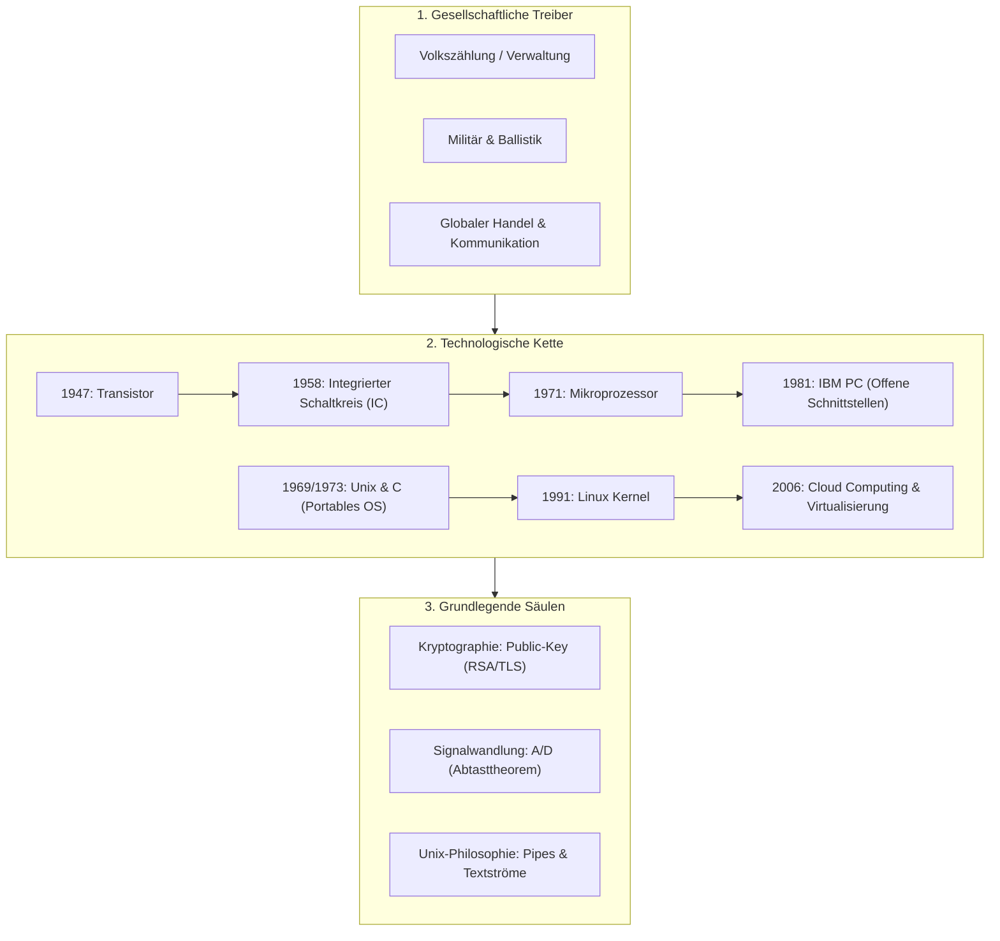

## tags: [fisi, ihk, lernsheet]

## 🧭 Navigation & Zusammenhänge
- **Vorausgesetztes Thema:** [[11_Beschaffungsprozess & Nutzwertanalyse (NWA)]]
- **Nächstes Thema:** [[13_Lebensbegleitendes Lernen & Personal Knowledge Management (PKM)]]
- **Verwandte Bausteine:** [[14_Künstliche Intelligenz & Blockchain]], [[01_Einführung_Allgemeine_BWL]]

## 🎯 IHK-Prüfungsrelevanz

> [!IMPORTANT] AP01: Einrichten eines IT-gestützten Arbeitsplatzes
> 
> - **Relevanz:** Mittel
>     
> - **Fokus:** Verständnis historischer Schnittstellen-Standards, Entstehung des Personal Computers (IBM PC ab 1981), Signalwandlung bei Peripheriegeräten (A/D-Wandlung für Audio/Video) sowie grundlegende Unix/Linux-Rechte und Verzeichnisstrukturen am Arbeitsplatz.
>     

> [!WARNING] AP02: Konzeption, Administration & Netzwerke
> 
> - **Relevanz:** Hoch
>     
> - **Fokus:** Grundprinzipien der Kryptographie (Symmetrische vs. Asymmetrische Verfahren, Diffie-Hellman, RSA, TLS), Evolution von Betriebssystemen (Unix-Philosophie, C-Portabilität, POSIX), physikalisch-technische Grundlagen der Signalübertragung (Abtasttheorem von Nyquist-Shannon, Aliasing, Datenratenberechnung) sowie historische Netzisentwicklungen (ARPANET, Umstellung auf TCP/IP 1983).
>     

## 📖 Einfache Erklärung & Praxisbeispiele

Informationstechnologie (IT) entstand nicht aus reiner technischer Neugier, sondern als direkte Antwort auf drängende gesellschaftliche, kaufmännische, administrative und militärische Herausforderungen. Bereits analoge Ordnungssysteme wie Karteikarten (Datensätze), Karteischränke (Tabellen) und Namens-/Straßenregister (Indizes) bildeten die logischen Grundlagen moderner relationaler Datenbanken, bevor Computer sie um ein Vielfaches beschleunigten.

### Unterthemen & Anschauliche Beispiele:

- **Gesellschaftlicher Druck als Innovationsmotor:**
    
    - **Verwaltung & Bevölkerungswachstum:** Die US-Volkszählung von 1880 dauerte von Hand ca. 8 Jahre. Durch den Einsatz von Herman Holleriths Lochkartenmaschinen reduzierte sich die Auswertungszeit 1890 auf gut 1 Jahr (woraus 1924 IBM hervorging).
        
    - **Militär & Kryptographie:** Der Zweite Weltkrieg erzwang die Erfindung programmierbarer elektronischer Rechenanlagen zur Dekodierung von Funksprüchen (z. B. _Colossus_ gegen die Lorenz-Chiffre, _Bombe_ gegen Enigma) und zur Ballistik-Berechnung (_ENIAC_).
        
    - 💡 **Praxisbeispiel:** Wenn im Systemhaus Kundendaten in ein ERP-System eingepflegt werden, beruht die Tabellenstruktur auf Grundprinzipien, die Ende des 19. Jahrhunderts für manuelle Lochkartenstanzer entwickelt wurden, um Millionen Bürger effizient zu verwalten.
        
- **Meilenstein 1: Kryptographie & Public-Key-Verfahren:**
    
    - **Kerckhoffs’ Prinzip:** Die Sicherheit eines kryptographischen Systems darf nicht auf der Geheimhaltung des Verfahrens beruhen, sondern ausschließlich auf der Geheimhaltung des Schlüssels.
        
    - **Symmetrisches Dilemma:** Bei symmetrischer Verschlüsselung (z. B. Enigma) müssen beide Parteien denselben Schlüssel vorab sicher austauschen. Bei $n$ Teilnehmern sind $n(n-1)/2$ Schlüssel erforderlich – im globalen Internet unmöglich.
        
    - **Asymmetrische Verschlüsselung (Public Key):** Diffie-Hellman (1976) und RSA (1977) lösten das Problem über ein Schlüsselpaar: Der _Public Key_ verschlüsselt, der _Private Key_ entschlüsselt. Grundlage für TLS 1.2/1.3 im Web.
        
    - 💡 **Praxisbeispiel:** Beim Aufruf einer Online-Banking-Webseite (`https://`) verhandeln Browser und Server über ein asymmetrisches Verfahren (RSA/Diffie-Hellman) einen einmaligen symmetrischen Sitzungsschlüssel, ohne dass sich die Parteien jemals zuvor begegnen oder Schlüssel austauschen mussten.
        
- **Meilenstein 2: Unix-Philosophie & Portabilität:**
    
    - **Portabilität durch C (1972/1973):** Vor Unix war jedes Betriebssystem in Assembler/Maschinensprache für eine spezifische Hardware geschrieben. Durch die Neuentwicklung von Unix in der Programmiersprache C musste für neue Rechnerarchitekturen nur noch der C-Compiler angepasst werden.
        
    - **Unix-Philosophie:** (1) Schreibe Programme, die eine Sache gut tun. (2) Lasse Programme zusammenarbeiten, indem Ausgaben zu Eingaben werden (Pipes). (3) Verarbeite Textströme als universelle Schnittstelle.
        
    - 💡 **Praxisbeispiel:** Ein Administrator filtert, sortiert und zählt Fehler in einer Logdatei auf der Linux-Kommandozeile durch Verkettung von drei unabhängigen Werkzeugen: `cat access.log | grep "500" | wc -l`.
        
- **Meilenstein 3: Signalwandlung (A/D- & D/A-Wandler):**
    
    - **Die Brücke zur analogen Welt:** Rechner verarbeiten ausschließlich diskrete Zahlen; die reale Welt besteht aus kontinuierlichen analogen Signalen (Schall, Licht, Spannung).
        
    - **Nyquist-Shannon-Abtasttheorem:** Die Abtastrate ($f_{s}$) muss **mehr als doppelt so hoch** sein wie die höchste zu erfassende Frequenz ($f_{max}$) der analogen Quelle:
        
        $$f_{s} > 2 \cdot f_{max}$$
        
    - **Aliasing:** Wird eine analoge Welle zu selten abgetastet, entsteht im digitalen Ergebnis eine Phantomsignalfrequenz, die in der Realität nie existierte (z. B. Moiré-Muster bei Kameras, sich rückwärts drehende Räder im Film).
        
    - **Berechnung der Datenrate (Audio-CD-Standard):**
        
        $$\text{Abtastrate: } 44{,}1\text{ kHz} \quad \vert{} \quad \text{Bit-Tiefe: } 16\text{ Bit} \quad \vert{} \quad \text{Kanäle: } 2 \text{ (Stereo)}$$
        
        $$\text{Datenrate} = 44.100\text{ Hz} \cdot 16\text{ Bit} \cdot 2 = 1.411.200\text{ Bit/s} \approx 1{,}41\text{ Mbit/s} \quad (\approx 10{,}5\text{ MB/Minute})$$
        
    - 💡 **Praxisbeispiel:** Da das menschliche Gehör Frequenzen bis ca. $20\text{ kHz}$ wahrnimmt, nutzt die Audio-CD eine Abtastrate von $44{,}1\text{ kHz}$ (inkl. Reserve für analoge Tiefpassfilter), um Aliasing-Effekte zu verhindern.

