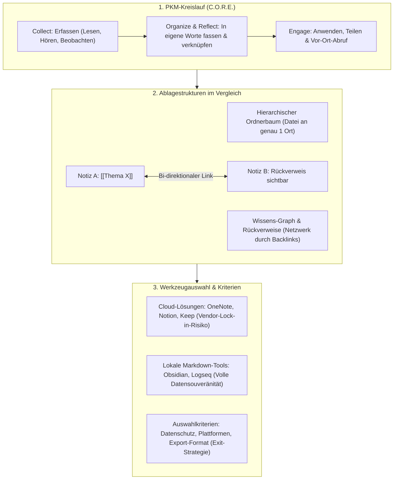

## tags: [fisi, ihk, lernsheet]

## 🧭 Navigation & Zusammenhänge
- **Vorausgesetztes Thema:** [[12_Historie der IT Entwicklung, Meilensteine & gesellschaftlicher Druck]]
- **Nächstes Thema:** [[14_Künstliche Intelligenz & Blockchain]]
- **Verwandte Bausteine:** [[03_Lernmethoden_Wissensmanagement]], [[08_Kundenberatung und Marketing in der IT]]
## 🎯 IHK-Prüfungsrelevanz

> [!IMPORTANT] AP01: Einrichten eines IT-gestützten Arbeitsplatzes
> 
> - **Relevanz:** Mittel
>     
> - **Fokus:** Dokumentation gelöster Fehler und Konfigurationen am Arbeitsplatz zur Vermeidung von Doppelarbeit, Auswahl und kaufmännische Bewertung integrierter Notizwerkzeuge (z. B. Microsoft OneNote im Firmenumfeld), Beachtung von Datenexport-Formaten und Vermeidung von Lock-in-Effekten.
>     

> [!WARNING] AP02: Konzeption, Administration & Netzwerke
> 
> - **Relevanz:** Hoch
>     
> - **Fokus:** Strategien zum Wissensmanagement im IT-Betrieb, Unterscheidung von hierarchischen Ordnerstrukturen vs. graphbasierten Netzwerken (Wissens-Graph, Rückverweise/Backlinks), Gewährleistung von Datenschutz und lokaler Datensouveränität (Cloud vs. Lokale Ablage) sowie die systematische Dokumentation technischer Lösungsansätze in der Systemintegration.
>     

## 📖 Einfache Erklärung & Praxisbeispiele

Aufgrund des rasanten technologischen Fortschritts und des schnellen Wissensverfalls in der IT-Branche ist **lebensbegleitendes Lernen** keine freiwillige Option, sondern eine berufliche Notwendigkeit. **Personal Knowledge Management (PKM)** bildet dabei das strukturelle System, um Erlerntes, Dokumentationen und Problemlösungen geordnet zu erfassen, zu verarbeiten und nachhaltig auffindbar zu machen („Wissen, das man nicht wiederfindet, hat man nicht“).

### Unterthemen & Anschauliche Beispiele:

- **Lebensbegleitendes Lernen & Wissenstransfer:**
    
    - **Umschichtung der Lernphase:** Während in der Industriegesellschaft ein Beruf einmalig erlernt wurde, erfordert die moderne Wissensgesellschaft das kontinuierliche Selbststudium im laufenden Arbeitsalltag.
        
    - **Lernmethodik:** Regelmäßige, kleine Lerneinheiten (Spaced Repetition / Verteiltes Wiederholen) schlagen lange, unregelmäßige Einmal-Sitzungen deutlich in der Langzeitretention.
        
    - 💡 **Praxisbeispiel:** Ein Systemintegrator reserviert täglich 15 Minuten zur Reflexion und Lektüre neuer Sicherheits-Bulletins, statt sich einmal im Jahr einen Tag lang durch alle Release Notes zu arbeiten.
        
- **Grundprinzipien des Personal Knowledge Management (PKM):**
    
    - **Der C.O.R.E.-Kreislauf (Collect, Organize, Reflect, Engage):** Erfassen von Inputs (Notizen, Links) $\rightarrow$ Einordnen und Verknüpfen in eigene Worte $\rightarrow$ Bewerten und Hinterfragen $\rightarrow$ Anwenden im Betriebsalltag oder Weitergeben an Kollegen.
        
    - **Typische Fehler:** Zu komplexe Ordner- und Tag-Strukturen (Pflegeaufwand), fehlende Durchsicht (Datenfriedhof) oder die Verwechslung von Werkzeugauswahl mit echtem Lernen.
        
    - 💡 **Praxisbeispiel:** Nach der Behebung eines komplexen Routing-Fehlers schreibt ein Administrator die Ursache und Befehle kurz in eigenen Worten auf. Wenn der Fehler Monate später erneut auftritt, spart das Nachschlagen in der eigenen Lösung Stundensuchen im Netz.
        
- **Werkzeugkategorien & Kriterien zur Softwareauswahl:**
    
    - **SaaS- & Proprietaere Cloud-Tools:** Microsoft OneNote (tief im M365-Ökosystem, unstrukturierte Leinwand), Notion (All-in-One-Datenbanken, hoher Anpassungsaufwand), Apple Notes / Google Keep (Schnelle Zettel, herstellergebunden).
        
    - **Lokale & Dateibasierte Werkzeuge:** Obsidian, Logseq, Joplin. Speichern Notizen als plain-text Markdown-Dateien lokal auf der eigenen Festplatte.
        
    - **Kritische Auswahlfragen:** 1. _Datenschutz/Cloud:_ Wo liegen die Daten und wer liest mit? 2. _Ausstieg/Export:_ In welchem offenen Format erhält man seine Notizen bei einem Wechsel zurück (Vendor-Lock-in)?
        
    - 💡 **Praxisbeispiel:** Ein Unternehmen entscheidet sich aus Datenschutz- und Compliance-Gründen gegen Notion und nutzt für technische Dokumentationen lokal gehostete Markdown-Dateien via Obsidian, um die volle Kontrolle über die Betriebsgeheimnisse zu behalten.
        
- **Vom Ordnerbaum zum Wissens-Graph (Netzwerk-Architektur):**
    
    - **Ordnerbaum (Hierarchisch):** Jede Datei muss an genau _einem_ Ort liegen. Führt bei fächerübergreifenden Themen zu Dubletten oder falscher Ablage.
        
    - **Wissens-Graph & Rückverweise (Bi-directional Links / Zettelkasten):** Jede Notiz ist ein Knotenpunkt im Netz. Links zwischen Notizen (z. B. `[[Thema]]`) erzeugen automatisch Rückverweise (_Backlinks_), sodass Beziehungen in beide Richtungen sichtbar werden, ohne dass eine feste Ordnerstruktur im Voraus geplant werden muss.
        
    - 💡 **Praxisbeispiel:** Eine Notiz zum Thema `[[USV-Anlagen]]` wird in einer Notiz zu `[[Serverraum-Planung]]` verlinkt. Ruft man später die Notiz zu `[[USV-Anlagen]]` auf, sieht man automatisch über die Rückverweise, in welchen Projekten und Räumen diese USV eingeplant wurde.

