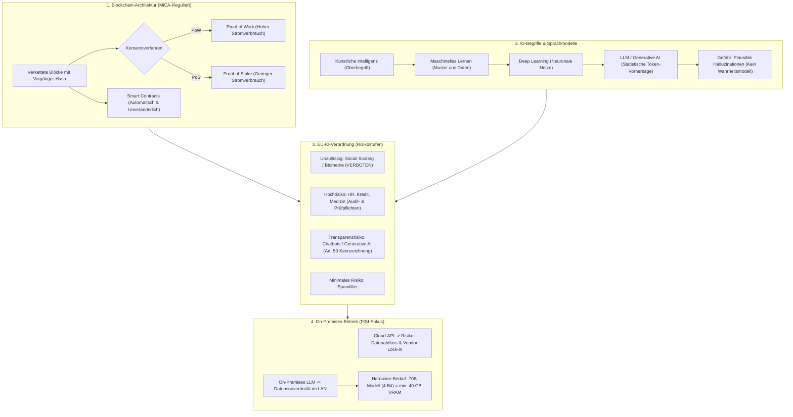

## tags: [fisi, ihk, lernsheet]

## 🧭 Navigation & Zusammenhänge
- **Vorausgesetztes Thema:** [[13_Lebensbegleitendes Lernen & Personal Knowledge Management (PKM)]]
- **Nächstes Thema:** [[15_Recht, Lizenzen & Handelskalkulation]]
- **Verwandte Bausteine:** [[09_Software-Qualität, Testing & Künstliche Intelligenz]], [[12_Historie der IT Entwicklung, Meilensteine & gesellschaftlicher Druck]]
## 🎯 IHK-Prüfungsrelevanz

> [!IMPORTANT] AP01: Einrichten eines IT-gestützten Arbeitsplatzes
> 
> - **Relevanz:** Mittel
>     
> - **Fokus:** Sichere Nutzung und Implementierung von KI-Tools am Arbeitsplatz (Einrichtung persönlicher Zugänge, Richtlinien zur Vermeidung von Datenabfluss), Einhaltung von Transparenzpflichten beim Einsatz von Chatbots/KI-Generatoren (EU-KI-Verordnung Art. 50) sowie Verständnis für überzeugende Halluzinationen und Fehlerquellen in KI-generierten Inhalten.
>     

> [!WARNING] AP02: Konzeption, Administration & Netzwerke
> 
> - **Relevanz:** Hoch
>     
> - **Fokus:** Systemintegration und On-Premises-Betrieb lokaler Open-Source-LLMs (Hardware-Dimensionierung, VRAM/GPU-Bedarf, Quantisierung), Beurteilung von Cloud vs. On-Prem-Architekturen unter DSGVO & Datenschutzaspekten, rechtliche Einordnung von KI-Systemen nach der EU-KI-Verordnung (Risikoklassen & Stufenplan) sowie technische und kaufmännische Evaluation von Blockchain-/Smart-Contract-Systemen (Vertrauensfreie Konsensmechanismen, MiCA-Regulierung).
>     

## 📖 Einfache Erklärung & Praxisbeispiele

Moderne IT-Landschaften erfordern eine fundierte, entzauberte Beurteilung von Zukunftstechnologien. Während die **Blockchain** eine verteilt geführte, unveränderliche Datenbank zur herstellerunabhängigen Konsensfindung zwischen einander fremden Parteien darstellt, basiert **Künstliche Intelligenz (KI)** im Kern auf statistischer Mustererkennung und Wahrscheinlichkeitsberechnung (ohne eigenes Verständnis von Wahrheit).

### Unterthemen & Anschauliche Beispiele:

- **Blockchain: Konsens, Transparenz & Mythen:**
    
    - **Funktionsweise:** Eine dezentral verteilte Datenbank (_Distributed Ledger_), bei der jeder Block den Hashwert seines Vorgängers trägt. Eine nachträgliche Manipulation wird durch die Verkettung unmöglich bzw. sofort von allen anderen Nodes als ungültig abgewiesen.
        
    - **Konsensverfahren:**
        
        - _Proof of Work (PoW):_ Einigung über aufwendig eingesetzte Rechenleistung (sehr hoher Energiebedarf; z. B. Bitcoin).
            
        - _Proof of Stake (PoS):_ Einigung gewichtet nach hinterlegtem Guthaben (extrem geringer Energiebedarf; z. B. Ethereum).
            
    - **Mythen vs. Realität:** Blockchain ist **pseudonym, nicht anonym** – alle Transaktionen sind in der öffentlichen Kette dauerhaft einsehbar. Transaktionen sind unwiderruflich.
        
    - **Smart Contracts:** Automatisch ausführender Programmcode auf der Blockchain. Sie sind unveränderlich, bieten jedoch keine juristische Garantie für inhaltliche Richtigkeit oder Haftung bei Code-Fehlern.
        
    - **Regulierung:** In der EU gilt seit 2024 die **MiCA-Verordnung** (_Markets in Crypto-Assets_).
        
    - 💡 **Praxisbeispiel:** Wenn drei voneinander unabhängige Logistikunternehmen und eine Zollbehörde eine gemeinsame, fälschungssichere Historie über Kühlketten-Daten benötigen, ohne dass eine Partei die alleinige Serverhoheit besitzt, ist eine Blockchain sinnvoll. Sobald jedoch ein Unternehmen die alleinige Datenhoheit hat, ist eine klassische relationale Datenbank drastisch schneller, günstiger und effizienter.
        
- **Künstliche Intelligenz (KI): Begrifflichkeiten & Funktionsweise:**
    
    - **Begriffsabgrenzung:**
        
        - _Künstliche Intelligenz (KI):_ Oberbegriff für die Automatisierung intelligenten Verhaltens (auch regelbasierte Systeme ohne Lernfähigkeit).
            
        - _Maschinelles Lernen (ML):_ Teilgebiet; Algorithmen lernen selbstständig Muster aus Beispieldaten, anstatt starr programmiert zu werden.
            
        - _Deep Learning (DL):_ Teilbereich von ML mit tief geschichteten künstlichen neuronalen Netzen.
            
    - **Sprachmodelle (LLMs):** LLMs sind **statistische Vorhersagemaschinen** – sie berechnen fortlaufend das mathematisch wahrscheinlichste nächste Textstück (_Next-Token-Prediction_).
        
    - **Das Halluzinations-Problem:** Ein LLM hat **kein Modell der Wahrheit**. Es erzeugt ausschließlich plausibel klingende Texte. Falsche Antworten oder frei erfundene Quellen sehen daher genauso überzeugend aus wie korrektes Fachwissen.
        
    - 💡 **Praxisbeispiel:** Ein Anwender bittet ein LLM um die Zusammenfassung einer langen Logdatei; das Modell liefert in Sekunden hervorragende Muster-Analysen (Eignung). Bittet man es jedoch, exakt zu zählen, wie oft der Fehler "Code 500" vorkommt, scheitert das LLM verlässlich und erfand im Test eine plausibel wirkende Zahl (Sicherheitsrisiko).
        
- **Die EU-KI-Verordnung (AI Act) & Fristen:**
    
    - Verordnung (EU) 2024/1689 teilt KI-Systeme in **vier Risikostufen** ein:
        
        1. _Unzulässiges Risiko (Verboten):_ Soziales Scoring, biometrische Echtzeit-Identifizierung im öffentlichen Raum.
            
        2. _Hohes Risiko (Hochrisiko):_ HR/Bewerberauswahl, Kreditwürdigkeit, kritische Infrastrukturen, Medizin. Unterliegt strengen Registrierungs-, Transparenz- und Audit-Pflichten.
            
        3. _Spezifisches Transparenzrisiko:_ Chatbots, Deepfakes, KI-generierte Texte/Bilder (Transparenz- & Kennzeichnungspflicht nach Art. 50).
            
        4. _Minimales/Geringes Risiko:_ Videospiele, Spam-Filter (keine Sonderauflagen).
            
    - **Wichtige Fristen:** Inkrafttreten im August 2024; Verbote & Pflicht zur KI-Kompetenz der Beschäftigten seit **Februar 2025**; Allgemeine Anwendbarkeit & Transparenzpflichten seit **August 2026**.
        
    - 💡 **Praxisbeispiel:** Nutzt eine Personalabteilung eine eingekaufte KI-Software zur automatischen Vorsortierung von Bewerbungen, handelt es sich rechtlich um ein **Hochrisiko-System**. Das Unternehmen haftet selbst vollumfänglich für die Einhaltung der KI-Verordnung und kann sich nicht auf den Softwarehersteller ausreden.
        
- **KI im IT-Betrieb: Datensicherheit, On-Premises & Integration:**
    
    - **Datenschutz & Cloud-Risiken:** Bei Nutzung externer Cloud-APIs verlassen sensible Eingaben, Dokumente und personenbezogene Daten das Unternehmen. Trainingsdaten lassen sich nach dem Einspeisen nicht mehr selektiv löschen.
        
    - **On-Premises-Self-Hosting (Aufgabe der Systemintegration):** Der lokale Betrieb eigener Open-Source-Modelle (z. B. via Hugging Face/Llama) stellt die Datensouveränität sicher.
        
    - **Hardware-Dimensionierung für lokale Modelle:**
        
        - Ein quantisiertes Modell mit 70 Milliarden Parametern (auf 4-Bit geschrumpft) benötigt reine $35\text{ GB}$ VRAM allein für die Parameter ($70 \text{ Mrd.} \times 0{,}5\text{ Byte}$).
            
        - Inklusive Kontextfenster und Verwaltungs-Overhead werden ca. **$40\text{ GB}$ VRAM (Grafikspeicher)** benötigt (z. B. Enterprise-GPUs wie NVIDIA A100/H100 oder mehrere gekoppelte RTX-Karten).
            
    - **Aktionsplan für den Betrieb:** (1) Regeln für Datenklassen definieren, (2) Einzellizenzen/Einzelsign-Ons zur Nachvollziehbarkeit nutzen, (3) Zentrale Tool-Freigabe erzwingen, (4) Schulung zu halluzinierten Fehlern durchführen, (5) KI-Verantwortlichen benennen.
        
    - 💡 **Praxisbeispiel:** Um Betriebsgeheimnisse zu schützen, richtet ein FISI einen lokalen Inference-Server mit einem 70B-Modell auf einem Server mit $48\text{ GB}$ VRAM ein. Der Datenverkehr bleibt vollständig im internen LAN, wodurch Datenschutz und Geschäftsgeheimnisse gewahrt bleiben.

