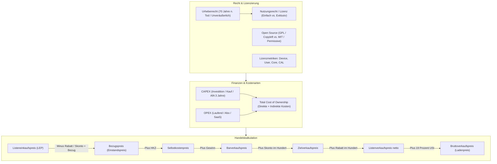

## tags: [fisi, ihk, lernsheet]

## 🧭 Navigation & Zusammenhänge
- **Vorausgesetztes Thema:** [[14_Künstliche Intelligenz & Blockchain]]
- **Nächstes Thema:** [[01_Fachbezogenes Rechnen & Digitaltechnik]]
- **Verwandte Bausteine:** [[10_Angebotsvergleich & Nutzwertanalyse (NWA)]], [[06_Kalkulation, Preisbildung & IT-Stundensatz]]
## 🎯 IHK-Prüfungsrelevanz

> [!IMPORTANT] AP01: Einrichten eines IT-gestützten Arbeitsplatzes
> 
> - **Relevanz:** Hoch
>     
> - **Fokus:** Rechte- und Lizenzkonforme Beschaffung sowie Auswahl korrekter Lizenzmetriken (Device vs. User License) für Arbeitsplatz-PCs, Verständnis von EULA-Bestimmungen, Nutzungsrechten und Gebrauchtsoftware.
>     

> [!WARNING] AP02: Konzeption, Administration & Netzwerke
> 
> - **Relevanz:** Hoch
>     
> - **Fokus:** Lizenzierung im Serverumfeld (Pro Core, Pro CPU, CALs), betriebswirtschaftliche Bewertung von CAPEX vs. OPEX (Abo/SaaS vs. Kauf/Perpetual), Total Cost of Ownership (TCO), AfA-Abschreibungssätze (3 Jahre für IT-Hardware/Standardsoftware) sowie fehlerfreie Durchführung der **Handelskalkulation (Vorwärts- und Rückwärtskalkulation im/vom Hundert)**.
>     

## 📖 Einfache Erklärung & Praxisbeispiele

Als immaterielles Wirtschaftsgut verschleißt Software nicht physisch und lässt sich unbegrenzt digital vervielfältigen. Der Schutz erfolgt in Deutschland automatisch über das **Urheberrecht** ($70\text{ Jahre}$ nach Tod des Schöpfers; nicht verkaufbar). Der Kunde erwirbt beim Kauf lediglich ein definiertes **Nutzungsrecht (Lizenz)**. Neben rechtlichen Rahmenbedingungen und Lizenzarten erfordert der IT-Vertrieb exakte betriebswirtschaftliche Berechnungen (TCO, AfA) sowie die kaufmännische **Handelskalkulation** zur Ermittlung profitabler Verkaufspreise.

### Unterthemen & Anschauliche Beispiele:

- **Rechtliche Rahmenbedingungen (Urheberrecht, Patent, Erschöpfungsgrundsatz):**
    
    - **Urheberrecht vs. Patentrecht:** Das Urheberrecht schützt Quellcode automatisch ohne Registrierung als Sprachwerk. Patente schützen dagegen technische Erfindungen (in der EU für reine Software ausgeschlossen; nur zulässig bei computerimplementierten Erfindungen wie ABS-Steuerungen).
        
    - **Nutzungsrecht (Lizenz):** Einfaches (Gleichzeitige Nutzung durch andere möglich) vs. ausschließliches Nutzungsrecht (Exklusivnutzung).
        
    - **Erschöpfungsgrundsatz (Gebrauchtsoftware):** Nach der Erstveräußerung durch den Hersteller innerhalb der EU ist der Weiterverkauf von Gebrauchtsoftware legal (EuGH-Urteil), sofern die eigene Kopie gelöscht wird.
        
    - 💡 **Praxisbeispiel:** Ein Unternehmen kauft gebrauchte Windows Server-Lizenzen von einem Fachhändler für Gebrauchtsoftware. Der Kauf ist legal, da der Erschöpfungsgrundsatz greift und der Verkäufer nachweislich seine Installationen gelöscht hat.
        
- **Lizenzierungsmodelle & Lizenzmetriken:**
    
    - **EULA (_End User License Agreement_):** Vertrag zwischen Hersteller und Endkunde über Nutzungsbedingungen.
        
    - **Open Source Lizenzen (FOSS):** _Copyleft (GPL)_ verpflichtet dazu, abgeleitete Werke ebenfalls unter GPL zu veröffentlichen („virale Lizenz“). _Permissive Lizenzen (MIT, Apache)_ erlauben die Einbindung in geschlossene, proprietäre Software.
        
    - **Lizenzmetriken:**
        
        - _Device License:_ Lizenz gilt pro Gerät (z. B. PCs im Schichtbetrieb).
            
        - _User License (Named User):_ Lizenz gilt pro Person (ideal bei mehreren Geräten pro Nutzer).
            
        - _Floating / Concurrent User:_ Lizenzierung nach parallelen Zugriffen.
            
        - _Server-Lizenzierung:_ Pro Core (Mindestanzahl Cores beachten, z. B. min. 16 Cores bei Windows Server) plus _CALs (Client Access Licenses)_ pro zugreifendem User oder Gerät.
            
    - 💡 **Praxisbeispiel:** Für eine Server-Infrastruktur mit 24 CPU-Kernen beschafft das IT-Team Lizenzen für 24 Cores sowie 50 User-CALs, da 50 Mitarbeiter flexibel von Notebooks und Smartphones zugreifen.
        
- **Kostenarten, TCO, CAPEX vs. OPEX & AfA:**
    
    - **CAPEX (_Capital Expenditures_):** Einmalige Investitionsausgaben in Anlagevermögen (z. B. Serverkauf), Kauflizenz (_Perpetual_), Bilanzaktivierung mit Abschreibung über AfA-Tabelle ($3\text{ Jahre}$ für PCs, Server und Standardsoftware in DE).
        
    - **OPEX (_Operational Expenditures_):** Laufende Betriebsausgaben (z. B. Cloud-Abo/SaaS, Miete, Strom), sofort steuerlich absetzbar.
        
    - **Total Cost of Ownership (TCO):** Ganzheitliche Lebenszykluskosten aus direkten (Kauf) und indirekten Kosten (Strom, Kühlung, Wartung, Support, Downtime).
        
    - 💡 **Praxisbeispiel:** Drucker A kostet $200\text{ €}$ (Kauf) und $0{,}03\text{ €}$ pro Seite. Drucker B kostet $500\text{ €}$ und $0{,}01\text{ €}$ pro Seite. Bei $20.000\text{ Seiten}$ beträgt die TCO von A $800\text{ €}$ ($200 + 600$), während B trotz höherer Anschaffung mit $700\text{ €}$ ($500 + 200$) günstiger ist.
        
- **Handelskalkulation (Vorwärts- und Rückwärtskalkulation):**
    
    - **Stufenweise Vorwärtskalkulation:**
        
        $$\text{Listeneinkaufspreis (LEP)}$$
        
        $$- \text{Lieferrabatt } (\text{vom Hundert})$$
        
        $$= \text{Zieleinkaufspreis (ZEP)}$$
        
        $$- \text{Lieferskonto } (\text{vom Hundert})$$
        
        $$= \text{Bareinkaufspreis (BEP)}$$
        
        $$+ \text{Bezugskosten (Fracht/Verpackung)}$$
        
        $$= \mathbf{\text{Bezugspreis / Einstandspreis}}$$
        
        $$+ \text{Handlungskostenzuschlag (HKZ in \% vom Bezugspreis)}$$
        
        $$= \text{Selbstkostenpreis}$$
        
        $$+ \text{Gewinnzuschlag (in \% von den Selbstkosten)}$$
        
        $$= \text{Barverkaufspreis}$$
        
        $$+ \text{Kundenskonto } (\mathbf{\text{im Hundert!}} \Rightarrow \text{Wert} = \frac{\text{Betrag} \cdot 100}{100 - \text{Skontosatz}})$$
        
        $$= \text{Zielverkaufspreis}$$
        
        $$+ \text{Kundenrabatt } (\mathbf{\text{im Hundert!}} \Rightarrow \text{Wert} = \frac{\text{Betrag} \cdot 100}{100 - \text{Rabattsatz}})$$
        
        $$= \mathbf{\text{Listenverkaufspreis netto (LVP netto)}}$$
        
        $$+ \text{Umsatzsteuer (19\%)}$$
        
        $$= \mathbf{\text{Bruttoverkaufspreis (Ladenpreis)}}$$
        
    - 💡 **Praxisbeispiel (IHK-Musteraufgabe Lösung zu Folie 31):**
        
        - _Aufgabe:_ $10\text{ Notebooks}$, $\text{LEP} = 800\text{ €/Stk.}$, Lieferrabatt $10\%$, Lieferskonto $2\%$, Bezugskosten pauschal $50\text{ €}$, $\text{HKZ} = 25\%$, $\text{Gewinn} = 15\%$, Kundenrabatt $3\%$ (kein Kundenskonto angegeben).
            
        
        _Berechnung:_
        
        1. $\text{LEP gesamt} = 10 \times 800\text{ €} = 8.000{,}00\text{ €}$
            
        2. $- 10\% \text{ Lieferrabatt} = - 800{,}00\text{ €} \Rightarrow \text{ZEP} = 7.200{,}00\text{ €}$
            
        3. $- 2\% \text{ Lieferskonto} = - 144{,}00\text{ €} \Rightarrow \text{BEP} = 7.056{,}00\text{ €}$
            
        4. $+ \text{Bezugskosten} = + 50{,}00\text{ €} \Rightarrow \mathbf{\text{Bezugspreis}} = 7.106{,}00\text{ €}$
            
        5. $+ 25\% \text{ HKZ } (7.106 \cdot 0{,}25) = + 1.776{,}50\text{ €} \Rightarrow \text{Selbstkosten} = 8.882{,}50\text{ €}$
            
        6. $+ 15\% \text{ Gewinn } (8.882{,}50 \cdot 0{,}15) = + 1.332{,}38\text{ €} \Rightarrow \text{Barverkaufspreis} = 10.214{,}88\text{ €}$
            
        7. $+ 3\% \text{ Kundenrabatt im Hundert } \left(\frac{10.214{,}88 \cdot 3}{97}\right) = + 315{,}92\text{ €} \Rightarrow \text{LVP netto} = 10.530{,}80\text{ €}$
            
        8. $+ 19\% \text{ USt } (10.530{,}80 \cdot 0{,}19) = + 2.000{,}85\text{ €} \Rightarrow \mathbf{\text{Brutto-Angebotspreis}} = \mathbf{12.531{,}65\text{ €}}$

