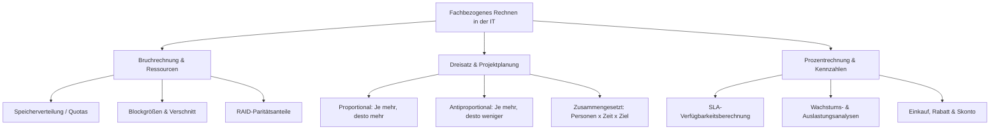

## tags: [fisi, ihk, lernsheet]

## 🧭 Navigation & Zusammenhänge
- **Vorausgesetztes Thema:** [[15_Recht, Lizenzen & Handelskalkulation]]
- **Nächstes Thema:** [[02_Potenzen, Präfixe & Datenstrom-Kalkulationen]]
- **Verwandte Bausteine:** [[03_Dualsystem & Bit-Logik]], [[07_Zusammenfassung Fachbezogenes Rechnen & Digitaltechnik]]
## 🎯 IHK-Prüfungsrelevanz

> [!IMPORTANT] AP01: Einrichten eines IT-gestützten Arbeitsplatzes
> 
> - **Relevanz:** Hoch
>     
> - **Fokus:** Zeit- und Ressourcenplanung bei Hardware-Rollouts, Berechnung von Speicherkapazitäten, Verschnitt bei Dateisystemen/Blockgrößen sowie einfache Proportionalitätsrechnungen für Arbeitsplatz-Installationen.
>     

> [!WARNING] AP02: Konzeption, Administration & Netzwerke
> 
> - **Relevanz:** Hoch
>     
> - **Fokus:** RAID-Kapazitäts- und Nutzdatenberechnungen, Verfügbarkeits- und Ausfallzeitberechnungen auf Basis von SLAs (Service Level Agreements) in Prozent, Bandbreiten- und Downloadzeit-Kalkulationen, Cloud Resource Quotas sowie mehrstufige Dreisatz- und Prozentrechnungen (z. B. Wachstum, Performance, Skonto/Rabatt).
>     

## 📖 Einfache Erklärung & Praxisbeispiele

Mathematische und rechnerische Grundlagen bilden das Fundament für präzise Systemplanung, Ressourcenverwaltung und wirtschaftliches Handeln in der IT-Praxis. Ob Speicherkapazitäten, Bandbreiten, SLA-Ausfallzeiten oder Personalaufwände – kaufmännische und technische Kalkulationen gewährleisten Planungssicherheit für Projekte und Infrastrukturen.

### Unterthemen & Anschauliche Beispiele:

- **1. Bruchrechnung im IT-Kontext (Speicher & Bandbreiten):**
    
    - Bruchrechnung dient der Verteilung von Hardware-Ressourcen, der Darstellung von Teilmengen in Monitoring-Systemen und der Ermittlung von Restkapazitäten.
        
    - 💡 **Praxisbeispiel:** Von einer Speicher-Partition mit $1200\text{ GB}$ sind $\frac{3}{5}$ belegt. Durch Multiplikation ($\frac{3}{5} \cdot 1200\text{ GB}$) ergibt sich eine belegte Kapazität von $720\text{ GB}$ und eine verbleibende Restkapazität von $480\text{ GB}$.
        
- **2. Blockgrößen, Verschnitt & Cloud Quotas:**
    
    - Die Adressierung physischer Speicherblöcke und Sektoren bestimmt den Verschnitt bei Dateisystemen. In Cloud-Umgebungen werden CPU-Cycles und Storage-Quoten als Bruchteile bzw. Verhältnisse auf Instanzen und Usergroups aufgeteilt.
        
    - 💡 **Praxisbeispiel:** Wenn einer Cloud-Instanz A die Hälfte ($\frac{1}{2}$) und Instanz B ein Viertel ($\frac{1}{4}$) der verfügbaren Cluster-Ressourcen zugewiesen wird, bleibt ein Rest von $\frac{1}{4}$ für Notfälle und dynamische Puffer reserviert.
        
- **3. Proportionaler (Einfacher) Dreisatz:**
    
    - Verhält sich eine Beziehung direkt proportional ("je mehr, desto mehr"), steigen zwei Größen im gleichen Verhältnis.
        
    - 💡 **Praxisbeispiel:** Benötigen $10$ Benutzer zusammen $20\text{ GB}$ Arbeitsspeicher, kalkuliert man über den einfachen Dreisatz für $120$ Benutzer einen Speicherbedarf von $240\text{ GB}$ ($2\text{ GB}$ pro Benutzer).
        
- **4. Antiproportionaler Dreisatz:**
    
    - Verhält sich eine Beziehung umgekehrt proportional ("je mehr, desto weniger"), sinkt der Aufwand bei steigendem Ressourceneinsatz.
        
    - 💡 **Praxisbeispiel:** Benötigt ein Techniker $120$ Minuten für das Patchen eines Server-Clusters, halbiert sich die benötigte Zeit bei Einsatz von $2$ Technikern auf $60$ Minuten ($1 \text{ Techniker} \cdot 120 \text{ min} = 2 \text{ Techniker} \cdot 60 \text{ min}$).
        
- **5. Zusammengesetzter Dreisatz:**
    
    - Kombiniert mehrere Einflussfaktoren (z. B. Personen, Aufgaben/Einheiten, Zeit) zur Lösung komplexer Ressourcen- und Projektkalkulationen.
        
    - 💡 **Praxisbeispiel:** Zur Hochrechnung der Dauer eines Großprojekts im Hardware-Rollout werden Technikeranzahl, Anzahl einzurichtender Arbeitsplätze und die Arbeitszeit pro Tag simultan verrechnet.
        
- **6. Bandbreite, Downloadzeiten & Wartungsfenster:**
    
    - Die Dauer von Datenübertragungen hängt direkt von Dateigröße, Anzahl der Dateien und der effektiv verfügbaren Datenrate ab.
        
    - 💡 **Praxisbeispiel:** Bei der Planung eines Wartungsfensters für Firmware-Updates wird die Gesamtdatenmenge durch die reduzierte Bandbreite der WAN-Strecke geteilt, um die genaue Dauer des Ausfallfensters zu berechnen.
        
- **7. Prozentrechnung, SLA-Verfügbarkeit & Wachstum:**
    
    - Ermittlung von System-Performance, Speicherauslastungen sowie prozentualen Ausfallzeiten auf Basis von Service Level Agreements (SLA).
        
    - 💡 **Praxisbeispiel:** Ein SLA garantiert eine Verfügbarkeit von $99{,}9\%$ im Jahr ($365\text{ Tage} \times 24\text{ h} = 8760\text{ h}$). Die maximal zulässige Ausfallzeit pro Jahr berechnet sich zu $0{,}1\% \times 8760\text{ h} = 8{,}76\text{ Stunden}$ ($\approx 525{,}6\text{ Minuten}$).

