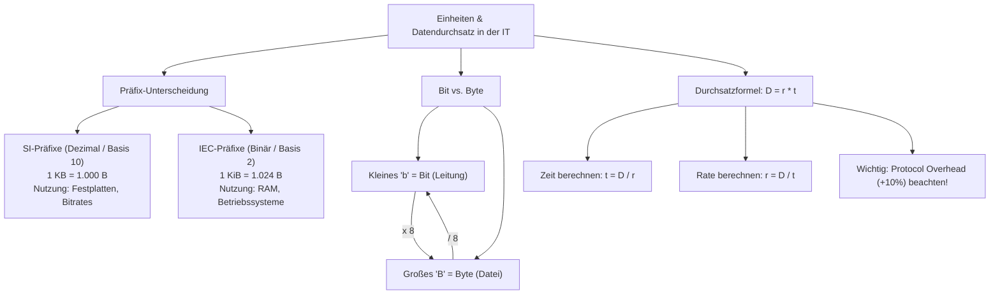

## tags: [fisi, ihk, lernsheet]

## 🧭 Navigation & Zusammenhänge
- **Vorausgesetztes Thema:** [[01_Fachbezogenes Rechnen & Digitaltechnik]]
- **Nächstes Thema:** [[03_Dualsystem & Bit-Logik]]
- **Verwandte Bausteine:** [[01_Computer-Formfaktoren & Hardware-Layouts]], [[05_IPv4-Grundlagen, Subnetting & Adressbereiche]]
## 🎯 IHK-Prüfungsrelevanz

> [!IMPORTANT] AP01: Einrichten eines IT-gestützten Arbeitsplatzes
> 
> - **Relevanz:** Hoch
>     
> - **Fokus:** Exakte Unterscheidung zwischen Bit und Byte bei Datenübertragungsraten vs. Dateigrößen (Faktor 8), Umrechnungen von Speichergrößen für Client-Systeme sowie Kalkulationen zur Zeitdauer bei Software-Rollouts und OS-Deployments an Arbeitsplätzen.
>     

> [!WARNING] AP02: Konzeption, Administration & Netzwerke
> 
> - **Relevanz:** Hoch
>     
> - **Fokus:** Gegenüberstellung von dezimalen SI-Präfixen (Kilo, Mega, Giga, Tera – Basis 10) und binären IEC-Präfixen (Kibi, Mebi, Gibi, Tebi – Basis 2), Berechnung des Kapazitätsverlusts durch OS-Darstellungen (z. B. 1 TB HDD vs. GiB im OS), Dimensionierung von WAN-Strecken und Backup-Fenstern, Berücksichtigung von TCP/IP-Overhead (Netto vs. Brutto) sowie Beherrschung der Zweierpotenzen ($2^0$ bis $2^{10}$).
>     

## 📖 Einfache Erklärung & Praxisbeispiele

In der IT treffen zwei unterschiedliche mathematische Welten aufeinander: Die dezimale Basis 10 (SI-Standard), die vorrangig von Hardware-Herstellern für Marketing und bei Übertragungsraten genutzt wird, und die binäre Basis 2 (IEC-Standard), nach der Speicheradressen und Betriebssysteme arbeiten. Ergänzt wird dies durch die Unterscheidung zwischen Bit (Leitung) und Byte (Datei) sowie die zeitliche Berechnung von Datenströmen.

### Unterthemen & Anschauliche Beispiele:

- **1. Potenzgesetze & Zweierpotenzen (Basis 2 vs. Basis 10):**
    
    - In der IT bestimmt $2^n$ die Anzahl adressierbarer Zustände (z. B. Speicheradressräume).
        
    - **Multiplikation:** Bei gleicher Basis werden Exponenten addiert ($a^n \cdot a^m = a^{n+m}$). Beispiel: $2^{10} \cdot 2^{10} = 2^{20}$ ($1\text{ KiB} \cdot 1024 = 1\text{ MiB}$).
        
    - **Division:** Bei gleicher Basis werden Exponenten subtrahiert ($a^n / a^m = a^{n-m}$). Beispiel: $2^{20} / 2^{12} = 2^8 = 256$.
        
    - 💡 **Praxisbeispiel:** Um $256$ IP-Adressen in einem Subnetz zu adressieren, benötigt man $8$ Bit, da $2^8 = 256$ Zustände ergibt.
        
- **2. SI-Präfixe vs. IEC-Präfixe (Dezimal vs. Binär):**
    
    - **SI-Präfixe (Dezimal):** Basis $10^3 = 1.000$ (k, M, G, T). Werden für Datenübertragungsraten ($\text{Bit/s}$) und von Herstellern für Massenspeicher-Nennkapazitäten genutzt.
        
    - **IEC-Präfixe (Binär):** Basis $2^{10} = 1.024$ (KiB, MiB, GiB, TiB). Werden für RAM-Adressierung und Betriebssystem-Anzeigen (z. B. Windows) verwendet.
        
    - 💡 **Praxisbeispiel:** Warum zeigt eine gekaufte $12\text{ TB}$ Festplatte unter Windows nur ca. $10{,}91\text{ TiB}$ an?
        
        - Herstellerangabe: $12\text{ TB} = 12 \cdot 10^{12}\text{ Byte} = 12.000.000.000.000\text{ Byte}$.
            
        - Windows-Anzeige (Binär): $12.000.000.000.000 / 1.024^4 \approx 10{,}91\text{ TiB}$.
            
- **3. Differenzierung: Bit vs. Byte (Faktor 8):**
    
    - Ein Kleines 'b' steht für Bit (messen i. d. R. die Leitungsgeschwindigkeit/Übertragungsrate), ein großes 'B' für Byte (messen Datengrößen auf Datenträgern).
        
    - **Formel:** $1\text{ Byte} = 8\text{ Bit}$.
        
- **4. Grundformel des Datendurchsatzes ($D = r \cdot t$):**
    
    - Die Datenmenge ($D$) entspricht dem Produkt aus Datenrate ($r$) und Zeit ($t$).
        
    - **Wichtiger Grundsatz:** Vor jeder Rechnung müssen alle Einheiten harmonisiert werden (z. B. MBit in MByte umrechnen oder Bit auf der Leitungsebene verwenden).
        
    - 💡 **Praxisbeispiel (Wiederherstellungsdauer / Disaster Recovery):**
        
        - **Aufgabe:** Wiederherstellung von $850\text{ GiB}$ Daten über eine $100\text{ MBit/s}$-Leitung.
            
        - **Schritt 1 (Einheit harmonisieren):** $850\text{ GiB} = 850 \cdot 1.024\text{ MiB} = 870.400\text{ MiB}$.
            
        - In Bit umrechnen: $870.400\text{ MiB} \cdot 8 = 6.963.200\text{ MBit}$.
            
        - **Schritt 2 (Zeit berechnen):** $t = D / r = 6.963.200\text{ MBit} / 100\text{ MBit/s} = 69.632\text{ Sekunden}$.
            
        - **Schritt 3 (Formatieren):** $69.632\text{ s} = 19\text{ Stunden}, 20\text{ Minuten}, 32\text{ Sekunden}$.
            
- **5. Bandbreitenplanung & Protocol Overhead:**
    
    - Bei der Berechnung erforderlicher Bandbreiten für feste Zeitfenster muss häufig ein Protokoll-Zuschlag (z. B. $+10\%$ für TCP/IP-Header/Overhead) hinzugerechnet werden.
        
    - 💡 **Praxisbeispiel (Backup-Bandbreite):**
        
        - **Aufgabe:** $2\text{ TB}$ Daten sollen in $6\text{ Stunden}$ über eine WAN-Strecke übertragen werden ($+10\%$ Overhead).
            
        - **Brutto-Datenmenge:** $2\text{ TB} \cdot 1{,}10 = 2{,}2\text{ TB} = 2.200.000\text{ MB} = 17.600.000\text{ MBit}$.
            
        - **Zeit in Sekunden:** $6\text{ Stunden} = 6 \cdot 3.600\text{ s} = 21.600\text{ s}$.
            
        - **Erforderliche Rate ($r$):** $17.600.000\text{ MBit} / 21.600\text{ s} \approx 814{,}81\text{ MBit/s}$.

