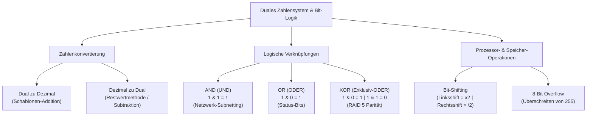

## tags: [fisi, ihk, lernsheet]

## 🧭 Navigation & Zusammenhänge
- **Vorausgesetztes Thema:** [[02_Potenzen, Präfixe & Datenstrom-Kalkulationen]]
- **Nächstes Thema:** [[04_Hexadezimalsystem, MAC-Adressen & Nibbles]]
- **Verwandte Bausteine:** [[05_Logik, Schaltalgebra & Boole'sche Operatoren]], [[06_Logikgatter, Addierer & Digitalrechenwerke]]
## 🎯 IHK-Prüfungsrelevanz

> [!IMPORTANT] AP01: Einrichten eines IT-gestützten Arbeitsplatzes
> 
> - **Relevanz:** Hoch
>     
> - **Fokus:** Umrechnung von Zahlenwerten zwischen Dual- und Dezimalsystem (Schablonen- und Restwertmethode), Grundverständnis von Bit und Byte als kleinsten Informationseinheiten sowie Bit-Wertigkeiten im Oktett ($2^0$ bis $2^7$).
>     

> [!WARNING] AP02: Konzeption, Administration & Netzwerke
> 
> - **Relevanz:** Hoch
>     
> - **Fokus:** Anwendung von Bit-Operationen (UND/AND, ODER/OR, XOR) bei der Netzwerk-Maskierung und IPv4-Subnetzberechnung, Paritätsberechnung im RAID 5 mittels XOR, Erkennung von 8-Bit-Overflows sowie Bit-Shifting (Links-/Rechtsshift) zur schnellen Multiplikation und Division auf Prozessorebene.
>     

## 📖 Einfache Erklärung & Praxisbeispiele

Computer und Netzwerkkomponenten arbeiten auf physikalischer Ebene mit elektrischen Spannungen, die in zwei eindeutige Zustände unterteilt werden: Low (0 / Aus) und High (1 / An). Dieses binäre (duale) Zahlensystem bildet das Fundament für die gesamte Datenverarbeitung, Adressierung im RAM und die logische Adressierung in Netzwerken.

### Unterthemen & Anschauliche Beispiele:

- **1. Das Oktett & Schablonen-Methode (Dual zu Dezimal):**
    
    - Ein Oktett besteht aus 8 Bit. Den Stellen von rechts nach links sind die Zweierpotenzen $2^0$ ($1$) bis $2^7$ ($128$) zugeordnet. Bei der Umrechnung werden alle aktiven Stellen ($1$) aufsummiert.
        
    - 💡 **Praxisbeispiel:** Umrechnung der Binärfolge `10101000` in eine Dezimalzahl:
        
        $$1 \cdot 128 + 0 \cdot 64 + 1 \cdot 32 + 0 \cdot 16 + 1 \cdot 8 + 0 \cdot 4 + 0 \cdot 2 + 0 \cdot 1 = 128 + 32 + 8 = 168$$
        
        Dies entspricht z. B. dem ersten Octet der IP-Adresse `168.x.x.x`.
        
- **2. Dezimal zu Dual (Subtraktions- vs. Restwertmethode):**
    
    - **Subtraktionsmethode:** Vergleicht die Zahl schrittweise mit der nächstkleineren Zweierpotenz.
        
    - **Restwertmethode (Division durch 2):** Die Zahl wird fortlaufend durch 2 geteilt, der Rest ($0$ oder $1$) notiert. Die Leserichtung der Reste von unten (MSB - Most Significant Bit) nach oben (LSB - Least Significant Bit) ergibt den Dualwert.
        
    - 💡 **Praxisbeispiel:** Konvertierung von Dezimal `177`:
        
        - Subtraktion: $177 \ge 128 \rightarrow \mathbf{1}$ (Rest $49$); $49 < 64 \rightarrow \mathbf{0}$; $49 \ge 32 \rightarrow \mathbf{1}$ (Rest $17$); $17 \ge 16 \rightarrow \mathbf{1}$ (Rest $1$); $1 < 8 \rightarrow \mathbf{0}$; $1 < 4 \rightarrow \mathbf{0}$; $1 < 2 \rightarrow \mathbf{0}$; $1 \ge 1 \rightarrow \mathbf{1}$.
            
        - Ergebnis: `10110001`.
            
- **3. Bit-Logik & Netzwerk-Maskierung (AND, OR, XOR):**
    
    - **UND (AND):** Liefert nur $1$, wenn beide Eingänge $1$ sind. Wird bei Subnetzmaskierungen verwendet, um aus IP-Adresse und Subnetzmaske die Netzwerkadresse zu filtern.
        
    - **ODER (OR):** Liefert $1$, wenn mindestens ein Eingang $1$ ist.
        
    - **Exklusiv-ODER (XOR):** Liefert nur dann $1$, wenn die Eingänge unterschiedlich sind.
        
    - 💡 **Praxisbeispiel (RAID 5 Parität):** Bei RAID 5 wird mittels XOR-Verknüpfung zweier Daten-Bits ein Paritäts-Bit berechnet. So ergibt `1 XOR 0 = 1`. Fällt eines der Datenlaufwerke aus, lässt sich der originale Bit-Zustand durch erneute XOR-Verknüpfung der verbliebenen Daten mit dem Paritäts-Bit wiederherstellen.
        
- **4. Bit-Shifting & Overflow-Problematik:**
    
    - **Bit-Shifting:** Ein Linksshift um 1 Bit verdoppelt den Dezimalwert (Multiplikation mit 2), ein Rechtsshift halbiert ihn (Division durch 2).
        
    - **Overflow:** Wird der maximale Wert eines 8-Bit-Systems ($255$) durch Addition überschritten, kommt es zu einem Überlauf (Overflow), da der Wert nicht mehr im Oktett dargestellt werden kann.
        
    - 💡 **Praxisbeispiel:** Versucht ein System im 8-Bit-Bereich den Wert `255` um `1` zu erhöhen, springt das Register auf `00000000` ($0$) zurück, was ohne Fehlerbehandlung zu Speicher-Corruption oder Systemabstürzen führt.

