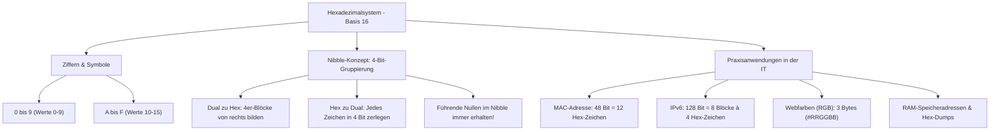

## tags: [fisi, ihk, lernsheet]

## 🧭 Navigation & Zusammenhänge
- **Vorausgesetztes Thema:** [[03_Dualsystem & Bit-Logik]]
- **Nächstes Thema:** [[05_Logik, Schaltalgebra & Boole'sche Operatoren]]
- **Verwandte Bausteine:** [[04_Ethernet-Grundlagen, MAC-Adressen & Rahmenstrukturen]], [[03_IPv6-Grundlagen & Adressierung]]

## 🎯 IHK-Prüfungsrelevanz

> [!IMPORTANT] AP01: Einrichten eines IT-gestützten Arbeitsplatzes
> 
> - **Relevanz:** Hoch
>     
> - **Fokus:** Verluste- und fehlerfreie Umrechnung zwischen Dual-, Hexadezimal- und Dezimalsystem ohne technische Hilfsmittel, Identifikation von MAC-Adressen an Client-Arbeitsplätzen (Aufbau: 48 Bit / 12 Hex-Zeichen in OUI und Seriennummer) sowie Verständnis von Farbcodes im Web- und Anwendungsdesign (Hex-RGB).
>     

> [!WARNING] AP02: Konzeption, Administration & Netzwerke
> 
> - **Relevanz:** Hoch
>     
> - **Fokus:** Struktur und Analyse von IPv6-Adressen (128 Bit, aufgeteilt in 8 Hex-Blöcke zu je 4 Zeichen), Analyse von Speicheradressen und Log-Dateien (Hex-Dumps, Offsets beim Debugging) sowie die Nutzung passender Notationen und Präfixe (z. B. `0x` in Programmiersprachen).
>     

## 📖 Einfache Erklärung & Praxisbeispiele

Reine Bit-Ketten aus Nullen und Einsen spiegeln die physikalischen Schaltzustände der Hardware wider. Für den Menschen sind sie jedoch unübersichtlich und führen bei der Analyse von Netzwerkadressen, Speicherbereichen oder Log-Files schnell zu Fehlern. Das **Hexadezimalsystem (Basis 16)** fungiert als extrem kompakte und effiziente „Kurzschrift“ bzw. Schnittstelle zwischen Mensch und Maschinencode.

### Unterthemen & Anschauliche Beispiele:

- **1. Das Nibble-Konzept & Hex-Symbole (Basis 16):**
    
    - Ein Oktett (Byte / 8 Bit) wird in zwei **Nibbles** (Halbbytes) zu je 4 Bit geteilt.
        
    - 4 Bit können genau $2^4 = 16$ Zustände darstellen ($0000_2$ bis $1111_2$).
        
    - Da das dezimale Ziffernsystem nur Werte von 0 bis 9 kennt, verwendet das Hexadezimalsystem für die Werte 10 bis 15 die Buchstaben **A** bis **F** ($A=10, B=11, C=12, D=13, E=14, F=15$).
        
- **2. Methodik der verlustfreien Umrechnung (Dual $\leftrightarrow$ Hexadezimal):**
    
    - **Dual zu Hex:** Die Bit-Kette wird von rechts nach links in 4er-Blöcke (Nibbles) gruppiert. Jedes Nibble wird direkt über seinen Wert ($1, 2, 4, 8$) in das passende Hex-Zeichen übersetzt.
        
    - **Hex zu Dual:** Jedes Hex-Zeichen wird exakt in ein 4-Bit-Muster zerlegt. Führende Nullen innerhalb eines Nibbles müssen beibehalten werden.
        
    - 💡 **Praxisbeispiel:** Umrechnung der Binärfolge `10101100`:
        
        - Nibble 1 (links): $1010_2 = 8 + 2 = 10 \rightarrow \mathbf{A}$
            
        - Nibble 2 (rechts): $1100_2 = 8 + 4 = 12 \rightarrow \mathbf{C}$
            
        - Hexadezimaler Wert: $\mathbf{AC}_{16}$ (oder `0xAC`)
            
- **3. Umrechnung Dezimal $\leftrightarrow$ Hexadezimal & Stellenwerte:**
    
    - Die Stellenwerte im Hexadezimalsystem steigen mit der Potenz der Basis 16 ($16^0 = 1$, $16^1 = 16$, $16^2 = 256$).
        
    - **Dezimal zu Hex (Restwertmethode):** Fortlaufende Division der Dezimalzahl durch 16; die Reste (in Hex-Zeichen übersetzt) von unten nach oben gelesen ergeben den Hex-Wert.
        
    - 💡 **Praxisbeispiel:** Dezimalzahl $33_{10}$ in Hexadezimal umrechnen:
        
        - $33 / 16 = 2$ Rest $1$
            
        - $2 / 16 = 0$ Rest $2$
            
        - Hex-Wert: `0x21` ($2 \cdot 16 + 1 \cdot 1 = 33$)
            
- **4. Notationen & Praxisanwendungen in der IT:**
    
    - **Notationen:** `0x` in Programmiersprachen (z. B. `0x1A`), `#` im Webdesign (z. B. `#FFFFFF`), `h` in Assembler (z. B. `14h`).
        
    - **MAC-Adresse:** 48 Bit Gesamtlänge, dargestellt als 12 Hex-Zeichen. Die ersten 6 Zeichen bilden die Hersteller-ID (OUI), die letzten 6 Zeichen die fortlaufende Seriennummer.
        
    - **Web-Farbcodes (RGB):** Jede Grundfarbe (Rot, Grün, Blau) wird durch 1 Byte (2 Hex-Stellen) dargestellt. Der Bereich reicht von `#000000` (Schwarz) bis `#FFFFFF` (Weiß).
        
    - **IPv6-Adressierung:** 128 Bit Adressraum, aufgeteilt in 8 Blöcke zu je 4 Hexadezimal-Ziffern, getrennt durch Doppelpunkte.
        
    - 💡 **Praxisbeispiel:** Eine Netzwerkkarte hat die MAC-Adresse `00:1A:2B:3C:4D:5E`. Bei der Fehlersuche liest der Administrator die OUI `00:1A:2B`, um im System den Hersteller des Netzwerkadapters direkt zu identifizieren.

