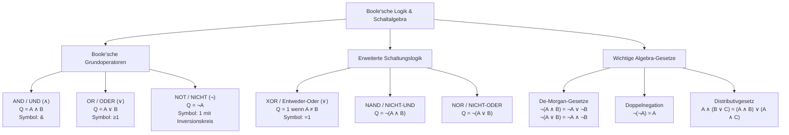

## tags: [fisi, ihk, lernsheet]

## 🧭 Navigation & Zusammenhänge
- **Vorausgesetztes Thema:** [[04_Hexadezimalsystem, MAC-Adressen & Nibbles]]
- **Nächstes Thema:** [[06_Logikgatter, Addierer & Digitalrechenwerke]]
- **Verwandte Bausteine:** [[03_Dualsystem & Bit-Logik]], [[06_Logikgatter, Addierer & Digitalrechenwerke]]
## 🎯 IHK-Prüfungsrelevanz

> [!IMPORTANT] AP01: Einrichten eines IT-gestützten Arbeitsplatzes
> 
> - **Relevanz:** Hoch
>     
> - **Fokus:** Verständnis von Grundlagen der Aussagenlogik, Verknüpfung von Bedingungen in Scripting/Programmierung (z. B. `if`/`then`-Bedingungen) sowie Kenntnis grundlegender Gatter und Wahrheitstabellen.
>     

> [!WARNING] AP02: Konzeption, Administration & Netzwerke
> 
> - **Relevanz:** Hoch
>     
> - **Fokus:** Anwendung der Schaltalgebra in der Netzwerktechnik (Subnetzmaskierung via AND), Erstellung und Analyse komplexer Wahrheitstabellen, Umformung logischer Ausdrücke mittels der **De-Morgan-Gesetze** und anderer Prinzipien (Assoziativ-, Distributiv-, Doppelnegationsgesetz) sowie Anwendung von XOR in Speichersystemen (RAID 5 Parität).
>     

## 📖 Einfache Erklärung & Praxisbeispiele

Die **Boole'sche Algebra** (benannt nach George Boole) und die darauf aufbauende **Schaltalgebra** bilden die mathematische Grundlage für die gesamte digitale Signalverarbeitung, Hardware-Entwicklung, Netzwerktechnik und Softwareentwicklung. In einem binären System existieren ausschließlich zwei Zustände (1/0, AN/AUS, WAHR/FALSCH, TRUE/FALSE, HIGH/LOW). „Halbwahrheiten“ gibt es in der Aussagenlogik nicht.

### Unterthemen & Anschauliche Beispiele:

- **1. Aussagenlogik & Boole'sche Grundoperatoren:**
    
    - Eine logische Aussage besitzt genau einen von zwei Wahrheitswerten. Aus Aussagen entstehen durch Operatoren verknüpfte Gesamtaussagen.
        
    - Die drei Boole'schen Grundoperatoren sind:
        
        - **UND / AND ($\wedge$):** Wahr nur, wenn alle Eingänge wahr sind.
            
        - **ODER / OR ($\vee$):** Wahr, sobald mindestens ein Eingang wahr ist.
            
        - **NICHT / NOT ($\neg$):** Negiert/Invertiert den Eingangswert.
            
- **2. Erweiterte Operatoren der Schaltalgebra (XOR, NAND, NOR):**
    
    - **ENTWEDER-ODER / XOR ($\underline{\vee}$ oder $\oplus$):** Liefert exakt dann den Wert $1$, wenn die Eingänge unterschiedlich sind ($A \neq B$).
        
    - 💡 **Praxisbeispiel (RAID 5 Paritätsberechnung):** XOR erlaubt die Rekonstruktion ausgefallener Datenblöcke auf einem Festplatten-Array. Fällt eine Disk aus, verknüpft der Controller die verbliebenen Daten mit dem XOR-Paritätsblock und stellt das fehlende Bit wieder her.
        
    - 💡 **Praxisbeispiel (Scripting / Automatisierung):** In einer Bash- oder Powershell-Bedingung wird eine Aktion nur ausgeführt, wenn System A erreichbar **und** System B offline ist: `if [ $A_ONLINE -eq 1 ] && [ $B_ONLINE -eq 0 ]; then ...`.
        
- **3. Wahrheitstabellen der Grundgatter:**
    
    |**A**|**B**|**AND (A∧B) PDF**|**OR (A∨B) PDF**|**XOR (A∨​B) PDF**|**NOT A (¬A) PDF**|
    |---|---|---|---|---|---|
    |0|0|0|0|0|1|
    |0|1|0|1|1|1|
    |1|0|0|1|1|0|
    |1|1|1|1|0|0|
    
- **4. Gesetze und Gesetzesregeln der Schaltalgebra:**
    
    - **Kommutativgesetz:** $A \wedge B = B \wedge A$ und $A \vee B = B \vee A$
        
    - **Assoziativgesetz:** $(A \wedge B) \wedge C = A \wedge (B \wedge C)$
        
    - **Distributivgesetz:** $A \wedge (B \vee C) = (A \wedge B) \vee (A \wedge C)$
        
    - **Idempotenzgesetz:** $A \wedge A = A$ sowie $A \vee A = A$
        
    - **Neutralitätsgesetz:** $A \wedge 1 = A$ sowie $A \vee 0 = A$
        
    - **Extremalgesetz:** $A \wedge 0 = 0$ sowie $A \vee 1 = 1$
        
    - **Doppelnegationsgesetz:** $\neg(\neg A) = A$
        
    - **De-Morgan-Gesetze (Prüfungsklassiker):**
        
        $$\neg(A \wedge B) = \neg A \vee \neg B$$
        
        $$\neg(A \vee B) = \neg A \wedge \neg B$$
        
    - 💡 **Praxisbeispiel (Refactoring von Firewall-Regeln):** Soll eine Regel invertiert werden, dass weder Dienst A **noch** Dienst B geblockt wird ($\neg(A \vee B)$), lässt sich das nach De Morgan vereinfachen zu: Nicht Dienst A **und** Nicht Dienst B ($\neg A \wedge \neg B$).

