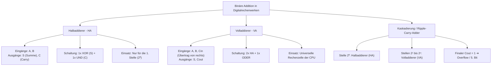

## tags: [fisi, ihk, lernsheet]

## 🧭 Navigation & Zusammenhänge
- **Vorausgesetztes Thema:** [[05_Logik, Schaltalgebra & Boole'sche Operatoren]]
- **Nächstes Thema:** [[07_Zusammenfassung Fachbezogenes Rechnen & Digitaltechnik]]
- **Verwandte Bausteine:** [[05_Logik, Schaltalgebra & Boole'sche Operatoren]], [[01_Einführung in die Programmierung & Logikgrundlagen]]

## 🎯 IHK-Prüfungsrelevanz

> [!IMPORTANT] AP01: Einrichten eines IT-gestützten Arbeitsplatzes
> 
> - **Relevanz:** Hoch
>     
> - **Fokus:** Verständnis der grundlegenden und spezialisierten Logikgatter (UND, ODER, NICHT, XOR, NAND, NOR), saubere Analyse von Verknüpfungen und Ausfüllen bzw. Auswerten einfacher Wahrheitstabellen (2-3 Eingänge).
>     

> [!WARNING] AP02: Konzeption, Administration & Netzwerke
> 
> - **Relevanz:** Hoch
>     
> - **Fokus:** Aufbau und Funktionsweise von Halb- und Volladdierern (HA/VA), Aufstellung logischer Terme für Summen- und Übertrags-Ausgänge ($S$ und $C$), Kaskadierung von Addierern zu Rechenwerken (Ripple-Carry-Adder) sowie Erkennung von Overflows am Ende der Kette.
>     

## 📖 Einfache Erklärung & Praxisbeispiele

Die Boole'sche Algebra und Schaltalgebra bilden das mathematische Fundament der Digitaltechnik. Während einzelne Logikgatter immer nur einen Ausgang liefern, erfordert die binäre Addition von zwei Einsen ($1 + 1 = 10_2$) ein zweistelliges Ergebnis aus Summe ($S$) und Übertrag ($C$). Durch geschickte Kombination einzelner Gatter entstehen Funktionseinheiten wie Halb- und Volladdierer, die als universelle Rechenzellen komplexer CPUS und ALUs (Arithmetic Logic Units) agieren.

### Unterthemen & Anschauliche Beispiele:

- **1. Das Problem mit der „Zwei“ & Auslandsdefinition:**
    
    - Die binäre Addition folgt festen Regeln ($0+0=0$, $0+1=1$, $1+0=1$, $1+1=10_2$).
        
    - Da ein einzelnes Logikgatter nur einen Ausgang besitzt, werden zur Darstellung zweistelliger Binärzahlen zwei Ausgänge benötigt: **Summe ($S$)** für die Stelle $2^0$ und **Carry/Übertrag ($C$)** für die Stelle $2^1$.
        
- **2. Der Halbaddierer (HA):**
    
    - Verarbeitet zwei Eingänge ($A$ und $B$) und erzeugt zwei Ausgänge ($S$ und $C$).
        
    - **Summen-Ausgang ($S$):** Entspricht einer XOR-Verknüpfung ($S = A \oplus B$), da $S$ nur dann $1$ ist, wenn die Eingänge unterschiedlich sind.
        
    - **Übertrags-Ausgang ($C$):** Entspricht einer UND-Verknüpfung ($C = A \wedge B$), da $C$ nur dann $1$ ist, wenn beide Eingänge $1$ sind.
        
    - ⚠️ **Grenze:** Der Halbaddierer kann keinen Übertrag aus einer vorherigen Stelle entgegennehmen und eignet sich daher nur für die allererste Stelle ($2^0$) ganz rechts.
        
    - 💡 **Praxisbeispiel:** Beim Addieren von $1_2 + 1_2$ an der niederwertigsten Stelle erzeugt der Halbaddierer $S=0$ und $C=1$, was im Binärsystem genau der Zahl $10_2$ ($2_{10}$) entspricht.
        
- **3. Der Volladdierer (VA):**
    
    - Besitzt drei Eingänge: $A$, $B$ und den Übertrag der vorherigen Stelle ($C_{in}$).
        
    - Besitzt zwei Ausgänge: Summe ($S$) und neuen Übertrag ($C_{out}$).
        
    - **Aufbau:** Besteht aus **2 Halbaddierern** und **1 ODER-Gatter**. Insgesamt werden 2x XOR, 2x UND und 1x ODER benötigt.
        
    - 💡 **Praxisbeispiel:** Müssen an Stelle $2^1$ die Eingänge $A=1$, $B=1$ und ein vorheriger Carry $C_{in}=1$ addiert werden ($1+1+1 = 3_{10} = 11_2$), ergibt der Volladdierer $S=1$ und $C_{out}=1$.
        
- **4. Wahrheitstabelle im Vergleich (HA vs. VA):**
    
    |**Typ**|**A**|**B**|**Cin​**|**Summe S**|**Übertrag C/Cout​**|
    |---|---|---|---|---|---|
    |**HA**|0|0|–|0|0|
    |**HA**|0|1|–|1|0|
    |**HA**|1|0|–|1|0|
    |**HA**|1|1|–|0|1|
    |**VA**|0|0|0|0|0|
    |**VA**|1|1|0|0|1|
    |**VA**|0|1|1|0|1|
    |**VA**|1|1|1|1|1|
    
- **5. Kaskadierung & Ripple-Carry-Adder:**
    
    - Zur Addition mehrstelliger Binärzahlen werden mehrere Addierer hintereinander geschaltet (kaskadiert): Stelle 1 ($2^0$) nutzt einen Halbaddierer, alle weiteren Stellen ($2^1, 2^2, \dots$) nutzen Volladdierer, deren $C_{in}$ mit dem $C_{out}$ der vorherigen Stelle verbunden wird.
        
    - Ist der finale $C_{out}$ der letzten Stelle nach der Addition $1$, entsteht ein **Overflow (Überlauf)**, da das Ergebnis mehr Bits benötigt als das Register breit ist.

