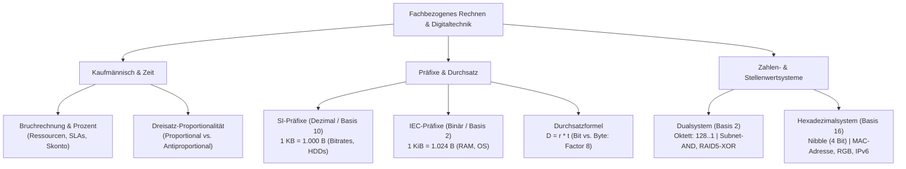

## tags: [fisi, ihk, lernsheet]

## 🧭 Navigation & Zusammenhänge
- **Vorausgesetztes Thema:** [[06_Logikgatter, Addierer & Digitalrechenwerke]]
- **Nächstes Thema:** [[01_Einführung in die Programmierung & Logikgrundlagen]]
- **Verwandte Bausteine:** [[01_Fachbezogenes Rechnen & Digitaltechnik]], [[02_Potenzen, Präfixe & Datenstrom-Kalkulationen]]

## 🎯 IHK-Prüfungsrelevanz

> [!IMPORTANT] AP01: Einrichten eines IT-gestützten Arbeitsplatzes
> 
> - **Relevanz:** Hoch
>     
> - **Fokus:** Verluste- und fehlerfreie Zahlenkonvertierung (Dezimal, Dual, Hexadezimal) ohne Taschenrechner, exakte Unterscheidung zwischen Bit (Leitung) und Byte (Datei) unter Nutzung des Faktors 8, einfache und zusammengesetzte Dreisatz-Kalkulationen für Arbeitsplatz-Rollouts sowie Basis-Wahrheitstabellen einfacher Logikgatter.
>     

> [!WARNING] AP02: Konzeption, Administration & Netzwerke
> 
> - **Relevanz:** Hoch
>     
> - **Fokus:** Gegenüberstellung von dezimalen SI-Präfixen (Basis 10) und binären IEC-Präfixen (Basis 2) mit Kapazitätsberechnung bei Betriebssystem-Abweichungen, Durchsatz- und Zeitfensterkalkulationen für Datensicherungen und WAN-Links ($D = r \cdot t$), IPv4-Subnetzmaskierung mittels Bit-AND, RAID 5 Paritätsberechnungen über XOR, Analyse von MAC-Adressen und IPv6-Blöcken im Hexadezimalsystem sowie Beachtung von 8-Bit Overflows.
>     

## 📖 Einfache Erklärung & Praxisbeispiele

Die mathematischen und rechnerischen Grundlagen der IT bilden das Fundament für präzise Systemplanung, saubere Datendurchsatz-Analysen und wirtschaftliche Projektkalkulationen. Von Bruchrechnung und Dreisätzen für Ressourcen-Monitoring über Potenz- und Präfixgesetze bis hin zur Hardware-Repräsentation im Dual- und Hexadezimalsystem ermöglichen diese Methoden den reibungslosen Brückenschlag zwischen physikalischer Hardware und logischer Software.

### Unterthemen & Anschauliche Beispiele:

- **1. Bruchrechnung, Proportionalität & Dreisatz:**
    
    - Bruchrechnung dient der Verteilung von Speicherressourcen und der Darstellung von Teilmengen in Monitoring-Systemen.
        
    - **Proportionaler Dreisatz:** Direkte Abhängigkeit ("je mehr, desto mehr"), z. B. Hardware-Anschaffungskosten pro Arbeitsplatz.
        
    - **Antiproportionaler Dreisatz:** Umgekehrte Abhängigkeit ("je mehr, desto weniger"), z. B. benötigte Personalzeit bei steigender Technikeranzahl.
        
    - 💡 **Praxisbeispiel:** Wenn 2 Techniker für das Server-Rollout 6 Stunden benötigen ($2 \times 6 = 12$ Technikerstunden), reduzieren 4 Techniker die Dauer auf 3 Stunden ($12 / 4 = 3$).
        
- **2. Potenzrechnung, SI- vs. IEC-Präfixe & Durchsatz ($D = r \cdot t$):**
    
    - **SI-Präfixe (Dezimal / Basis 10):** $1\text{ KB} = 10^3 = 1.000\text{ Byte}$. Verwendung bei Übertragungsraten ($\text{Bit/s}$) und Festplatten-Herstellerangaben.
        
    - **IEC-Präfixe (Binär / Basis 2):** $1\text{ KiB} = 2^{10} = 1.024\text{ Byte}$. Verwendung bei RAM und Betriebssystemen (Windows).
        
    - **Durchsatzformel:** $\text{Datenmenge } D = \text{Datenrate } r \cdot \text{Zeit } t$. Wichtig ist die vorherige Harmonisierung auf dieselbe Einheit (Bit vs. Byte, Faktor 8).
        
    - 💡 **Praxisbeispiel:** Eine gekaufte $12\text{ TB}$ HDD zeigt unter Windows nur ca. $10{,}91\text{ TiB}$ an, da der Hersteller mit $12 \cdot 10^{12}\text{ Byte}$ rechnet, Windows jedoch durch $1.024^4$ teilt.
        
- **3. Dualsystem, Stellenwerttabelle & Konvertierung:**
    
    - Das Dualsystem nutzt die Stellenwerte $2^0$ bis $2^7$ ($1, 2, 4, 8, 16, 32, 64, 128$).
        
    - Konvertierung erfolgt wahlweise über die Subtraktionsmethode oder Division/Modulo (Restwertmethode durch 2).
        
    - 💡 **Praxisbeispiel:** Die Umrechnung der Zahl $177_{10}$ ergibt binär `10110001`, da $128 + 32 + 16 + 1 = 177$.
        
- **4. Bit-Logik, Netzmasken & Overflow:**
    
    - **AND ($\wedge$):** Liefert nur 1, wenn beide Eingänge 1 sind. Anwendung beim Subnetting zur Filterung der Netzadresse.
        
    - **OR ($\vee$):** Liefert 1, sobald mindestens ein Eingang 1 ist.
        
    - **XOR ($\oplus$):** Liefert 1 nur bei unterschiedlichen Eingängen. Anwendung bei RAID 5 Paritätsberechnungen.
        
    - **8-Bit-Overflow:** Bei Überschreiten von $255_{10}$ (`11111111`) im 8-Bit-Register kommt es zum Überlauf.
        
- **5. Nibble-Konzept & Hexadezimalsystem (Basis 16):**
    
    - Ein Oktett (8 Bit) wird in zwei **Nibbles** (4 Bit) geteilt.
        
    - 4 Bit stellen 16 Zustände dar ($0000_2$ bis $1111_2 \rightarrow 0_{16}$ bis $\text{F}_{16}$). Werte von 10 bis 15 werden als **A** bis **F** dargestellt.
        
    - Notationen: `0x` in Code (z. B. `0x1A`), `#` für Farbcodes (z. B. `#FFFFFF`), `h` in Assembler.
        
    - 💡 **Praxisbeispiel:** MAC-Adressen nutzen 48 Bit, aufgeteilt in 12 Hex-Zeichen (z. B. `00:1A:2B:...`), wobei die ersten 6 Zeichen den Hersteller (OUI) kennzeichnen.

