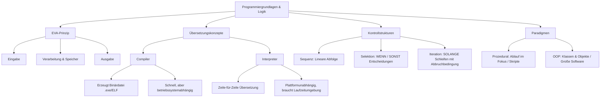

## tags: [fisi, ihk, lernsheet]

## 🧭 Navigation & Zusammenhänge
- **Vorausgesetztes Thema:** [[07_Zusammenfassung Fachbezogenes Rechnen & Digitaltechnik]]
- **Nächstes Thema:** [[01_Grundlagen der Programmierung & Algorithmen]]
- **Verwandte Bausteine:** [[05_Logik, Schaltalgebra & Boole'sche Operatoren]], [[11_Grundkonzepte der OOP vs. Strukturierte Programmierung]]
## 🎯 IHK-Prüfungsrelevanz

> [!IMPORTANT] AP01: Einrichten eines IT-gestützten Arbeitsplatzes
> 
> - **Relevanz:** Hoch
>     
> - **Fokus:** Grundlegendes Verständnis des EVA-Prinzips (Eingabe, Verarbeitung, Ausgabe), Verständnis von einfachen Automatisierungsskripten zur Konfiguration von Arbeitsplätzen sowie saubere Unterscheidung von Syntax- und Semantikfehlern.
>     

> [!WARNING] AP02: Konzeption, Administration & Netzwerke
> 
> - **Relevanz:** Hoch
>     
> - **Fokus:** Erstellung und Interpretation von Pseudocode, Flussdiagrammen und Nassi-Shneiderman-Struktogrammen (DIN 66261) für die Systemautomatisierung, Verstehen von Kontrollstrukturen (Sequenz, Selektion, Iteration), Auswahl der passenden Sprache (Compiler vs. Interpreter / prozedural vs. OOP) sowie Beachtung der Eigenschaften von Algorithmen.
>     

## 📖 Einfache Erklärung & Praxisbeispiele

Programmierung ist die Formulierung von präzisen Anweisungen für ein Computersystem, um eine spezifische Aufgabe systematisch zu lösen. Software dient dabei als immaterielles Werkzeug (_Non-Tangible Asset_). Sie schlägt die Brücke zwischen der physischen Hardware (Prozessoren mit binären Schaltungszuständen und festem Befehlssatz) und den Anwendungen für Endanwender.

### Unterthemen & Anschauliche Beispiele:

- **Das EVA-Prinzip:** Basis jeder Datenverarbeitung. Daten werden eingegeben (_Eingabe_), verarbeitet (_Verarbeitung_ unter Nutzung einer _Speichereinheit_) und ausgegeben (_Ausgabe_).
    
    - 💡 **Praxisbeispiel:** Ein FISI schreibt ein Skript für ein Anmelde-Formular: Der Benutzer gibt Benutzername und Passwort ein (_Eingabe_), das System vergleicht das Passwort mit dem Hash in der Datenbank (_Verarbeitung/Speicher_) und gewährt oder verweigert den Zugriff (_Ausgabe_).
        
- **Eigenschaften eines Algorithmus:** Ein Algorithmus ist eine eindeutige, ausführbare, endliche und terminierende Handlungsvorschrift zur Lösung eines Problems.
    
    - **Eindeutigkeit:** Keine Interpretationsspielräume.
        
    - **Ausführbarkeit:** Jeder Schritt muss machbar sein.
        
    - **Endlichkeit:** Der Code hat einen festen Umfang an Anweisungen.
        
    - **Terminiertheit:** Der Programmablauf stoppt nach endlichen Schritten (keine ungewollte Endlosschleife).
        
    - 💡 **Praxisbeispiel:** Ein Passwort-Eingabe-Skript erlaubt maximal 3 Fehlversuche. Ist das Passwort nach 3 Versuchen falsch, endet das Programm mit einer Account-Sperre.
        
- **Generationswandel der Programmiersprachen:**
    
    - **1. Generation (Maschinensprache):** Direkte Hardwaresteuerung über Byte-Folgen/Hex (z. B. `55 48 89 E5`).
        
    - **2. Generation (Assembler):** Nutzen von Mnemonics als Merkhilfe für CPU-Befehle (z. B. `push rbp`, `mov rbp, rsp`).
        
    - **3. Generation (3GL / Hochsprachen):** Hohe Lesbarkeit für Menschen (z. B. C, Pascal, BASIC).
        
    - **4. Generation (4GL & darüber):** Starke Abstraktion, plattformunabhängig lauffähig (z. B. Python, Java, SQL).
        
    - 💡 **Praxisbeispiel:** Statt Bytefolgen direkt in Register zu schreiben (1. Gen), schreibt der FISI in Python einfach `print("Hello, World!")`, um einen System-Status in der Konsole auszugeben.
        
- **Compiler vs. Interpreter:**
    
    - **Compiler (z. B. C, C++, Go, Rust):** Übersetzt den gesamten Quellcode vorab in eine binäre, ausführbare Datei (`.exe`, ELF). _Vorteil:_ Hohe Ausführungsgeschwindigkeit und Quellcodeschutz. _Nachteil:_ Betriebssystem- und plattformabhängig.
        
    - **Interpreter (z. B. Python, JavaScript, PHP):** Übersetzt den Quellcode Zeile für Zeile direkt bei der Ausführung. _Vorteil:_ Plattformunabhängig und einfache Wartung/Skripterstellung. _Nachteil:_ Langsamere Ausführung, Interpreterumgebung wird benötigt.
        
    - 💡 **Praxisbeispiel:** Ein plattformübergreifendes Log-Analyse-Skript für Linux und Windows wird in der Interpretersprache Python verfasst. Ein performantes Core-Tool für Router-Betriebssysteme wird in C/C++ kompiliert.
        
- **Kontrollstrukturen:**
    
    - **Sequenz:** Lineare, Schritt-für-Schritt-Abarbeitung von oben nach unten.
        
    - **Selektion:** Wenn-Dann-Entscheidung (Verzweigung / Abzweigung).
        
    - **Iteration:** Wiederholung/Schleife (z. B. `WHILE` / `FOR`), gesteuert durch Abbruchbedingungen zur Effizienzsteigerung.
        
    - 💡 **Praxisbeispiel:** `SOLANGE Versuche > 0 UND Login_Erfolgreich GLEICH Falsch TUE: Frage Passwort ab...`.
        
- **Syntax vs. Semantik:**
    
    - **Syntax Error:** Grammatik-/Rechtschreibfehler im Code (z. B. fehlende Klammer/Semikolon); das Programm startet gar nicht.
        
    - **Semantischer Fehler:** Die Logik ist falsch. Das Programm läuft fehlerfrei durch, liefert aber das falsche Ergebnis.
        
    - 💡 **Praxisbeispiel:** Berechne den Durchschnitt zweier Zahlen. Code: `durchschnitt = a + b / 2`. Wegen der mathematischen Regel „Punkt-vor-Strich“ ist das Ergebnis semantisch falsch (Richtig: `(a + b) / 2`).
        
- **Programmierparadigmen:**
    
    - **Prozedural:** Ablauf-orientiert („Was muss nacheinander getan werden?“); Trennung von Daten und Logik (ideal für Skripte und Automatisierung).
        
    - **Objektorientiert (OOP):** Objekt-orientiert („Welche Objekte/Akteure sind beteiligt und wie interagieren sie?“); Verkapselung von Daten und Methoden in Klassen/Bauplänen und Objekten/Instanzen (ideal für große Softwarearchitekturen).
        
    - **Hybride Sprachen:** Sprachen wie Python, PHP oder Perl erlauben sowohl prozedurale als auch objektorientierte Ansätze.
        
    - 💡 **Praxisbeispiel:** Ein FISI schreibt ein kurzes prozedurales Bash-/Python-Skript, um automatisch Backups von Server-Verzeichnissen zu erstellen. Ein Entwicklerteam nutzt OOP in Java, um ein großes ERP-System mit Klassen wie `Server`, `Benutzer` und `Netzwerkkarte` zu bauen.

