## 🧭 Navigation & Zusammenhänge
- **Vorausgesetztes Thema:** [[01_Einführung in die Programmierung & Logikgrundlagen]]
- **Nächstes Thema:** [[02_Programmiergrundlagen Datentypen, Operatoren & Kontrollstrukturen]]
- **Verwandte Bausteine:** [[05_Algorithmus-Analyse, Wertetabellen & Namespaces (LEGB)]], [[03_Schleifentypen & Abbruchbedingungen im Detail]]

---

## 🎯 IHK-Prüfungsrelevanz
> [!IMPORTANT] AP01: Einrichten eines IT-gestützten Arbeitsplatzes
> - **Relevanz:** Mittel
> - **Fokus:** Grundlegendes Verständnis von Skripten zur Automatisierung von Client-Einrichtungen (z. B. PowerShell oder Bash). Verständnis von Datentypen und Variablen zur Konfiguration von Systemumgebungen.

> [!WARNING] AP02: Konzeption, Administration & Netzwerke
> - **Relevanz:** Hoch
> - **Fokus:** Kernkompetenz im Bereich "Anwendungsentwicklung und Skripting" für FISI. Die IHK prüft intensiv die Eigenschaften von Algorithmen (Finitheit, Determinismus), den Unterschied zwischen Compiler- und Interpreter-Sprachen sowie logische Verknüpfungen (Operatoren) bei der Systemüberwachung.

---

## 📖 Einfache Erklärung & Praxisbeispiele
Ein **Algorithmus** ist eine präzise Schrittfolge zur Lösung eines spezifischen Problems. Für den Systemintegrator bildet dieses logische Grundverständnis das Fundament, um administrative Abläufe zu automatisieren (z. B. Backups, Benutzeranlage). Damit der Computer diesen Lösungsweg versteht, wird er über eine **Programmiersprache** formuliert und entweder zeilenweise übersetzt (**Interpreter**) oder als Ganzes in Maschinencode umgewandelt (**Compiler**). Daten werden dabei temporär in strukturierten Behältern, den **Variablen**, verarbeitet.

### Unterthemen & Anschauliche Beispiele:
- **Eigenschaften von Algorithmen:** Ein funktionierender Algorithmus muss fassbar sein. Wichtige Kriterien sind *Finitheit* (endliche Anzahl von Schritten), *Determinismus* (gleiche Eingabe führt immer zum gleichen Ergebnis) und *Effektivität* (maximaler Fortschritt pro Schritt).
  - 💡 **Praxisbeispiel:** Ein FISI schreibt ein Skript zur automatischen Bereinigung von Log-Dateien. Das Skript muss nach dem Löschen der alten Logs zwingend terminieren (Finitheit) und darf bei identischem Serverzustand keine willkürlichen Systemdateien löschen (Determinismus).
- **Übersetzungsverfahren (Compiler vs. Interpreter):** Ein *Compiler* übersetzt den Quelltext als Ganzes in eine schnelle ausführbare Datei (z. B. C, C++), schützt das geistige Eigentum, erfordert aber bei jeder Änderung eine Neukompilierung. Ein *Interpreter* (z. B. Python, PowerShell) übersetzt und führt den Code zeilenweise aus. Dies vereinfacht die Fehlersuche im Admin-Alltag ungemein, läuft jedoch etwas langsamer.
  - 💡 **Praxisbeispiel:** Für das tägliche Auslesen von Active-Directory-Benutzern nutzt der FISI ein PowerShell-Skript (Interpretersprache), da er den Code schnell anpassen und sofort ohne vorheriges Kompilieren testen kann.
- **Iterative vs. Rekursive Algorithmen:** Ein *iterativer* Algorithmus nutzt klassische Schleifen und schont Systemressourcen. Ein *rekursiver* Algorithmus ruft sich selbst auf, reduziert komplexen Code, birgt jedoch das Risiko eines Speichermangels (Stack Overflow).
  - 💡 **Praxisbeispiel:** Beim Durchsuchen einer tief verschachtelten Verzeichnisstruktur nach verwaisten Dateien nutzt ein Skript das rekursive Prinzip (eine Funktion scannt einen Ordner und ruft sich für jeden Unterordner selbst auf).
- **Variablen, Datentypen & Operatoren:** Variablen besitzen einen eindeutigen Namen (Bezeichner), müssen initialisiert werden und speichern spezifische Daten (z. B. Integer für Ganzzahlen, String für Text, Boolean für True/False). *Operatoren* dienen der logischen (UND, ODER) oder arithmetischen (Modulo `%`) Verarbeitung.
  - 💡 **Praxisbeispiel:** Ein Monitoring-Skript prüft den Festplattenspeicher. Die Variable `intSpeicherFrei` (Integer) hält den aktuellen Wert. Über einen Vergleichsoperator (`< 10`) und einen logischen Operator wird evaluiert, ob eine Warn-E-Mail versendet werden muss.

---

## 📊 Visuelle Darstellung (Mermaid.js)

```mermaid
flowchart TD
    A[Programmierung & Logik] --> B[Algorithmen]
    A --> C[Sprachverarbeitung]
    A --> D[Datenstrukturen]

    subgraph Algo [Kriterien & Typen]
        B --> B1[Eigenschaften]
        B --> B2[Ansätze]
        B1 --> B1a[Finitheit / Terminierung]
        B1 --> B1b[Determinismus]
        B1 --> B1c[Effektivität]
        B2 --> B2a[Iteration <br>Schleifen / Ressourcenarm]
        B2 --> B2b[Rekursion <br>Selbstaufruf / Stack-Gefahr]
    end

    subgraph Translators [Übersetzungsprozess]
        C --> C1[Compiler]
        C --> C2[Interpreter]
        C1 --> C1a[Übersetzt Quelltext als Ganzes]
        C1 --> C1b[Schnelle Ausführung / Exe-Datei]
        C2 --> C2a[Übersetzt zeilenweise live]
        C2 --> C2b[Direktes Testen / Skripting]
    end

    subgraph Data [Variablen & Logik]
        D --> D1[Datentypen]
        D --> D2[Operatoren]
        D1 --> D1a[Integer / Float]
        D1 --> D1b[String / Text]
        D1 --> D1c[Boolean / Wahrheitswert]
        D2 --> D2a[Arithmetisch: +, -, *, /, %]
        D2 --> D2b[Logisch: AND, OR, NOT]
    end

    style Algo fill:#f2f2f9,stroke:#333,stroke-width:1px
    style Translators fill:#f9f2f2,stroke:#333,stroke-width:1px
    style Data fill:#f2f9f2,stroke:#333,stroke-width:1px
```

