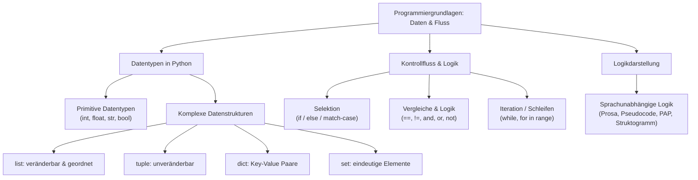

## tags: [fisi, ihk, lernsheet]

## 🧭 Navigation & Zusammenhänge
- **Vorausgesetztes Thema:** [[01_Grundlagen der Programmierung & Algorithmen]]
- **Nächstes Thema:** [[03_Listen & Datenstrukturen in der Systemintegration]]
- **Verwandte Bausteine:** [[04_Python Basics Grundlagen, EVA-Prinzip & Kontrollstrukturen]], [[03_Dualsystem & Bit-Logik]]

## 🎯 IHK-Prüfungsrelevanz

> [!IMPORTANT] AP01: Einrichten eines IT-gestüttzen Arbeitsplatzes
> 
> - **Relevanz:** Hoch
>     
> - **Fokus:** Verständnis einfacher Automatisierungsskripte zur Systemkonfiguration (z. B. PowerShell, Bash, Python), korrekte Zuweisung von Variablen und Datentypen für Benutzereingaben und Parameter.
>     

> [!WARNING] AP02: Konzeption, Administration & Netzwerke
> 
> - **Relevanz:** Hoch
>     
> - **Fokus:** Entwurf und Analyse von Kontrollflüssen in Pseudocode, Nassi-Shneiderman-Struktogrammen und Programmablaufplänen (PAP), Einsatz passender Datenstrukturen (z. B. Dictionaries für User-Data, Sets für eindeutige IP-Sammlungen), Verknüpfung von Bedingungen mit logischen Operatoren (AND, OR, NOT) sowie saubere Schleifensteuerung zur Prozessautomatisierung.
>     

## 📖 Einfache Erklärung & Praxisbeispiele

Programmiersprachen abstrahieren die grundlegenden Funktionen der Hardware (Bitfolgen im Maschinencode) in eine für Menschen lesbare und wartbare Form. Variablen dienen dabei als benannte Speicherbereiche im RAM zur Ablage von Daten. Kontrollstrukturen steuern den logischen Ablauf eines Programms durch Bedingungen, Verzweigungen und Wiederholungen.

### Unterthemen & Anschauliche Beispiele:

- **Abstraktionslevel & Sprachenauswahl:**
    
    - **Low-Level (Gen 1–2):** Maschinensprache und Assembler arbeiten sehr hardwarenah.
        
    - **High-Level (Gen 3–5):** Sprachen wie Python, Java, C# oder C++ bieten hohe Abstraktion für spezifische Einsatzbereiche (z. B. Skripte/Automatisierung via Python/PowerShell vs. verteilte Anwendungen via Java).
        
    - 💡 **Praxisbeispiel:** Für das schnelle Auslesen und Ändern von Client-Einstellungen schreibt der FISI ein Skript in PowerShell oder Python, anstatt Maschinencode manuell zu steuern.
        
- **Primitive & Komplexe Datentypen (Python):**
    
    - **Primitive Datentypen:** `int` (Ganzzahl, z. B. `100`), `float` (Fließkommazahl, z. B. `3.14`), `str` (String/Text, z. B. `"comcave"`), `bool` (Wahrheitswert: `True`/`False`). Python ermittelt Datentypen dynamisch bei Wertzuweisung.
        
    - **Komplexe Datenstrukturen:**
        
        - `list`: Geordnete, veränderbare Sammlung (z. B. `[1, 2, 3]`).
            
        - `tuple`: Geordnete, unveränderbare Sammlung (z. B. GPS-Koordinaten `(51.55, 10.23)`).
            
        - `dict`: Schlüssel-Wert-Paare (Key-Value), ideal für strukturierte Datensätze (z. B. `{"benutzername": "admin", "email": "admin@example.com"}`).
            
        - `set`: Ungeordnete Menge _eindeutiger_ Elemente; Duplikate werden automatisch entfernt.
            
    - 💡 **Praxisbeispiel:** Beim Scannen eines Subnetzes speichert das Skript gefundene IP-Adressen in ein `set` (`gefundene_ips = {'192.168.1.1', '192.168.1.2'}`), um doppelte Einträge automatisch auszufiltern.
        
- **Vergleichs- & Logik-Operatoren:**
    
    - **Vergleichsoperatoren:** `==` (Gleich), `!=` (Ungleich), `<`, `>`, `<=`, `>=`.
        
    - **Logische Verknüpfungen:** `and` (UND), `or` (ODER) sowie Invertierung mit `not` (`!`).
        
    - 💡 **Praxisbeispiel:** Ein Login-System prüft, ob die verbleibenden Versuche größer als 0 sind UND der Status auf nicht-eingeloggt steht (`versuche > 0 and login == False`).
        
- **Kontrollstrukturen (Verzweigung, Schleifen, Fallunterscheidung):**
    
    - **Selektion (`if` / `else` / `elif`):** Bedingte Ausführung von Code-Blöcken.
        
    - **Kopfgesteuerte Schleife (`while` / `for`):** Wiederholt Anweisungen, solange eine Bedingung wahr ist.
        
    - **Zählschleife (`for in range`):** Iteriert über einen definierten Bereich/Index, wenn etwas exakt $x$-mal ausgeführt werden soll.
        
    - **Fallunterscheidung (`match` / `case`):** Prüft eine Variable gezielt auf mehrere Werte/Zustände.
        
    - 💡 **Praxisbeispiel:** Ein System-Monitoring-Skript prüft die Serverauslastung via `match besucherzahl:`: Unter 200 Besucher gibt es Status `"Alles in Ordnung"` aus, ab 300 initiiert es eine automatische Lastverteilung.
        
- **Darstellung von Logik ohne Programmiersprache:**
    
    - Logik kann unabhängig von der Zielsprache visualisiert werden: als **Prosa**, **Pseudocode**, **Nassi-Shneiderman-Struktogramm** oder **Programmablaufplan (PAP)**.
        
    - 💡 **Praxisbeispiel:** Vor dem Schreiben eines Migrationsskripts skizziert der Administrator den Ablaufsortier-Algorithmus als Programmablaufplan (PAP), um Fehler im Kontrollfluss frühzeitig zu vermeiden.

