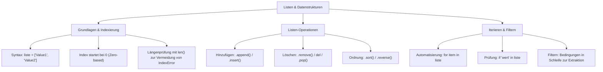

## tags: [fisi, ihk, lernsheet]

## 🧭 Navigation & Zusammenhänge
- **Vorausgesetztes Thema:** [[02_Programmiergrundlagen Datentypen, Operatoren & Kontrollstrukturen]]
- **Nächstes Thema:** [[03_Schleifentypen & Abbruchbedingungen im Detail]]
- **Verwandte Bausteine:** [[04_Python Basics Grundlagen, EVA-Prinzip & Kontrollstrukturen]], [[02_SQL-Datentypen & Domänen im Detail]]

## 🎯 IHK-Prüfungsrelevanz

> [!IMPORTANT] AP01: Einrichten eines IT-gestützten Arbeitsplatzes
> 
> - **Relevanz:** Hoch
>     
>     PDF+ 2
>     
> - **Fokus:** Auslesen und Verarbeiten von Gerätelisten (z. B. Hardware-Komponenten, Verzeichnisse, Software-Pakete) zur Arbeitsplatzautomatisierung, Vermeidung von Systemabstürzen durch sichere Index-Prüfung (`len()`).
>     
>     PDF+ 3
>     

> [!WARNING] AP02: Konzeption, Administration & Netzwerke
> 
> - **Relevanz:** Hoch
>     
>     PDF+ 2
>     
> - **Fokus:** Automatisierte Verarbeitung von Netzwerkinventaren (z. B. IP-Listen durchloopen und pingen), Filtern kritischer Systemzustände (z. B. Server-Temperaturen, Log-Einträge), Verfolgung von Schleifenverläufen mittels Wertetabellen/Tracking sowie Anwendung gängiger Listen-Methoden zur Datenbereinigung.
>     
>     PDF+ 4
>     

## 📖 Einfache Erklärung & Praxisbeispiele

Anstatt für jedes IT-System eine eigene Variable anzulegen (z. B. `server1`, `server2`, `server3`), fassen Listen (_Arrays_) mehrere Werte geordnet in einem einzigen Datencontainer zusammen. Dies erlaubt eine dynamische, skalierbare Datenverarbeitung und bildet die Grundlage für die Automatisierung in der Systemintegration.

PDF+ 4

### Unterthemen & Anschauliche Beispiele:

- **Listensyntax & Adressierung (Index):**
    
    - Eine Liste wird in Python durch eckige Klammern `[]` definiert.
        
    - Die Zählung/Adressierung der Elemente beginnt immer bei **0 (Zero-based Indexing)**.
        
    - **IndexError:** Tritt auf, wenn auf eine Position zugegriffen wird, die nicht existiert. Um Fehler zu vermeiden, wird die Länge der Liste mit `len()` bestimmt.
        
    - 💡 **Praxisbeispiel:** Ein Skript speichert Netzwerkgeräte: `geraete = ['Router', 'Switch', 'Server']`. `geraete[0]` liefert `'Router'`. Eine Sicherheitsabfrage prüft vor dem Zugriff `if len(geraete) > 10:`, um einen Absturz zu verhindern.
        
- **Veränderbarkeit (_Mutable_) & Listen-Methoden:**
    
    - Listen sind veränderbar: Elemente können direkt überschrieben, ergänzt oder gelöscht werden.
        
    - `.append(wert)`: Fügt ein Element am Ende der Liste an.
        
    - `.insert(index, wert)`: Fügt ein Element an einer spezifischen Position ein.
        
    - `.remove(wert)`: Löscht das erste Vorkommen eines bestimmten Wertes.
        
    - `del liste[index]` / `.pop()`: Entfernt Elemente anhand ihrer Position.
        
    - `.sort()` / `.reverse()`: Sortiert Elemente (alphabetisch/numerisch) oder dreht die Reihenfolge um.
        
    - 💡 **Praxisbeispiel:** Während der Inventarisierung wird ein neuer Access Point entdeckt und per `geraete.append('Access-Point')` der bestehenden Geräteliste hinzugefügt.
        
- **Automatisierung: `for`-Schleife & Suchen/Filtern:**
    
    - In Kombination mit `for`-Schleifen können hunderte Datensätze effizient mit wenig Code nacheinander verarbeitet werden.
        
    - Der Operator `in` prüft, ob ein Wert in einer Liste vorhanden ist.

        
    - Durch Bedingungen innerhalb von Schleifen lassen sich Teilmengen herausfiltern (z. B. kritische Werte in eine neue Liste kopieren).

    - 💡 **Praxisbeispiel:** Ein Überwachungsskript prüft eine Liste von IP-Adressen `ip_adressen = ['192.168.1.1', '10.0.0.1']`. In einer `for ip in ip_adressen:`-Schleife wird jede IP automatisch gepingt und der Erreichbarkeitsstatus ausgegeben.

- **Wertetabelle & Tracking:**
    
    - Zur Fehleranalyse und Nachvollziehbarkeit des Datenflusses werden Variablen- und Listenverläufe Schritt für Schritt in einer Wertetabelle protokolliert.

        
    - 💡 **Praxisbeispiel:** Beim Aufsummieren von Werten (`summe = summe + w`) mit `werte = [10, 20, 30]` dokumentiert die Wertetabelle: Schritt 1 = 10, Schritt 2 = 30, Schritt 3 = 60.

