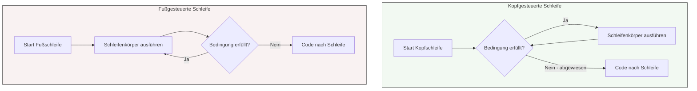

## 🧭 Navigation & Zusammenhänge
- **Vorausgesetztes Thema:** [[03_Listen & Datenstrukturen in der Systemintegration]]
- **Nächstes Thema:** [[04_Python Basics Grundlagen, EVA-Prinzip & Kontrollstrukturen]]
- **Verwandte Bausteine:** [[01_Grundlagen der Programmierung & Algorithmen]], [[05_Algorithmus-Analyse, Wertetabellen & Namespaces (LEGB)]]
---

## 🎯 IHK-Prüfungsrelevanz
> [!IMPORTANT] AP01: Einrichten eines IT-gestützten Arbeitsplatzes
> - **Relevanz:** Niedrig bis Mittel
> - **Fokus:** Anwendung von Standard-Schleifen beim Auslesen von lokalen Systemkonfigurationen oder Logfiles.

> [!WARNING] AP02: Konzeption, Administration & Netzwerke
> - **Relevanz:** Hoch
> - **Fokus:** Extrem prüfungsrelevant für die Pseudocode- und Logikaufgaben. Die IHK testet hier exakt den Unterschied bei der Durchlaufanzahl (0-mal vs. mindestens 1-mal). Ein typischer Fehler in Prüfungen ist das "Off-by-One"-Problem (Schleife läuft einmal zu viel oder zu wenig), was durch das Verständnis von Kopf- und Fußsteuerung vermieden wird.

---

## 📖 Einfache Erklärung & Praxisbeispiele
Schleifen (Wiederholungsstrukturen) wiederholen einen bestimmten Codeblock, solange eine Laufbedingung erfüllt ist oder bis eine Abbruchbedingung eintritt. In der Systemintegration steuern sie kritische Prozesse wie Warteschlangen, Verbindungsaufbauten oder Datenverarbeitungen. Der entscheidende Unterschied liegt darin, **wann** die Bedingung geprüft wird – vor dem Durchlauf (kopfgesteuert) oder nach dem Durchlauf (fußgesteuert). Ein falscher Schleifentyp kann im schlimmsten Fall zu Systemabstürzen durch Endlosschleifen führen.

### Unterthemen & Anschauliche Beispiele:
- **Kopfgesteuerte Schleife (abweisende Schleife):** Die Bedingung wird **vor** dem ersten Durchlauf geprüft. Ist sie von Anfang an falsch, wird der Inhalt der Schleife **0-mal** ausgeführt.
  - 💡 **Praxisbeispiel:** Ein Skript soll ausstehende Windows-Updates installieren. Die Bedingung lautet: `Solange UpdatesVerfügbar == True`. Gibt es keine Updates, springt das Skript sofort weiter, ohne den Installationsblock auch nur einmal anzufassen.
- **Fußgesteuerte Schleife (nicht abweisende Schleife):** Die Bedingung wird erst **nach** dem Durchlauf am Fuß geprüft. Der Codeblock wird daher **mindestens 1-mal** ausgeführt, selbst wenn die Bedingung von Beginn an nicht zutrifft.
  - 💡 **Praxisbeispiel:** Ein Abfrage-Skript für Passwörter. Das System muss den Nutzer *zuerst* nach dem Passwort fragen (1. Durchlauf) und kann erst *danach* prüfen, ob die Eingabe falsch war, um die Schleife eventuell zu wiederholen (`Wiederhole solange PasswortUngültig == True`).
- **Zählergesteuerte Schleife (For-Schleife):** Wird verwendet, wenn die Anzahl der Durchläufe bereits vor dem Start exakt bekannt ist. Sie nutzt eine integrierte Zählervariable.
  - 💡 **Praxisbeispiel:** Ein FISI konfiguriert ein Skript, das exakt 3 Ping-Signale an einen Gateway-Router sendet (`Für i = 1 bis 3`), um die Netzwerkverfügbarkeit zu testen.
- **Schleifensteuerung (Abbruch & Fortsetzung):** 
  - `Break` / `Exit`: Bricht die gesamte Schleife sofort ab und springt zum Code danach.
  - `Continue`: Bricht nur den *aktuellen* Durchlauf ab und springt direkt zur nächsten Überprüfung der Bedingung am Kopf/Fuß.
  - 💡 **Praxisbeispiel:** Ein Skript scannt eine Liste von IP-Adressen. Stößt es auf eine ungültige IP, springt es mit `Continue` sofort zur nächsten Adresse. Findet es die gesuchte Master-IP, bricht es den gesamten Scan-Prozess mit `Break` ab.

---

## 📊 Visuelle Darstellung (Mermaid.js)

