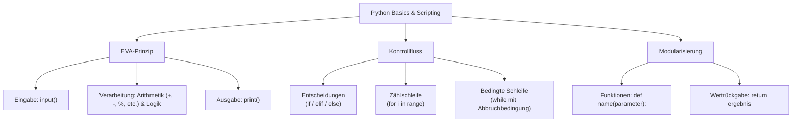

## tags: [fisi, ihk, lernsheet]

## 🧭 Navigation & Zusammenhänge
- **Vorausgesetztes Thema:** [[03_Schleifentypen & Abbruchbedingungen im Detail]]
- **Nächstes Thema:** [[05_Algorithmus-Analyse, Wertetabellen & Namespaces (LEGB)]]
- **Verwandte Bausteine:** [[02_Programmiergrundlagen Datentypen, Operatoren & Kontrollstrukturen]], [[01_Einführung in die Programmierung & Logikgrundlagen]]

## 🎯 IHK-Prüfungsrelevanz

> [!IMPORTANT] AP01: Einrichten eines IT-gestützten Arbeitsplatzes
> 
> - **Relevanz:** Hoch
>     
> - **Fokus:** Praktische Anwendung des EVA-Prinzips (Eingabe, Verarbeitung, Ausgabe) bei der Skripterstellung zur Automatisierung von Client-Konfigurationen, Interaktion mit Anwendern über Benutzereingaben (`input()`) und Konsolenausgaben (`print()`).
>     

> [!WARNING] AP02: Konzeption, Administration & Netzwerke
> 
> - **Relevanz:** Hoch
>     
> - **Fokus:** Steuerung automatisierter Administrationsprozesse durch Verzweigungen (`if`/`elif`/`else`) und Schleifen (`for`, `while`), Modularisierung von Administrationstools mithilfe von Funktionen (`def`, Parameter, `return`), Vermeidung von Endlosschleifen durch explizite Abbruchbedingungen sowie strikte Beachtung von Syntax-Regeln wie der Code-Einrückung (Indentation).
>     

## 📖 Einfache Erklärung & Praxisbeispiele

Python ist eine universelle, hochabstrahierte Interpretersprache, die sich hervorragend zur Automatisierung von administrativen Aufgaben in der Systemintegration eignet. Variablen agieren als benannte Container im RAM. Der Programmablauf folgt dem klassischen EVA-Prinzip (Eingabe, Verarbeitung, Ausgabe) und wird durch Bedingungen, Schleifen sowie wiederverwendbare Funktionen strukturiert.

### Unterthemen & Anschauliche Beispiele:

- **Variablen & Datentypen:**
    
    - **Variablen:** Werden über den Zuweisungsoperator `=` deklariert (z. B. `vorname = 'Max'`, `alter = 25`, `ist_aktiv = True`).
        
    - **Primitivtypen:** `str` (Texte), `int` (Ganzzahlen), `float` (Kommazahlen mit Punkt) und `bool` (`True`/`False`).
        
    - 💡 **Praxisbeispiel:** Ein Skript liest den Namen des Hostsystems aus und speichert ihn in einer String-Variable `hostname = 'SRV-DB-01'`, um anschließend Konfigurationsänderungen vorzunehmen.
        
- **Das EVA-Prinzip in Python:**
    
    - **Eingabe (_E_):** Datenempfang über `input()`.
        
    - **Verarbeitung (_V_):** Logische und arithmetische Operationen (z. B. Grundrechenarten `+`, `-`, `*`, `/` sowie Modulo `%` für Restwert-Berechnungen).
        
    - **Ausgabe (_A_):** Anzeige der Ergebnisse auf der Konsole mittels `print()`.
        
    - 💡 **Praxisbeispiel:** Ein Support-Skript erfragt den Benutzernamen per `name = input('Wer bist Du?')` (_Eingabe_), verarbeitet die Daten (_Verarbeitung_) und begrüßt den Techniker per `print('Hallo', name)` (_Ausgabe_).
        
- **Vergleichs- & Logik-Operatoren:**
    
    - **Unterschied Zuweisung vs. Vergleich:** `=` weist einen Wert zu, `==` prüft auf Gleichheit.
        
    - **Vergleiche:** `==` (Gleich), `!=` (Ungleich), `>`, `<`.
        
    - **Logische Verknüpfungen:** `and` (beide Bedingungen wahr), `or` (mindestens eine wahr), `not` (Negation/Umkehrung).
        
    - 💡 **Praxisbeispiel:** Zugriffsprüfung auf ein Wartungsfenster: `if (alter > 18) and (hat_ticket == True):` gewährt Admin-Rechte nur, wenn beide Bedingungen erfüllt sind.
        
- **Kontrollstrukturen (Entscheidungen & Schleifen):**
    
    - **Verzweigungen (`if`, `elif`, `else`):** Steuern den Kontrollfluss basierend auf Bedingungen; Codeblöcke werden zwingend durch **Einrückungen (Indentation)** strukturiert.
        
    - **`for`-Schleife:** Ideal für eine festgelegte Anzahl von Durchläufen (z. B. mit `range(5)` für Indizes von 0 bis 4).
        
    - **`while`-Schleife:** Läuft solange eine Bedingung wahr ist; benötigt eine klare Abbruchbedingung zur Vermeidung von Endlosschleifen.
        
    - 💡 **Praxisbeispiel:** Eine Passwortabfrage sperrt den Ablauf, solange das eingegebene Passwort falsch ist: `while passwort_eingabe != passwort_gespeichert:` frägt das Skript das Passwort erneut per `input()` ab.
        
- **Modularisierung durch Funktionen:**
    
    - Mithilfe des Schlüsselworts `def` werden wiederverwendbare Code-Bausteine definiert.
        
    - **Parameter & Argumente:** Parameter fungieren als Platzhalter in der Funktionsdefinition, Argumente sind die konkret übergebenen Werte beim Aufruf.
        
    - **`return`:** Liefert das verarbeitete Ergebnis an den Aufrufer zurück.
        
    - 💡 **Praxisbeispiel:** Eine Funktion `def pinge_host(ip):` nimmt eine IP-Adresse als Parameter entgegen, führt den ICMP-Check aus und liefert per `return` den Online-Status zurück. Einmal geschrieben, kann sie für beliebige Server im Netz aufgerufen werden.

