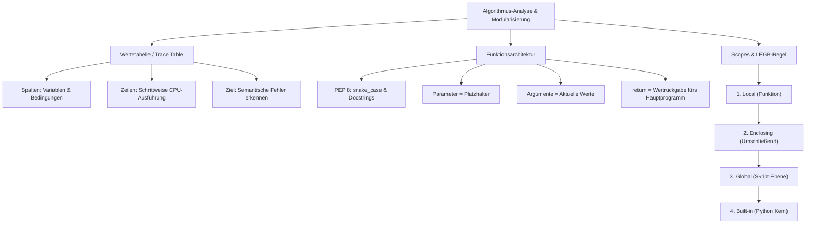

## tags: [fisi, ihk, lernsheet]

## 🧭 Navigation & Zusammenhänge
- **Vorausgesetztes Thema:** [[04_Python Basics Grundlagen, EVA-Prinzip & Kontrollstrukturen]]
- **Nächstes Thema:** [[06_ANSI-SPARC 3-Ebenen-Architektur & ERM (Chen-Notation)]]
- **Verwandte Bausteine:** [[01_Grundlagen der Programmierung & Algorithmen]], [[08_Objektorientierung Datenelemente & Sichtbarkeiten]]
## 🎯 IHK-Prüfungsrelevanz

> [!IMPORTANT] AP01: Einrichten eines IT-gestützten Arbeitsplatzes
> 
> - **Relevanz:** Hoch
>     
> - **Fokus:** Einhaltung von PEP 8 Programmierstandards (z. B. `snake_case`), Erstellung lesbarer Skripte zur Arbeitsplatz-Automatisierung sowie Vermeidung von Seiteneffekten durch sauberes Variablen-Scope-Management.
>     

> [!WARNING] AP02: Konzeption, Administration & Netzwerke
> 
> - **Relevanz:** Hoch
>     
> - **Fokus:** Durchführung manueller Code-Analysen mittels Wertetabellen (_Trace Tables_ – Standard-IHK-Prüfungsinhalt zur Erkennung semantischer Fehler), Unterscheidung zwischen Parametern (Platzhaltern) und Argumenten (konkreten Werten), Modularisierung komplexer Systeme nach dem DRY-Prinzip (_Don't Repeat Yourself_), Anwendung von `return` vs. `print` sowie Beherrschung der LEGB-Regel für Gültigkeitsbereiche/Scopes.
>     

## 📖 Einfache Erklärung & Praxisbeispiele

Um die Logik komplexer Skripte zu durchdringen, logische Fehler (_Semantik_) ohne Debugger zu identifizieren und die CPU-Arbeit nachzuvollziehen, nutzt man Wertetabellen (_Trace Tables_). Zur Vermeidung von unwartbarem „Spaghetti-Code“ wird Software in wiederverwendbare Funktionen zerlegt (DRY-Prinzip). Dabei steuern Gültigkeitsbereiche (_Scopes/Namespaces_), wo Variablen sichtbar und veränderbar sind.

### Unterthemen & Anschauliche Beispiele:

- **Analyse von Algorithmen & Wertetabellen (Trace Tables):**
    
    - **Funktion:** Systematische, zeilenweise Erfassung aller Variablenzustände und Bedingungsprüfungen (`True`/`False`) während des Programmablaufs.
        
    - **Aufbau:** Jede Spalte repräsentiert eine Variable oder Prüfung; jede Zeile entspricht einem Ausführungsschritt im zeitlichen Verlauf.
        
    - 💡 **Praxisbeispiel:** In einer Zählschleife (`for i in range(3):`) dokumentiert die Wertetabelle den Index `i` pro Iteration (Schritt 1: `i=0`, Schritt 2: `i=1`, Schritt 3: `i=2`), um den finalen Variablenzustand exakt nachzuverfolgen.
        
- **Modularisierung & PEP 8 Konventionen:**
    
    - **DRY-Prinzip (_Don't Repeat Yourself_):** Vermeidung von redundantem Code durch Auslagerung wiederkehrender Logik in Funktionen.
        
    - **PEP 8 Standard:** Namensgebung in `snake_case` (kleingeschrieben mit Unterstrichen, z. B. `berechne_nettopreis`). Funktionsbeschreibungen erfolgen in Docstrings (`"""Dokumentation"""`).
        
    - 💡 **Praxisbeispiel:** Statt in jedem Skript die IP-Validierung neu zu schreiben, wird einmal die Funktion `def valide_ip_adresse(ip):` definiert und überall wiederverwendet.
        
- **Parameter vs. Argumente & Rückgabewerte (`return`):**
    
    - **Parameter (Platzhalter - P-P):** Variablen in der Funktionsdefinition (z. B. `def pinge_host(ip_adresse):`).
        
    - **Argumente (Aktuelle Werte - A-A):** Die beim tatsächlichen Funktionsaufruf übergebenen echten Daten (z. B. `pinge_host('192.168.1.1')`).
        
    - **`return` vs. `print`:** `print` zeigt Werte nur auf der Konsole an. `return` beendet die Funktion und liefert den berechneten Wert zur Weiterverarbeitung im Hauptprogramm zurück.
        
    - 💡 **Praxisbeispiel:** Eine Berechnungsfunktion liefert mit `return erg_brutto` das Ergebnis an das Hauptprogramm zurück, wo es weiter in eine Rechnung eingefügt oder in einer Datenbank gespeichert wird.
        
- **Gültigkeitsbereiche (Namespaces) & Die LEGB-Regel:**
    
    - **Lokaler Scope (Local):** Variablen innerhalb einer Funktion existieren nur während deren Ausführung und werden danach gelöscht.
        
    - **Globaler Scope (Global):** Auf oberster Skriptebene definierte Variablen. Vorsicht: Globale Nutzung führt schnell zu unvorhersehbaren Seiteneffekten.
        
    - **LEGB-Regel (Suchreihenfolge des Interpreters):**
        
        1. **L**ocal (Lokale Ebene in der Funktion)
            
        2. **E**nclosing (Umschließende Funktionen bei Verschachtelung)
            
        3. **G**lobal (Oberste Modulebene des Skripts)
            
        4. **B**uilt-in (Vordefinierte Python-Funktionen wie `len()`, `print()`)
            
    - **Shadowing:** Wenn eine lokale Variable denselben Namen wie eine globale Variable besitzt, verdeckt („shadowed“) der lokale Wert den globalen.
        
    - 💡 **Praxisbeispiel:** Existiert eine globale Variable `status = "Server Offline"` und innerhalb einer Funktion `def check(): status = "Online"`, so sucht Python nach der LEGB-Regel zuerst lokal und nutzt `"Online"`, ohne die globale Variable außerhalb zu verändern.

