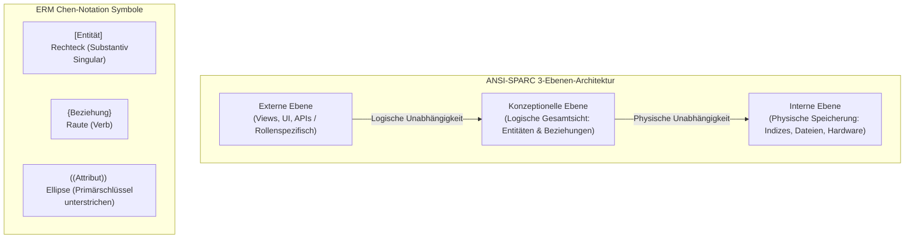

## tags: [fisi, ihk, lernsheet]

## 🧭 Navigation & Zusammenhänge
- **Vorausgesetztes Thema:** [[05_Algorithmus-Analyse, Wertetabellen & Namespaces (LEGB)]]
- **Nächstes Thema:** [[07_Objektorientierung Wert- vs. Referenztypen]]
- **Verwandte Bausteine:** [[01_Datenbankmodelle & Schichtenmodell der Erkenntnis]], [[04_ANSI-SPARC 3-Ebenen-Architektur & Chen-Notation]]

## 🎯 IHK-Prüfungsrelevanz

> [!IMPORTANT] AP01: Einrichten eines IT-gestützten Arbeitsplatzes
> 
> - **Relevanz:** Mittel
>     
> - **Fokus:** Grundlegendes Verständnis von Datenbank-Sichten auf der externen Ebene zur Berechtigungstrennung an Arbeitsplätzen (z. B. Datenschutz/Rollenzuweisung im UI).
>     

> [!WARNING] AP02: Konzeption, Administration & Netzwerke
> 
> - **Relevanz:** Hoch
>     
> - **Fokus:** Verständnis und Anwendung der ANSI-SPARC 3-Ebenen-Architektur zur Gewährleistung logischer und physischer Datenunabhängigkeit, grafischer Entwurf logischer Datenmodelle mittels Entity-Relationship-Diagrammen (ERD) in der Chen-Notation, Bestimmung von Kardinalitäten ($1:1$, $1:n$, $m:n$) sowie Beachtung der Atomarität von Attributen und sauberer Namenskonventionen.
>     

## 📖 Einfache Erklärung & Praxisbeispiele

Beim Entwurf professioneller Datenbanken wird die Systemarchitektur strukturell von den Anwender-Sichten getrennt. Das **ANSI-SPARC 3-Ebenen-Modell** schirmt Endnutzer von technischen Speicherdetails ab und garantiert Datenunabhängigkeit. Zur Planung der logischen Gesamtsicht nutzt man das **Entity-Relationship-Modell (ERM)**, welches Datenstrukturen und deren Verknüpfungen grafisch (häufig in der Chen-Notation) beschreibt.

### Unterthemen & Anschauliche Beispiele:

- **Die ANSI-SPARC 3-Ebenen-Architektur:**
    
    - **Externe Ebene (View Layer):** Anwendungsspezifische, individuelle Sichten (_Views_, UI, APIs) für verschiedene Benutzergruppen (z. B. Marketing vs. Buchhaltung) aus Datenschutzgründen.
        
    - **Konzeptionelle Ebene (Logical Layer):** Die logische Gesamtsicht aller Daten (Entitäten, Attribute, Beziehungen) – völlig unabhängig von Hardware und DBMS-Software.
        
    - **Interne Ebene (Physical Layer):** Die physische Speicherung auf den Datenträgern (Dateipfade, Indizes, Speicherstrukturen, Hardware-Optimierung).
        
    - **Datenunabhängigkeit:**
        
        - _Physische Unabhängigkeit:_ Hardware oder Speicherpfade ändern sich, ohne dass sich das konzeptionelle Schema ändert.
            
        - _Logische Unabhängigkeit:_ Das konzeptionelle Schema erweitert sich, ohne dass bestehende externe Anwendungen brechen.
            
    - 💡 **Praxisbeispiel:** Ein FISI tauscht die zugrundeliegenden HDDs des Datenbank-Servers gegen ein NVMe-RAID aus (_Interne Ebene_). Wegen der physischen Datenunabhängigkeit muss weder das Datenbank-Schema (_Konzeptionelle Ebene_) angepasst werden, noch bemerkt die HR-Software (_Externe Ebene_) den Wechsel – außer durch schnellere Zugriffszeiten.
        
- **Grafische Notationssymbole nach Peter Chen:**
    
    - **Entität (Rechteck):** Objekt der realen Welt, beschriftet mit einem Substantiv im Singular (z. B. `Kunde`, `Dozent`, `Kurs`).
        
    - **Attribut (Ellipse):** Eigenschaft einer Entität; wird über Linien verbunden. Der **Primärschlüssel** wird durch eine Unterstreichung gekennzeichnet (z. B. $\underline{\text{Kunden\_ID}}$).
        
    - **Beziehung (Raute/Diamant):** Logische Verknüpfung zwischen Entitäten, meist beschriftet mit einem Verb (z. B. `leiht aus`, `leitet`).
        
    - 💡 **Praxisbeispiel:** Das Modell einer Videothek stellt die Entität `Kunde` (Rechteck) über die Beziehung `Leiht aus` (Raute) mit der Entität `Film` (Rechteck) dar.
        
- **Kardinalitäten (Quantifizierung von Beziehungen):**
    
    - **$1:1$ (Eins-zu-Eins):** Jede Entität A ist genau einer Entität B zugeordnet (z. B. Person `besitzt` Personalausweis).
        
    - **$1:n$ (Eins-zu-Viele):** Eine Entität A kann mit vielen Entitäten B verknüpft sein, aber eine Entität B gehört zu genau einer Entität A (z. B. eine Abteilung `beschäftigt` viele Mitarbeiter).
        
    - **$m:n$ (Viele-zu-Viele):** Viele Entitäten A sind mit vielen Entitäten B verknüpft (z. B. Student `besucht` Kurse, Kunde `leiht aus` Filme). Dies erfordert später im relationalen Modell eine Hilfstransformation/Koppeltabelle.
        
    - 💡 **Praxisbeispiel:** In einer Schul-Datenbank leitet ein Dozent genau $1$ Kurs ($1:1$). An einem Kurs nehmen jedoch $n$ Schüler teil ($1:n$).
        
- **Best Practices & Modellierungsregeln:**
    
    - **Atomarität von Attributen:** Attribute dürfen keine zusammengesetzten Informationen enthalten. Schlecht: `Name` oder `Anschrift`. Richtig: Trennung in `Vorname`, `Nachname`, `PLZ`, `Ort`, `Straße`.
        
    - **Keine mehrwertigen Attribute:** Feldeinträge wie `Hobby` (mit mehreren Komma-Werten) verletzen die Atomarität.
        
    - **Künstliche Primärschlüssel:** Verwendung eindeutiger, künstlicher IDs (z. B. `Kunden_ID` oder `Kurs_ID`).
        
    - **Vermeidung von Redundanz:** Keine doppelten Attribute in verschiedenen Entitäten ablegen.
        
    - 💡 **Praxisbeispiel:** Bei der Erfassung eines Kunden speichert die DB den Namen nicht im Feld `"Max Mustermann, Berlin"`, sondern zerlegt ihn atomar in `Vorname: Max`, `Nachname: Mustermann`, `Ort: Berlin`, damit eine gezielte Sortierung nach Nachnamen oder Filterung nach PLZ möglich ist.

