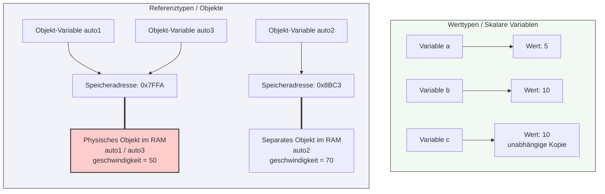

## 🧭 Navigation & Zusammenhänge
- **Vorausgesetztes Thema:** [[06_ANSI-SPARC 3-Ebenen-Architektur & ERM (Chen-Notation)]]
- **Nächstes Thema:** [[08_Objektorientierung Datenelemente & Sichtbarkeiten]]
- **Verwandte Bausteine:** [[13_Definition & Konzept Was ist eine Klasse]], [[14_Definition & Konzept Was ist ein Objekt]]
---

## 🎯 IHK-Prüfungsrelevanz
> [!IMPORTANT] AP01: Einrichten eines IT-gestützten Arbeitsplatzes
> - **Relevanz:** Niedrig
> - **Fokus:** Kaum direkte Relevanz für die reine Client-Konfiguration, jedoch wichtig beim Verstehen von komplexeren objektorientierten Skripten (z. B. in PowerShell bei der Arbeit mit .NET-Objekten).

> [!WARNING] AP02: Konzeption, Administration & Netzwerke
> - **Relevanz:** Mittel bis Hoch
> - **Fokus:** Ein kritischer Stolperstein in der IHK-Anwendungsentwicklung. Die IHK stellt gerne "Tricky"-Aufgaben im Pseudocode, bei denen ein Objekt einer neuen Variable zugewiesen und danach eine Eigenschaft geändert wird. Wer den Unterschied zwischen einer echten Wertkopie und einer Referenzkopie (Speicheradresse) nicht kennt, wählt bei Multiple-Choice-Fragen oder Trace-Tabellen das falsche Ergebnis.

---

## 📖 Einfache Erklärung & Praxisbeispiele
In der Programmierung unterscheidet man fundamental, wie Daten im Arbeitsspeicher (RAM) abgelegt und kopiert werden. 
Bei **skalaren Variablen (Werttypen)** wie Zahlen (`int`, `float`) wird der tatsächliche Wert direkt in der Variable gespeichert. Eine Zuweisung kopiert den Wert.
Bei **Objekten (Referenztypen)** speichert die Variable nicht das Objekt selbst, sondern nur eine **Speicheradresse (Referenz)**, die auf den Platz im RAM zeigt, an dem das Objekt liegt. Eine Zuweisung kopiert nur diese Adresse – beide Variablen zeigen danach auf dasselbe physische Objekt.

### Unterthemen & Anschauliche Beispiele:
- **Zuweisung bei skalaren Variablen (Wertkopie):** Wird eine primitive Variable einer anderen zugewiesen, entsteht eine komplett unabhängige, identische Kopie des Wertes im Speicher. Änderungen an der einen Variable beeinflussen die andere nicht.
  - 💡 **Praxisbeispiel:** 
    ```text
    a = 5;
    b = 10;
    c = b; // c kopiert den Wert 10.
    c = 20; // a und b bleiben völlig unverändert.
    ```
- **Zuweisung bei Objekten (Referenzkopie):** Wird eine Objektvariable einer anderen zugewiesen, wird lediglich die Speicheradresse kopiert. Modifiziert man danach die Eigenschaften über die neue Variable, ändert sich das originale Objekt, da beide Variablen auf denselben Speicherplatz verweisen.
  - 💡 **Praxisbeispiel:** Ein FISI arbeitet mit virtuellen Maschinen (VM-Objekten) in einem Skript.
    ```text
    auto1.geschwindigkeit = 50;
    auto2.geschwindigkeit = 70;
    auto3 = auto1; // auto3 zeigt nun auf dieselbe Speicheradresse wie auto1!
    auto3.geschwindigkeit = 90; // auto1.geschwindigkeit ist jetzt AUTOMATISCH auch 90!
    ```

---

## 📊 Visuelle Darstellung (Mermaid.js)


