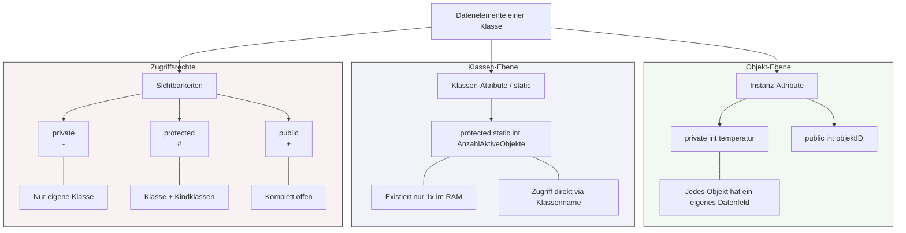

## 🧭 Navigation & Zusammenhänge
- **Vorausgesetztes Thema:** [[07_Objektorientierung Wert- vs. Referenztypen]]
- **Nächstes Thema:** [[09_Objektorientierung Methoden einer Klasse]]
- **Verwandte Bausteine:** [[15_Die Kernziele der Objektorientierung (OOP)]], [[21_Vertiefung Klassendiagramm Beziehungen & Sichtbarkeiten]]
---

## 🎯 IHK-Prüfungsrelevanz
> [!IMPORTANT] AP01: Einrichten eines IT-gestützten Arbeitsplatzes
> - **Relevanz:** Niedrig
> - **Fokus:** Verständnis von Objektstrukturen bei der Skript-basierten Verwaltung (z. B. AD-User-Attribute in PowerShell).

> [!WARNING] AP02: Konzeption, Administration & Netzwerke
> - **Relevanz:** Hoch
> - **Fokus:** Ein absoluter Standard in IHK-Prüfungen. Die IHK verlangt regelmäßig das Lesen oder Schreiben von Klassendiagrammen (häufig im UML-Standard). Zu verstehen, was die Modifikatoren (`+` für public, `-` für private) bedeuten, wie Datenfelder deklariert werden und was das Schlüsselwort `static` bewirkt, entscheidet über wertvolle Punkte im Programmierteil der Abschlussprüfung.

---

## 📖 Einfache Erklärung & Praxisbeispiele
**Datenelemente** (auch Attribute, Felder oder Eigenschaften genannt) werden innerhalb einer Klasse deklariert. Sie beschreiben den datenmäßigen Zustand oder die Merkmale eines Objekts. In der objektorientierten Programmierung (OOP) ist es ein grundlegendes Prinzip, diese Daten nicht ungeschützt von außen manipulierbar zu machen. Stattdessen regeln **Sichtbarkeitsmodifikatoren**, wer auf die Daten zugreifen darf. Zudem wird streng zwischen Attributen unterschieden, die zu einer konkreten Objektinstanz gehören, und solchen, die global für die gesamte Klasse gelten (`static`).

### Unterthemen & Anschauliche Beispiele:
- **Instanz-Attribute (Objekt-Eigenschaften):** Beschreiben Eigenschaften eines *konkreten* Objekts. Jedes erzeugte Objekt besitzt seine eigenen, separaten Werte für diese Felder.
  - 💡 **Praxisbeispiel:** Die Klasse `Server` besitzt das Attribut `int speicherKapazitaet`. Instanziiert der FISI `server1` mit 500GB und `server2` mit 2000GB, speichert jedes Objekt unabhängig seinen eigenen Zustand.
- **Klassen-Attribute (Statische Attribute / `static`):** Gehören der Klasse als Ganzes, nicht den einzelnen Objekten. Sie existieren genau **einmal** im Speicher. Der Zugriff erfolgt direkt über den Klassennamen – es muss dafür kein Objekt instanziiert werden. Objekte selbst enthalten dieses Attribut nicht.
  - 💡 **Praxisbeispiel:** Ein Lizenzüberwachungs-Skript nutzt in der Klasse `Lizenz` das Attribut `protected static int AnzahlAktiveObjekte`. Jedes Mal, wenn ein neues Lizenzobjekt erstellt wird, erhöht sich dieser zentrale Zähler für die gesamte Klasse.
- **Sichtbarkeitsstufen & Datenkapselung:** Um Daten vor ungewollten Schreibzugriffen von außen zu schützen, sollten Attribute nach Möglichkeit restriktiv deklariert und über Methoden (Getter/Setter) abgesichert werden:
  - `private`: Zugriff nur innerhalb derselben Klasse erlaubt (Standard für Attribute).
  - `protected`: Zugriff innerhalb der Klasse und deren abgeleiteten Unterklassen erlaubt.
  - `public`: Zugriff für alle Programmteile von außen erlaubt (offene Schnittstelle).

---

## 📊 Visuelle Darstellung (Mermaid.js)

