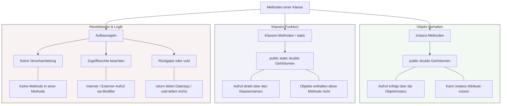

## 🧭 Navigation & Zusammenhänge
- **Vorausgesetztes Thema:** [[08_Objektorientierung Datenelemente & Sichtbarkeiten]]
- **Nächstes Thema:** [[10_Objektorientierung Die Objektreferenz this]]
- **Verwandte Bausteine:** [[08_Objektorientierung Datenelemente & Sichtbarkeiten]], [[19_Das UML-Klassendiagramm]]
---

## 🎯 IHK-Prüfungsrelevanz
> [!IMPORTANT] AP01: Einrichten eines IT-gestützten Arbeitsplatzes
> - **Relevanz:** Niedrig
> - **Fokus:** Verständnis von Objekt-Methoden zur Abfrage von Systemwerten in administrativen Skripten (z. B. `.ToString()` oder `.GetType()`).

> [!WARNING] AP02: Konzeption, Administration & Netzwerke
> - **Relevanz:** Hoch
> - **Fokus:** Zentraler Bestandteil von Programmieraufgaben. In IHK-Prüfungen musst du häufig Methoden im Pseudocode implementieren, Parameter korrekt übergeben und Rückgabewerte (`return`) logisch verarbeiten. Das Unterscheiden von Instanz-Methoden und Klassen-Methoden (`static`) ist hierbei essenziell, um korrekte Programmabläufe zu entwerfen oder in UML-Klassendiagrammen zu interpretieren.

---

## 📖 Einfache Erklärung & Praxisbeispiele
**Methoden** legen die Funktionalität und das Verhalten von Objekten fest. Sie sind benannte Programmblöcke, die innerhalb einer Klasse deklariert werden, um Daten einzulesen, Berechnungen anzustellen oder Aktionen auszuführen. Methoden können Parameter (Eingabewerte) empfangen und Ergebnisse über einen Rückgabetyp zurückliefern. Ist kein Rückgabewert erforderlich, wird das Schlüsselwort `void` genutzt. Auch hier wird fundamental zwischen Verhaltensweisen unterschieden, die an eine konkrete Objektinstanz gebunden sind, und Funktionen, die global der gesamten Klasse zugeordnet sind (`static`).

### Unterthemen & Anschauliche Beispiele:
- **Instanz-Methoden:** Beschreiben das Verhalten eines *konkreten* Objekts. Sie können auf die individuellen Instanz-Attribute des jeweiligen Objekts zugreifen.
  - 💡 **Praxisbeispiel:** 
    ```text
    public double GetVolumen(float l, float b, float h) 
    {
        return l * b * h;
    }
    ```
    Ein FISI instanziiert ein Objekt `paket1` der Klasse `Paket`. Der Aufruf erfolgt über die Instanz: `paket1.GetVolumen(10, 20, 30);`.
- **Klassen-Methoden (Statische Methoden / `static`):** Gehören zur Klasse als Ganzes. Für ihren Aufruf wird kein instanziiertes Objekt benötigt. Der Zugriff erfolgt direkt über den Klassennamen. Statische Methoden können *nicht* auf Instanz-Attribute zugreifen, sondern operieren nur auf den übergebenen Parametern oder statischen Variablen.
  - 💡 **Praxisbeispiel:** Eine mathematische Hilfsklasse `NetzwerkRechner` besitzt die Methode `public static String BerechneSubnetz(String ip, int cidr)`. Der Administrator ruft sie direkt über die Klasse auf: `NetzwerkRechner.BerechneSubnetz("192.168.1.0", 24);`, ohne vorher ein Objekt erzeugen zu müssen.
- **Regeln und Interaktionen von Methoden:**
  - **Zugehörigkeit:** Methoden gehören *immer* zu einer Klasse. Es können beliebig viele in beliebiger Reihenfolge angelegt werden.
  - **Verschachtelung:** Innerhalb einer Methode kann *keine* weitere Methode deklariert werden.
  - **Aufrufe:** Methoden einer Klasse können andere Methoden derselben Klasse direkt aufrufen. Sie können auch Methoden fremder Klassen aufrufen, sofern die Sichtbarkeits-Modifikatoren (`public`) dies erlauben.

---

## 📊 Visuelle Darstellung (Mermaid.js)

