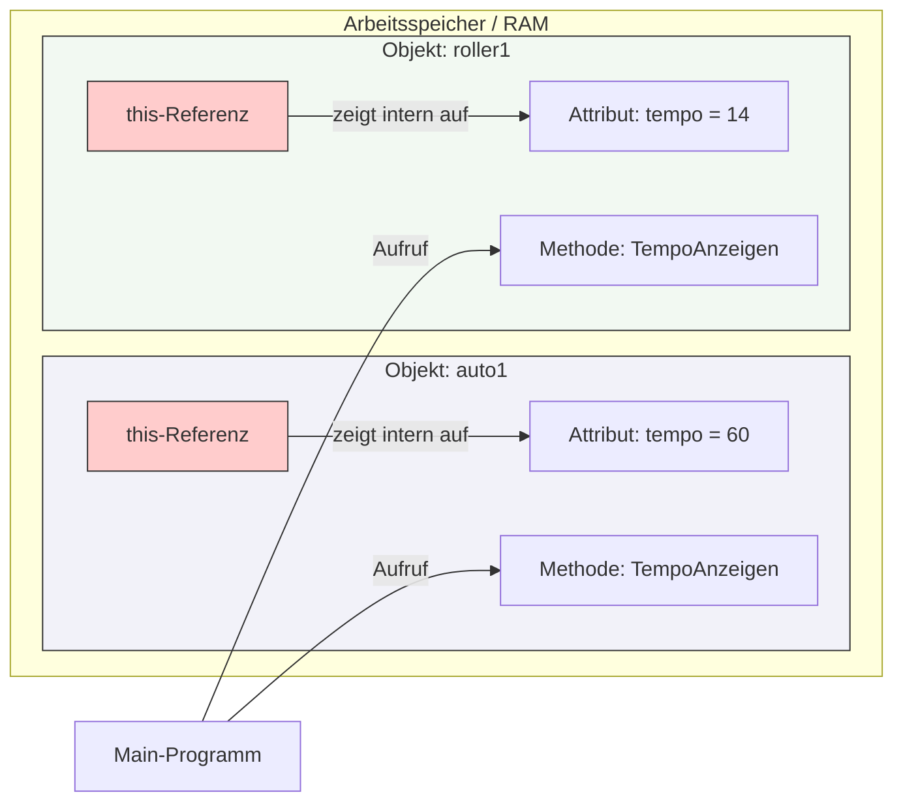

## 🧭 Navigation & Zusammenhänge
- **Vorausgesetztes Thema:** [[09_Objektorientierung Methoden einer Klasse]]
- **Nächstes Thema:** [[11_Grundkonzepte der OOP vs. Strukturierte Programmierung]]
- **Verwandte Bausteine:** [[14_Definition & Konzept Was ist ein Objekt]], [[09_Objektorientierung Methoden einer Klasse]]
---

## 🎯 IHK-Prüfungsrelevanz
> [!IMPORTANT] AP01: Einrichten eines IT-gestützten Arbeitsplatzes
> - **Relevanz:** Niedrig
> - **Fokus:** Keine direkte Auswirkung auf reine Client-Installationen, da es sich um ein internes Sprachkonstrukt handelt.

> [!WARNING] AP02: Konzeption, Administration & Netzwerke
> - **Relevanz:** Mittel bis Hoch
> - **Fokus:** Wichtig für das fehlerfreie Lesen und Schreiben von Quellcode und Pseudocode. Die IHK nutzt `this` sehr häufig in Konstruktoren, wenn Übergabeparameter exakt denselben Namen tragen wie die Attribute der Klasse. Wer hier den Sinn von `this` nicht versteht, verwechselt im Ablauf die lokalen Parameter mit den eigentlichen Objekt-Eigenschaften.

---

## 📖 Einfache Erklärung & Praxisbeispiele
Da Datenelemente (Attribute) und Methoden gemeinsam in derselben Klasse definiert werden, "wohnen" sie nach der Instanziierung auch im selben Objekt im Arbeitsspeicher. **`this`** ist eine spezielle **Referenzvariable**, die vom Compiler automatisch in jedem erzeugten Objekt bereitgestellt wird. Sie verweist immer auf das *aktuelle* Objekt selbst, in dem der Code gerade ausgeführt wird ("dieses Objekt"). Mit `this` greift eine Instanz-Methode explizit auf die eigenen Member (Attribute und Methoden) zu, um Eindeutigkeit zu schaffen.

### Unterthemen & Anschauliche Beispiele:
- **Eindeutigkeit bei Namensgleichheit (Kapselung):** Der häufigste Einsatz von `this` findet im Konstruktor oder in Setter-Methoden statt. Wenn ein Übergabeparameter denselben Bezeichner hat wie ein Klassenattribut, löst `this` den Konflikt auf.
  - 💡 **Praxisbeispiel:** 
    ```text
    class Server {
        private String ipAdresse;
        
        public Server(String ipAdresse) {
            this.ipAdresse = ipAdresse; 
            // this.ipAdresse meint das Attribut des Objekts.
            // = ipAdresse meint den gerade übergebenen Parameter.
        }
    }
    ```
- **Kontextbezogener Zugriff:** Alle Instanz-Methoden eines Objekts können auf `this` zugreifen. Ruft man dieselbe Methode für zwei verschiedene Objekte auf, zeigt `this` intern jeweils auf den Speicherbereich des aktuell aktiven Objekts.
  - 💡 **Praxisbeispiel:** Ein FISI instanziiert zwei Netzwerkschnittstellen:
    ```text
    Fahrzeug auto1 = new Fahrzeug();
    Fahrzeug roller1 = new Fahrzeug();
    auto1.tempo = 60;
    roller1.tempo = 14;
    
    auto1.TempoAnzeigen();   // Intern nutzt die Methode 'this.tempo' und gibt 60 aus.
    roller1.TempoAnzeigen(); // Intern nutzt dieselbe Methode 'this.tempo' und gibt 14 aus.
    ```

---

## 📊 Visuelle Darstellung (Mermaid.js)



