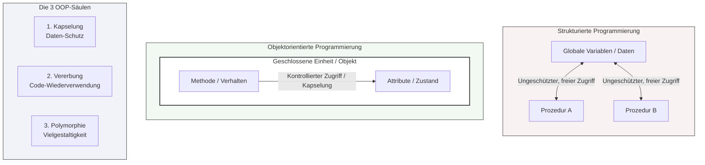

## 🧭 Navigation & Zusammenhänge
- **Vorausgesetztes Thema:** [[10_Objektorientierung Die Objektreferenz this]]
- **Nächstes Thema:** [[12_Vorteile der OOP & Software-Effizienz]]
- **Verwandte Bausteine:** [[01_Einführung in die Programmierung & Logikgrundlagen]], [[15_Die Kernziele der Objektorientierung (OOP)]]
---

## 🎯 IHK-Prüfungsrelevanz
> [!IMPORTANT] AP01: Einrichten eines IT-gestützten Arbeitsplatzes
> - **Relevanz:** Niedrig
> - **Fokus:** Verständnis des objektorientierten Aufbaus moderner Administrationswerkzeuge (z. B. warum PowerShell Ausgaben als Objekte statt als reinen Text weitergibt).

> [!WARNING] AP02: Konzeption, Administration & Netzwerke
> - **Relevanz:** Hoch
> - **Fokus:** Ein absoluter Klassiker für Theoriefragen im Programmier- und Konzeptionsbereich der IHK. Die IHK verlangt regelmäßig die Gegenüberstellung von strukturierter und objektorientierter Programmierung. Kernbegriffe wie Kapselung, Vererbung und Polymorphie müssen fehlerfrei definiert und voneinander abgegrenzt werden können.

---

## 📖 Einfache Erklärung & Praxisbeispiele
Die Software-Entwicklung kennt zwei fundamentale Denkweisen: Die **klassische strukturierte Programmierung** zerlegt eine Gesamtaufgabe mittels Top-Down- oder Bottom-Up-Ansatz in Prozeduren und Funktionen. Der große Nachteil: Daten (Variablen) und Code (Funktionen) sind strikt getrennt. Dadurch können ungeschützte Zugriffe auf globale Variablen stattfinden, was fatale, schwer auffindbare Semantikfehler erzeugt.

Die **Objektorientierte Programmierung (OOP)** fasst Daten (Attribute) und die Operationen (Methoden) in einer einzigen geschlossenen Struktur – der **Klasse** – zusammen. Variablen, die nach diesem Bauplan erzeugt werden, heißen **Objekte**. Das Lösen einer Aufgabe erfolgt dadurch, dass Objekte untereinander Nachrichten austauschen und gegenseitig Methoden aufrufen. OOP-Programme sind deutlich leichter zu warten, zu erweitern und einzelne Klassen sind in anderen Projekten direkt wiederverwendbar.

### Die 3 Kernsäulen der OOP:
- **1. Datenkapselung (Encapsulation):** Der Schutz von Objektdaten vor direktem Überschreiben von außen. Eigenschaften werden restriktiv geschützt (`private`) und Zugriffe erfolgen ausschließlich indirekt über Methoden (Getter/Setter). Dadurch können Werte vor der Speicherung validiert, korrigiert oder zurückgewiesen werden.
  - 💡 **Praxisbeispiel:** Ein FISI schreibt eine Klasse `Benutzerkonto`. Das Attribut `int speicherKontingent` ist gekapselt. Versucht ein Skript, den Speicher auf einen negativen Wert zu setzen, verweigert die Setter-Methode dies vor der internen Speicherung.
- **2. Vererbung (Inheritance):** Daten und Funktionalitäten einer generalisierten **Oberklasse (Basisklasse)** werden an eine spezialisierte **Unterklasse (abgeleitete Klasse)** übergeben. Redundanter Code wird vermieden, da Attribute nicht neu implementiert werden müssen.
  - 💡 **Praxisbeispiel:** Eine Basisklasse `Netzwerkgeraet` vererbt allgemeine Eigenschaften wie `ipAdresse` und `macAdresse` an die abgeleiteten Klassen `Switch` und `Router`, welche zusätzlich eigene, spezialisierte Routing-Funktionen erhalten.
- **3. Polymorphie (Vielgestaltigkeit):** Eine Methode der Oberklasse wird mit exakt demselben Namen in einer Unterklasse aufgerufen, besitzt dort aber eine andere, an das Objekt angepasste Funktionalität.
  - 💡 **Praxisbeispiel:** Die Oberklasse `Netzwerkgeraet` besitzt die Methode `Neustart()`. Ein abgeleitetes Objekt `Server` führt bei `Neustart()` einen kontrollierten Shutdown der Dienste aus, während ein abgeleiteter `Switch` sofort die Stromzufuhr der Ports kappt und neu bootet.

---

## 📊 Visuelle Darstellung (Mermaid.js)

