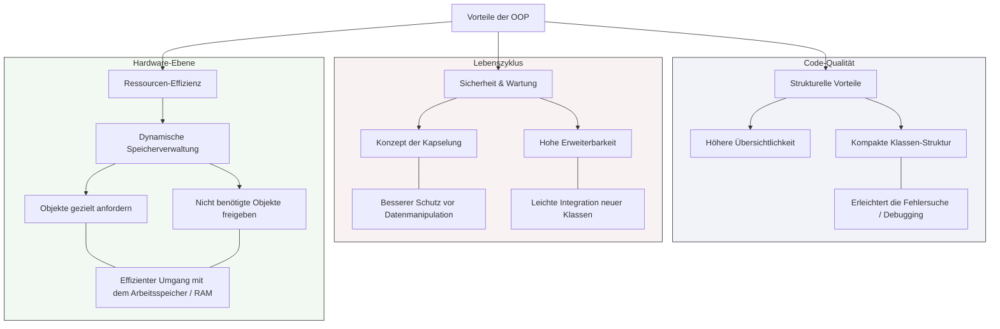

## 🧭 Navigation & Zusammenhänge
- **Vorausgesetztes Thema:** [[11_Grundkonzepte der OOP vs. Strukturierte Programmierung]]
- **Nächstes Thema:** [[13_Definition & Konzept Was ist eine Klasse]]
- **Verwandte Bausteine:** [[09_Software-Qualität, Testing & Künstliche Intelligenz]], [[15_Die Kernziele der Objektorientierung (OOP)]]
---

## 🎯 IHK-Prüfungsrelevanz
> [!IMPORTANT] AP01: Einrichten eines IT-gestützten Arbeitsplatzes
> - **Relevanz:** Niedrig
> - **Fokus:** Verständnis von ressourcenschonender Softwareausführung auf Client-Systemen.

> [!WARNING] AP02: Konzeption, Administration & Netzwerke
> - **Relevanz:** Hoch
> - **Fokus:** Die IHK fragt in konzeptionellen Aufgabenstellungen der Anwendungsentwicklung regelmäßig nach den wirtschaftlichen und technischen Begründungen für den Einsatz von OOP. Insbesondere die Aspekte der Wartbarkeit, der strukturierten Fehlersuche in komplexen Systemen sowie das Zusammenspiel mit dem Arbeitsspeicher (Ressourceneffizienz) sind beliebte Punktebringer in Freitextfragen.

---

## 📖 Einfache Erklärung & Praxisbeispiele
Die **Objektorientierte Programmierung (OOP)** bietet im Vergleich zu älteren Programmierparadigmen massive strategische und technische Vorteile für die Software-Entwicklung und den Systembetrieb. Durch die Bündelung von Logik und Daten in abgeschlossenen Einheiten wird der gesamte Quellcode strukturell entlastet. Neben organisatorischen Vorteilen bei der Code-Verwaltung bietet OOP durch die **dynamische Instanziierung** auch direkte Laufzeitvorteile für die zugrunde liegende Hardware-Infrastruktur.

### Die Kernvorteile im Überblick:
* **Höhere Übersichtlichkeit:** Quelltexte werden durch die modulare Aufteilung in Klassen sauber strukturiert, anstatt in gigantischen, unübersichtlichen Skriptdateien zu enden.
* **Erleichterte Fehlersuche (Debugging):** Die kompakte und isolierte Struktur der einzelnen Klassen sorgt dafür, dass logische Fehler schnell auf den betroffenen Baustein eingegrenzt werden können.
* **Optimaler Datenschutz (Kapselung):** Da Variablen nicht ungeschützt im globalen Raum liegen, verhindern definierte Zugriffsmethoden die unbemerkte Datenkorruption durch fremde Programmteile.
* **Flexible Erweiterbarkeit:** Neue Klassen oder funktionale Änderungen lassen sich mit minimalem Risiko und ohne Seiteneffekte in bereits bestehende Software-Systeme integrieren.
* **Effiziente RAM-Auslastung:** Durch das gezielte Anfordern und anschließende Freigeben von **dynamischem Speicher** für Objekte, die im Programmverlauf aktuell benötigt werden, wird ein hochgradig effizienter Umgang mit dem Arbeitsspeicher sichergestellt.

  - 💡 **Praxisbeispiel (Effiziente Speicherverwaltung):** Ein FISI entwickelt einen automatisierten Netzwerk-Scanner. Anstatt die Daten aller 10.000 gescannten Geräte permanent im RAM zu halten, erzeugt das Skript für jedes Gerät ein temporäres Objekt. Sobald die Daten in die SQL-Datenbank geschrieben wurden, wird das Objekt freigegeben und der dynamische Speicher im RAM steht sofort wieder für den nächsten Scan-Zyklus bereit.

---

## 📊 Visuelle Darstellung (Mermaid.js)

