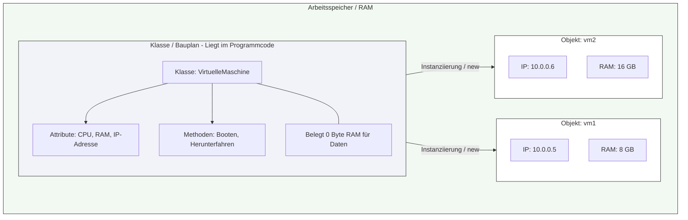

## 🧭 Navigation & Zusammenhänge
- **Vorausgesetztes Thema:** [[12_Vorteile der OOP & Software-Effizienz]]
- **Nächstes Thema:** [[14_Definition & Konzept Was ist ein Objekt]]
- **Verwandte Bausteine:** [[14_Definition & Konzept Was ist ein Objekt]], [[19_Das UML-Klassendiagramm]]
---

## 🎯 IHK-Prüfungsrelevanz
> [!IMPORTANT] AP01: Einrichten eines IT-gestützten Arbeitsplatzes
> - **Relevanz:** Niedrig
> - **Fokus:** Keine direkte Anwendung bei der Hardware-Konfiguration, jedoch grundlegend für das Verstehen von Skript-Objekten im Betriebssystem.

> [!WARNING] AP02: Konzeption, Administration & Netzwerke
> - **Relevanz:** Hoch
> - **Fokus:** Die IHK fordert in der Anwendungsentwicklung die fehlerfreie begriffliche Abgrenzung zwischen einer "Klasse" und einem "Objekt" (Instanz). Ein häufiger Fehler in Prüfungen ist die Annahme, dass das reine Definieren einer Klasse bereits RAM belegt. Das Verständnis über den Zeitpunkt der Speicherallokation ist essenziell für Systemarchitektur-Fragen.

---

## 📖 Einfache Erklärung & Praxisbeispiele
Eine **Klasse** ist der rein theoretische **Bauplan** für ein Objekt. Sie dient als abstraktes Modell, Muster oder Vorlage. Die Klasse selbst legt fest, welche Daten und Verhaltensweisen die aus ihr erzeugten Objekte später besitzen werden. 

Wichtig für die Systemintegration: Solange eine Klasse nur im Quelltext entworfen und deklariert ist, wird für sie **kein Speicherplatz im RAM** reserviert. Erst wenn im Programmverlauf ein konkretes Objekt auf Basis dieses Bauplans erzeugt wird (Instanziierung), fordert das System physischen Arbeitsspeicher an. Auf Basis einer einzigen Klasse können beliebig viele, voneinander unabhängige Objekte erstellt werden.

### Wichtige Fachbegriffe (IHK-Vokabular):
* **Daten einer Klasse:** Werden synonym als **Datenelemente**, **Felder**, **Attribute**, **Merkmale** oder **Eigenschaften** bezeichnet. Sie beschreiben den Zustand.
* **Funktionalitäten einer Klasse:** Werden als **Methoden** bezeichnet. Sie beschreiben das Verhalten.
* **Member (Mitglieder):** Die Gesamtheit aller Datenelemente und Methoden einer Klasse wird als *Member* bezeichnet.

  - 💡 **Praxisbeispiel:** Ein FISI entwirft ein automatisiertes Deployment-Tool. Er schreibt die Klasse `VirtuelleMaschine` (der Bauplan). Dieser Bauplan legt fest, dass jede VM eine `vCPU-Anzahl` (Attribut) und eine Methode `Starten()` besitzt. Das Skript belegt beim Starten erst einmal 0 Byte RAM für Daten. Erst wenn die Schleife läuft und `vm1`, `vm2` und `vm3` erzeugt, wird für jede Instanz separat Speicherplatz im RAM allokiert.

---

## 📊 Visuelle Darstellung (Mermaid.js)

