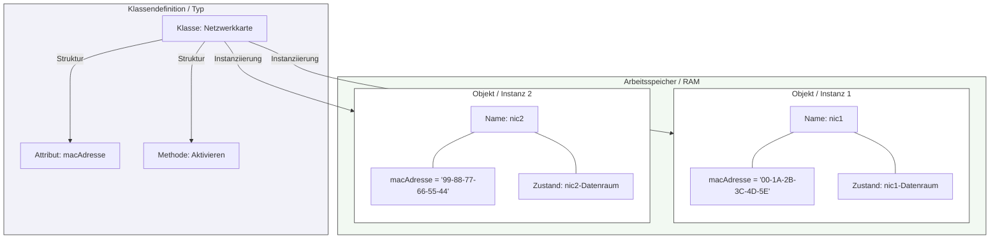

## 🧭 Navigation & Zusammenhänge
- **Vorausgesetztes Thema:** [[13_Definition & Konzept Was ist eine Klasse]]
- **Nächstes Thema:** [[15_Die Kernziele der Objektorientierung (OOP)]]
- **Verwandte Bausteine:** [[13_Definition & Konzept Was ist eine Klasse]], [[20_Darstellung von Klassen und Objekten (UML-Spezialkonzepte)]]
---

## 🎯 IHK-Prüfungsrelevanz
> [!IMPORTANT] AP01: Einrichten eines IT-gestützten Arbeitsplatzes
> - **Relevanz:** Niedrig
> - **Fokus:** Grundverständnis für objektbasierte Systemabfragen (z. B. WMI/CIM-Objekte in Windows-Umgebungen).

> [!WARNING] AP02: Konzeption, Administration & Netzwerke
> - **Relevanz:** Hoch
> - **Fokus:** Die IHK prüft das exakte Verständnis von Objekten im RAM. Systemintegratoren müssen in Ablaufanalysen (Trace-Tabellen) den Zustand eines Objekts protokollieren können. Wichtig ist die Erkenntnis, dass Objekte derselben Klasse exakt dieselbe Struktur besitzen und sich ausschließlich durch ihre Variablenwerte unterscheiden.

---

## 📖 Einfache Erklärung & Praxisbeispiele
Ein **Objekt** (auch **Objektvariable** oder **Instanz** genannt) ist eine Variable, die nach dem genauen Muster einer Klasse erzeugt wurde. Im Gegensatz zu einer *skalaren Variable* (wie `float einzelpreis = 13.95;`), bei der man einen primitiven Datentyp wählt, wird ein Objekt durch die Auswahl einer definierten *Klasse* als Typ erstellt. Der Vorgang des Erstellens wird als **Instanziierung** bezeichnet.

Alle Objekte, die aus derselben Klasse hervorgegangen sind, besitzen exakt dieselben Datenelemente (Attribute) und dieselben Funktionalitäten (Methoden). Der fundamentale Unterschied liegt in den konkreten Inhalten: Die einzelnen Objekte unterscheiden sich ausschließlich durch die aktuellen **Werte**, die sie in ihren Datenelementen speichern. Während der Programmausführung hat jede Instanz einen eigenen, fest zugewiesenen Speicherplatz im RAM.

### Kernmerkmale eines Objekts:
* **Zustand des Objekts:** Die Datenelemente eines Objekts enthalten die aktuellen Daten. Diese Werte bestimmen den gegenwärtigen Zustand der Instanz.
* **Methoden des Objekts:** Die Funktionalitäten dienen dazu, Daten anzuzeigen, neue Daten entgegenzunehmen oder komplexere administrative Vorgänge auszuführen.

  - 💡 **Praxisbeispiel:** Ein FISI verwaltet Netzwerkkarten über ein Skript. Die zugrunde liegende Klasse heißt `Netzwerkkarte`. Das Skript instanziiert nun zwei konkrete Objekte: `nic1` (Typ: `Netzwerkkarte`) und `nic2` (Typ: `Netzwerkkarte`). Beide besitzen das Feld `macAdresse`. Der Zustand von `nic1` ist `00-1A-2B...`, der Zustand von `nic2` ist `00-1A-3C...`. Beide nutzen dieselbe Methode `Aktivieren()`, operieren dabei aber auf ihrem eigenen Speicherplatz im RAM.

---

## 📊 Visuelle Darstellung (Mermaid.js)

