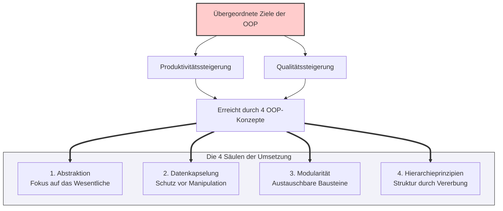

## 🧭 Navigation & Zusammenhänge
- **Vorausgesetztes Thema:** [[14_Definition & Konzept Was ist ein Objekt]]
- **Nächstes Thema:** [[16_ Phasen des OOP-Vorgehensmodells]]
- **Verwandte Bausteine:** [[11_Grundkonzepte der OOP vs. Strukturierte Programmierung]], [[12_Vorteile der OOP & Software-Effizienz]]
---

## 🎯 IHK-Prüfungsrelevanz
> [!IMPORTANT] AP01: Einrichten eines IT-gestützten Arbeitsplatzes
> - **Relevanz:** Niedrig
> - **Fokus:** Verständnis von Softwarearchitekturen bei Standardanwendungen.

> [!WARNING] AP02: Konzeption, Administration & Netzwerke
> - **Relevanz:** Hoch
> - **Fokus:** Ein sehr beliebtes Thema für konzeptionelle Fragestellungen. Die IHK fordert oft eine Begründung, *warum* ein IT-System nach OOP-Prinzipien entworfen wird. Du musst in Prüfungen die übergeordneten wirtschaftlichen/technischen Ziele (Produktivität & Qualität) nennen und erklären können, mit welchen vier Kernkonzepten diese in der Praxis erreicht werden.

---

## 📖 Einfache Erklärung & Praxisbeispiele
Das übergeordnete Ziel beim Einsatz von objektorientierter Softwareentwicklung ist die **Produktivitäts- und Qualitätssteigerung**. IT-Projekte müssen heute schneller umgesetzt werden (Produktivität), während die resultierende Software stabil, fehlerfrei und sicher laufen muss (Qualität). Um diese beiden Ziele in modernen Systemen zu garantieren, setzt die OOP auf vier fundamentale Architekturkonzepte:

### Die 4 Kernkonzepte zur Zielerreichung:
* **Abstraktion:** Die Reduzierung von komplexen Systemen auf das Wesentliche. Unnötige Details der realen Welt werden ausgeblendet, um ein klares Softwaremodell zu schaffen.
  * 💡 **Praxisbeispiel:** Beim Entwurf einer Klasse `Netzwerkgerät` ignoriert der FISI die Gehäusefarbe oder das Gewicht des Switches und fokussiert sich rein auf prüfungsrelevante Aspekte wie die `IP-Adresse` und die Anzahl der Ports.
* **Datenkapselung:** Der strikte Schutz des inneren Zustands eines Objekts. Attribute werden isoliert, sodass kein unkontrollierter Zugriff von außen stattfinden kann.
  * 💡 **Praxisbeispiel:** Ein Service-Objekt erlaubt das Ändern des Systempassworts nicht direkt, sondern zwingt das Programm über eine Validierungsmethode, die Komplexitätsregeln zu prüfen.
* **Modularität:** Das Aufteilen eines großen Softwaresystems in kleinere, eigenständige und austauschbare Baugruppen (Klassen/Module).
  * 💡 **Praxisbeispiel:** Ein Monitoring-Tool besteht aus separaten Modulen für den E-Mail-Versand, die Datenbank-Abfrage und den Netzwerk-Ping. Ändert sich der Mailserver, muss nur dieses eine Modul angepasst werden.
* **Hierarchieprinzipien:** Die Organisation von Klassen in logischen Ober- und Unterstrukturen (Vererbung). Gemeinsamkeiten werden zentral verwaltet, Besonderheiten spezialisiert.
  * 💡 **Praxisbeispiel:** Eine allgemeine Basisklasse `Benutzer` vererbt Basiseigenschaften an die spezialisierten Hierarchiestufen `StandardUser` und `DomainAdmin`.

---

## 📊 Visuelle Darstellung (Mermaid.js)

