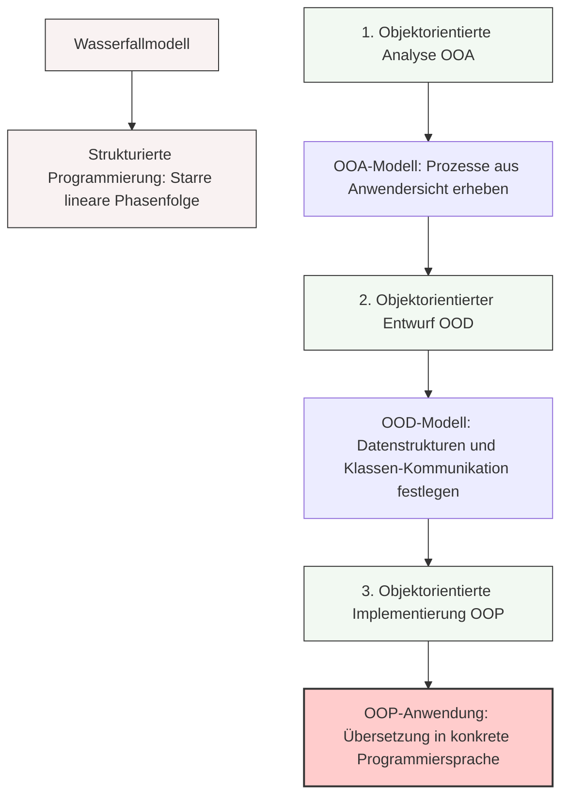

## 🧭 Navigation & Zusammenhänge
- **Vorausgesetztes Thema:** [[15_Die Kernziele der Objektorientierung (OOP)]]
- **Nächstes Thema:** [[17_Grundlagen der Unified Modeling Language (UML)]]
- **Verwandte Bausteine:** [[06_Prozessmodellierung]], [[18_Übersicht der UML-Diagrammarten nach Entwicklungsphasen]]
---

## 🎯 IHK-Prüfungsrelevanz
> [!IMPORTANT] AP01: Einrichten eines IT-gestützten Arbeitsplatzes
> - **Relevanz:** Niedrig
> - **Fokus:** Strukturierte Vorgehensweise bei der Planung von kleineren Automatisierungsschritten.

> [!WARNING] AP02: Konzeption, Administration & Netzwerke
> - **Relevanz:** Hoch
> - **Fokus:** Ein sehr wichtiges Thema für den Bereich Projektmanagement und Softwarekonzeption. Die IHK fragt regelmäßig die typischen Phasen der Softwareentwicklung ab. Du musst den Unterschied zwischen den klassischen, starren Modellen (wie dem Wasserfallmodell bei der strukturierten Programmierung) und dem dreistufigen objektorientierten Entwicklungsprozess (OOA, OOD, OOP) kennen, benennen und inhaltlich voneinander abgrenzen können.

---

## 📖 Einfache Erklärung & Praxisbeispiele
Software wird grundsätzlich in strukturierten Phasen entwickelt. Während die klassische strukturierte Programmierung stark auf lineare, aufeinanderfolgende Phasen wie das **Wasserfallmodell** setzt (Anforderungen ➔ Entwurf ➔ Implementation ➔ Überprüfung ➔ Wartung), nutzt die objektorientierte Welt ein spezialisiertes, dreistufiges Vorgehensmodell. Dieses Modell stellt sicher, dass die Anforderungen des Anwenders nahtlos in saubere, objektorientierte Datenstrukturen überführt und anschließend fehlerfrei programmiert werden.

### Die 3 Kernphasen des OOP-Modells:
* **1. Objektorientierte Analyse (OOA):** In dieser ersten Phase werden alle benötigten Prozesse und Anforderungen rein aus der **Sicht des Anwenders** erfasst. Das Ergebnis ist das **OOA-Modell**, welches die logische Realität beschreibt, ohne sich bereits Gedanken über Code zu machen.
  * 💡 **Praxisbeispiel:** Ein FISI plant ein neues IT-Asset-Management-Tool. In der OOA-Phase erfasst er: Ein Mitarbeiter muss Server, Switches und Lizenzen eintragen, verschieben oder ausmustern können.
* **2. Objektorientierter Entwurf (OOD):** Auf Basis des OOA-Modells werden nun die konkreten **Datenstrukturen (Klassen) und deren Kommunikation** untereinander festgelegt. Das Ergebnis ist das **OOD-Modell**, das meistens in Form von grafischen UML-Klassendiagrammen dargestellt wird.
  * 💡 **Praxisbeispiel:** Der FISI legt im Entwurf fest: Es gibt eine Oberklasse `Hardware` mit Attributen wie `Seriennummer`, von der die Unterklassen `Server` und `Switch` erben. Zudem wird definiert, wie die Klasse `DatenbankSchnittstelle` die Daten speichert.
* **3. Objektorientierte Implementierung (OOP):** In der finalen Phase werden die im OOD-Modell definierten Strukturen und Funktionalitäten in eine **konkrete Programmiersprache** (z. B. Python, C#, Java oder PowerShell) übersetzt. Das Ergebnis ist die fertige, ausführbare **OOP-Anwendung**.
  * 💡 **Praxisbeispiel:** Der FISI schreibt den eigentlichen Code, deklariert die Klassen mit ihren Modifikatoren, programmiert die Methoden und erstellt die Benutzeroberfläche.

---

## 📊 Visuelle Darstellung (Mermaid.js)

